# PRD - Aprendendo C com um servidor HTTP

Oct 9, 2026 · @Pedro

## Visão geral

Aprender C construindo um servidor HTTP que expõe uma API de tarefas em JSON, em duas partes:

1. **Tudo próprio (Fases 0 a 12):** sockets, parser HTTP, JSON, persistência em arquivo e event loop escritos por mim, usando só a biblioteca padrão de C e a interface POSIX do Linux.
2. **Refatoração com as peças do Node (Fases 13 a 15):** troca do meu event loop por libuv, do meu parser HTTP por llhttp, do meu JSON por cJSON e do arquivo por SQLite. As duas primeiras são exatamente as bibliotecas que rodam por baixo do Node.js.

Cada fase está amarrada a capítulos do _The C Programming Language_ (K&R, 2ª edição) e, a partir da rede, do _Beej's Guide to Network Programming_. Uma fase só começa quando os critérios da anterior forem cumpridos.

**Por que um servidor HTTP.** No Node, o Express esconde sockets, parsing de requisição e gerência de memória. Em C, tudo isso é responsabilidade minha, e o projeto obriga a entender o que acontece por baixo das APIs que uso todo dia. A Parte 2 fecha o ciclo: depois de escrever cada peça, eu uso a versão que o Node usa e comparo.

**Objetivos**

- Dominar ponteiros, memória manual, strings e structs sem vazamentos nem comportamento indefinido.
- Entender a interface do sistema operacional: arquivos, sockets, sinais e I/O não bloqueante.
- Entregar um servidor que atende `curl` e vários clientes ao mesmo tempo, testado com Valgrind e sanitizers.
- Saber explicar o que libuv, llhttp, cJSON e SQLite fazem a mais que a minha versão.

**Não objetivos**

- Um servidor seguro para a internet: o servidor roda apenas em `localhost`.
- Portabilidade: o alvo é só Linux. No macOS, o desenvolvimento acontece dentro de um container.
- Velocidade: o ritmo é ditado pelos critérios de cada fase.

## Regras de colaboração com o Claude

Todo código do projeto é escrito por mim. O Claude planeja, explica e revisa, mas nunca entrega a solução pronta.

| O Claude faz                                                        | O Claude não faz                                            |
| ------------------------------------------------------------------- | ----------------------------------------------------------- |
| Detalha o plano de cada fase antes de eu começar                    | Escrever código da solução, nem parcial                     |
| Explica conceitos e indica a seção do livro                         | Completar trechos que deixei pela metade                    |
| Revisa meu código e aponta problemas com o motivo                   | Devolver meu arquivo com as correções aplicadas             |
| Explica saídas do compilador, do Valgrind e dos sanitizers          | Decidir que avancei de fase: quem marca os critérios sou eu |
| Aponta comportamento indefinido, mesmo quando o programa "funciona" | Pular a escada de dicas quando eu travar                    |

**Escada de dicas** (quando eu travar, o Claude sobe um degrau por vez, e só avança se eu pedir):

1. Uma pergunta que me faça olhar para o lugar certo.
2. O conceito envolvido e a seção do livro ou a página de manual (`man`) que o explica.
3. Uma descrição em palavras do que precisa mudar, sem código.
4. Um exemplo genérico de sintaxe, fora do domínio do projeto, só quando eu pedir explicitamente.

Se uma resposta do Claude contiver código da solução, peço que ele refaça a resposta no degrau adequado.

## Escopo do produto

O produto é um servidor HTTP/1.1 mínimo, escrito em C99 com POSIX para Linux, que atende uma API de tarefas em JSON e persiste os dados em arquivo (SQLite na Parte 2).

**Endpoints ao final do projeto**

| Método | Rota            | Descrição                       | Fase |
| ------ | --------------- | ------------------------------- | ---- |
| GET    | `/health`       | Verifica se o servidor está no ar | 6, 7 |
| GET    | `/tarefas`      | Lista as tarefas                | 9    |
| GET    | `/tarefas/{id}` | Detalha uma tarefa              | 9    |
| POST   | `/tarefas`      | Cria uma tarefa                 | 9    |
| PATCH  | `/tarefas/{id}` | Atualiza campos de uma tarefa   | 9    |
| DELETE | `/tarefas/{id}` | Remove uma tarefa               | 9    |

**Fora de escopo:** HTTPS, HTTP/2, keep-alive, `Transfer-Encoding: chunked`, autenticação, threads, Windows e macOS nativo.

## Contrato da API

O contrato é um subconjunto do contrato do projeto de Rust: mesmos nomes de campo, mesmos valores de status e mesmo formato de erro, sem prazo, datas, paginação nem autenticação. Ele é construído ao longo da Parte 1 e **congelado no fim da Fase 12**. A partir daí, a suíte de contrato (script com curl contra o servidor rodando) não pode ser alterada, só passar.

### Tarefa

```json
{
  "id": 7,
  "titulo": "Ler o capítulo 5 do K&R",
  "descricao": "Ponteiros e arrays",
  "status": "em_andamento"
}
```

| Campo       | Tipo                                            | Regras                                                        |
| ----------- | ----------------------------------------------- | ------------------------------------------------------------- |
| `id`        | inteiro positivo                                | Gerado pelo servidor em sequência a partir de 1; nunca reaproveitado, nem depois de remoções e reinícios |
| `titulo`    | string                                          | Obrigatório, 1 a 120 caracteres (pontos de código Unicode, não bytes) após remover espaços das pontas |
| `descricao` | string ou `null`                                | Até 1000 caracteres                                           |
| `status`    | `"pendente"`, `"em_andamento"` ou `"concluida"` | Toda tarefa nasce `"pendente"`                                |

### Criação e atualização

- **POST `/tarefas`** aceita `titulo` e `descricao`. Campos desconhecidos são ignorados, seja qual for o valor deles. Responde 201 com a tarefa criada.
- **PATCH `/tarefas/{id}`** aceita `titulo`, `descricao` e `status`, com três estados por campo:
  - **ausente:** o campo não muda;
  - **`null`:** apaga o valor (só para `descricao`; em `titulo` e `status` vira 422);
  - **valor:** substitui.

  Um corpo sem nenhum campo conhecido vira 422. Responde 200 com a tarefa atualizada.
- **DELETE `/tarefas/{id}`** responde 204 sem corpo.
- Um `{id}` que não seja um inteiro positivo representável (`abc`, `0`, `-1`, `12abc`, `99999999999999999999`) vira 400.
- **Durabilidade:** uma resposta 2xx a POST, PATCH ou DELETE só sai depois que a alteração foi gravada em disco. Se a gravação falhar, a resposta é 500 e a alteração é desfeita na memória.

### Listagem

`GET /tarefas` devolve todas as tarefas, em ordem crescente de `id`:

```json
{ "itens": [], "total": 0 }
```

### Health

`GET /health` responde 200 com `{ "status": "ok" }`. Na Fase 6 ele é um texto fixo; a partir da Fase 7 passa pelo roteador e segue o contrato.

### Erros

Todo erro sai no mesmo formato. `detalhes` só aparece em erros de validação.

```json
{
  "erro": {
    "codigo": "validacao",
    "mensagem": "Dados inválidos",
    "detalhes": [{ "campo": "titulo", "mensagem": "não pode ser vazio" }]
  }
}
```

| Status | `codigo`                 | Quando                                                              |
| ------ | ------------------------ | ------------------------------------------------------------------- |
| 400    | `requisicao_invalida`    | HTTP malformado, JSON inválido ou fora de UTF-8, id inválido         |
| 404    | `nao_encontrado`         | Rota ou tarefa inexistente                                          |
| 405    | `metodo_nao_permitido`   | Rota existe, método não; resposta com header `Allow`                |
| 408    | `tempo_esgotado`         | Cliente não enviou a requisição completa a tempo                    |
| 413    | `corpo_muito_grande`     | Corpo acima de 1 MiB                                                |
| 422    | `validacao`              | JSON válido, mas com regras de negócio violadas                     |
| 431    | `cabecalho_muito_grande` | Linha de requisição e headers acima de 8 KiB                         |
| 500    | `interno`                | Falha inesperada, inclusive erro de gravação; detalhes só no log    |
| 503    | `indisponivel`           | Limite de conexões simultâneas atingido                             |

### Outros

- Toda resposta tem `Content-Type: application/json; charset=utf-8` (exceto 204), `Content-Length` e `Connection: close`.
- Limites: headers 8 KiB, corpo 1 MiB, profundidade de JSON 64 níveis, 5 s para o cliente enviar a requisição completa, 128 conexões simultâneas.

## Ferramentas e dependências

### Parte 1: nenhuma biblioteca externa

Só a biblioteca padrão de C99 e a interface POSIX.1-2008, habilitada com a macro `_POSIX_C_SOURCE` (sem ela, `-std=c99` esconde funções como `strdup`, `getaddrinfo` e `sigaction`, e o `-Werror` transforma isso em erro de compilação).

| Necessidade              | Escolha                                                         | Equivalente no meu dia a dia          |
| ------------------------ | --------------------------------------------------------------- | ------------------------------------- |
| Compilador               | gcc ou clang com `-std=c99 -Wall -Wextra -Werror`               | `tsc` em modo strict                  |
| Build                    | Make, com dependências de headers geradas pelo compilador        | scripts do `package.json`             |
| Depuração                | gdb                                                             | debugger do VS Code / Chrome DevTools |
| Memória                  | Valgrind e AddressSanitizer (em builds separados: não rodam juntos) | (não existe: o GC cuida disso)    |
| Comportamento indefinido | UndefinedBehaviorSanitizer                                      | (não existe)                          |
| Formatação e análise     | clang-format, cppcheck                                          | Prettier, ESLint                      |
| Testes unitários         | Runner próprio                                                  | Jest                                  |
| Testes de contrato       | Script com curl e jq                                            | Supertest                             |
| Ambiente                 | Linux; container com as ferramentas acima para quem está no macOS | Docker Compose                      |

### Parte 2: as peças do Node e afins

| Necessidade    | Parte 1 (na mão)                       | Parte 2         | Onde aparece no Node      |
| -------------- | -------------------------------------- | --------------- | ------------------------- |
| Event loop     | `poll()` com estado por conexão        | libuv           | É o event loop do Node    |
| Parser HTTP    | Parser próprio sobre buffers           | llhttp          | É o parser do `node:http` |
| JSON           | Parser e serializador próprios         | cJSON           | `JSON.parse` / `JSON.stringify` |
| Persistência   | Arquivo texto com gravação atômica     | SQLite          | `node:sqlite`, better-sqlite3 |

libuv e SQLite vêm do gerenciador de pacotes do sistema (via `pkg-config`). llhttp e cJSON são copiados para `third_party/` como código-fonte e nunca editados.

## Fases do desenvolvimento

Cada fase lista o que ler antes de codar, o que precisa estar pronto para começá-la, o que entregar e os critérios que liberam a fase seguinte. Os capítulos são do K&R, 2ª edição; as referências ao Beej's Guide usam o nome da seção, porque a numeração muda entre versões.

### Parte 1 - Tudo próprio

#### Fase 0 - Fundamentos

- **Leitura:** K&R cap. 1 (A Tutorial Introduction), 2 (Types, Operators and Expressions), 3 (Control Flow).
- **Pré-requisitos para começar:** Linux (ou container) com gcc ou clang; terminal; saber compilar e rodar um arquivo com `gcc arquivo.c -o programa`.
- **Entregáveis:** os exercícios do capítulo 1 que envolvem contagem de caracteres, palavras e linhas; um contador de palavras que lê da entrada padrão.
- **Ponte com JS:** não há `string` nem `number` genéricos; cada tipo tem tamanho fixo, e `char` é só um inteiro pequeno.

Critérios para avançar:

- [ ] Compilo com `-std=c99 -Wall -Wextra -Werror` sem avisos.
- [ ] Explico a diferença entre `int`, `long`, `char` e `unsigned`, e o que acontece num overflow de cada um (e por que um deles é comportamento indefinido).
- [ ] Explico o que é EOF, como `getchar()` o sinaliza e por que o resultado precisa ir para um `int`, não para um `char`.

#### Fase 1 - Funções, módulos e build

- **Leitura:** K&R cap. 4 (Functions and Program Structure); manual do GNU Make, seções sobre regras de padrão e variáveis automáticas.
- **Pré-requisitos para começar:** Fase 0 concluída; Make instalado.
- **Entregáveis:** CLI de tarefas com um array fixo de structs (até 100 tarefas) e comandos `add`, `list`, `done` e `rm`; código dividido em `tarefas.c`, `tarefas.h` e `cli.c`; Makefile com alvos `build` e `clean` e dependências de headers geradas automaticamente pelo compilador.
- **Ponte com JS:** o `.h` é a interface pública do módulo (como os `export`); `static` em uma função é o equivalente a não exportá-la.

Critérios para avançar:

- [ ] Explico as etapas pré-processador, compilação e linkagem.
- [ ] Explico por que header guards existem.
- [ ] Alterar só `cli.c` não recompila `tarefas.c`; alterar `tarefas.h` recompila os dois.

#### Fase 2 - Ponteiros, arrays e strings

- **Leitura:** K&R cap. 5 (Pointers and Arrays).
- **Pré-requisitos para começar:** Fase 1 concluída.
- **Entregáveis:** exercícios do capítulo 5 sobre funções de string (versões próprias de comparar, copiar e concatenar, com ponteiros); a CLI passa a receber comandos por `argv` e a interpretar a linha com aritmética de ponteiros, sem índices.
- **Ponte com JS:** uma string em C é só um endereço onde começa uma sequência de bytes terminada em `\0`; não existe `.length` guardado em lugar nenhum.

Critérios para avançar:

- [ ] Explico a diferença entre `char s[]` e `char *s`, inclusive o que acontece ao tentar alterar cada um.
- [ ] Explico por que um array "vira" ponteiro ao ser passado para uma função e o que se perde com isso.
- [ ] Explico o que acontece quando uma string fica sem o `\0` final.

#### Fase 3 - Structs e memória dinâmica

- **Leitura:** K&R cap. 6 (Structures) e 8.7 (Example: A Storage Allocator); `man 3 malloc`.
- **Pré-requisitos para começar:** Fase 2 concluída; Valgrind instalado.
- **Entregáveis:** o array fixo vira uma lista dinâmica que cresce com `malloc`/`realloc`, sem perder o bloco antigo se o `realloc` falhar; título e descrição alocados com tamanho exato, com descrição opcional representada por `NULL`; funções próprias de criar e liberar a lista; id sequencial que nunca é reaproveitado.
- **Ponte com JS:** não existe garbage collector; cada `malloc` tem um dono responsável pelo `free` correspondente.

Critérios para avançar:

- [ ] Valgrind reporta zero bytes vazados e zero erros de leitura ou escrita.
- [ ] Explico o que acontece ao usar um ponteiro depois de `free` e por que nem sempre o programa quebra.
- [ ] Sei dizer, para cada `malloc` do projeto, quem faz o `free`.

#### Fase 4 - Arquivos e persistência

- **Leitura:** K&R cap. 7 (Input and Output); `man 2 rename` e `man 3 errno`.
- **Pré-requisitos para começar:** Fase 3 concluída.
- **Entregáveis:**
  - Formato de arquivo próprio, documentado em `docs/`, capaz de guardar títulos e descrições com qualquer caractere (inclusive quebra de linha e o próprio separador) e o próximo id.
  - Gravação após cada alteração, de forma atômica: escreve num arquivo temporário e troca com `rename`. Uma queda no meio da gravação nunca deixa o arquivo pela metade.
  - Carregamento ao iniciar; todo erro de I/O tratado com mensagem via `perror`.
  - Leitura de linha com limite de tamanho e tratamento de linha maior que o buffer.
- **Ponte com JS:** sem exceções; cada chamada devolve um código de erro que eu preciso checar, e `errno` diz o motivo.

Critérios para avançar:

- [ ] Arquivo inexistente, vazio, truncado ou com linha malformada não derruba o programa.
- [ ] Um título com quebra de linha, separador e acentos sobrevive a salvar e carregar.
- [ ] Nenhum uso de `gets` nem de `scanf("%s", ...)` sem limite, e explico por que são perigosos.

#### Fase 5 - Testes e ferramentas

- **Leitura:** revisão dos cap. 5 a 7; `man 3 assert`; documentação do gdb e dos sanitizers do compilador.
- **Pré-requisitos para começar:** Fase 4 concluída.
- **Entregáveis:**
  - Runner de testes próprio para `tarefas.c` e para a persistência. Ele continua depois de uma falha e informa quantos testes falharam. O `assert` puro não serve, porque aborta no primeiro erro e some quando `NDEBUG` está definido.
  - Alvos `make test`, `make debug` (`-g -fsanitize=address,undefined`) e `make valgrind`, que roda os testes sob Valgrind num build sem sanitizers.
  - clang-format e cppcheck configurados, com alvos no Makefile.
  - Uma sessão de gdb com breakpoint, `bt` e inspeção de variáveis.
- **Ponte com JS:** é o equivalente a montar o Jest à mão, o que mostra o que um framework de testes realmente faz.

Critérios para avançar:

- [ ] `make test` passa sob os sanitizers e sob o Valgrind.
- [ ] Encontro um bug plantado de propósito usando só o gdb.
- [ ] Explico o que é comportamento indefinido e dou dois exemplos do projeto que o evitariam.

#### Fase 6 - Sockets e o primeiro servidor

- **Leitura:** K&R cap. 8 (The UNIX System Interface); Beej's Guide, seções "What is a socket?", "IP Addresses, structs, and Data Munging" e "System Calls or Bust"; `man 7 signal` (seção sobre SIGPIPE) e `man 2 send`.
- **Pré-requisitos para começar:** Fase 5 concluída; entender TCP no nível de "conexão, porta e fluxo de bytes".
- **Entregáveis:**
  - Um echo server TCP, com porta vinda de argumento ou variável de ambiente.
  - Envio em laço: `send` pode enviar menos bytes que o pedido, e o servidor continua até mandar tudo.
  - Proteção contra SIGPIPE: escrever num socket que o cliente já fechou mata o processo inteiro por padrão.
  - Chamadas interrompidas por sinal (`EINTR`) tratadas como "tente de novo", não como erro.
  - Depois, um servidor que responde `200 OK` com corpo fixo para qualquer requisição; `curl localhost:8080/health` funciona.
- **Ponte com JS:** é o que `http.createServer` faz por baixo: `socket`, `bind`, `listen`, `accept`, `recv` e `send`.

Critérios para avançar:

- [ ] Explico por que `recv` e `send` podem processar menos bytes do que foram pedidos.
- [ ] Um cliente que fecha a conexão no meio da resposta não derruba o servidor.
- [ ] Todo descritor aberto é fechado, inclusive nos caminhos de erro.
- [ ] O servidor reinicia sem "Address already in use".

#### Fase 7 - Parser HTTP e roteamento

- **Leitura:** revisão do K&R cap. 5 (ponteiros de caractere) e 6 (structs); RFC 9112, seções 2 a 6, como referência; `man 7 socket` (opção de timeout de recebimento).
- **Pré-requisitos para começar:** Fase 6 concluída.
- **Entregáveis:**
  - Leitura em buffer até `\r\n\r\n`, com limite de 8 KiB (431), e depois exatamente `Content-Length` bytes de corpo, com limite de 1 MiB (413).
  - Timeout de leitura por conexão (408). Neste ponto o servidor atende um cliente por vez, então sem timeout um cliente parado trava todos.
  - `struct requisicao` com método, caminho, headers e corpo. Nome de header sem diferenciar maiúsculas. `Content-Length` inválido, negativo, com lixo, grande demais para o tipo ou repetido com valores diferentes vira 400.
  - O parser é uma função pura sobre um buffer, testável sem socket.
  - Roteador por método e caminho, com 404, 405 (com `Allow`) e o formato de erro do contrato; `/health` passa a seguir o contrato.
  - Início da suíte de contrato em `tests/contrato/`, um script com curl e jq. Ela cresce a cada fase e é congelada na Fase 12.
- **Ponte com JS:** é o trabalho que o Node faz antes de entregar `req.method`, `req.url` e `req.headers`.

Critérios para avançar:

- [ ] Testes do parser com requisições válidas, truncadas, gigantes, com bytes nulos e sem `Content-Length`.
- [ ] Nenhuma leitura além do fim do buffer, confirmado com AddressSanitizer.
- [ ] Explico por que limitar o tamanho de headers e corpo, e por que confiar no `Content-Length` sem checar é perigoso.

#### Fase 8 - JSON próprio

- **Leitura:** RFC 8259 (JSON); RFC 3629 (UTF-8); revisão do K&R 4.10 (recursão) e 7.2 (`snprintf`).
- **Pré-requisitos para começar:** Fase 7 concluída.
- **Entregáveis:**
  - Leitor de JSON capaz de extrair os campos conhecidos de um objeto e pular qualquer valor desconhecido (objetos e arrays aninhados inclusive), com limite de profundidade de 64.
  - Strings com todos os escapes da RFC, incluindo `\uXXXX` e pares surrogate, convertidas para UTF-8.
  - Distinção entre campo ausente, `null` e valor, que o PATCH vai precisar.
  - Rejeição de texto que não seja UTF-8 válido.
  - Contagem de caracteres em pontos de código, não em bytes.
  - Serializador com escape de aspas, barra invertida e caracteres de controle.
  - Testes unitários com entradas válidas e inválidas, sob os sanitizers.
- **Ponte com JS:** `JSON.parse` e `JSON.stringify` não existem; fazer uma versão própria mostra por que são caros e onde falham.

Critérios para avançar:

- [ ] Explico como um caractere fora do plano básico (ex.: um emoji) aparece em UTF-8 e em `\uXXXX`.
- [ ] JSON inválido, profundo demais ou fora de UTF-8 gera erro, nunca crash.
- [ ] `make test` verde sob sanitizers e Valgrind.

#### Fase 9 - API de tarefas

- **Leitura:** revisão do K&R cap. 6 e 7.
- **Pré-requisitos para começar:** Fase 8 concluída.
- **Entregáveis:** as rotas de `/tarefas` conforme o contrato, reaproveitando `tarefas.c`, a persistência da Fase 4 e o JSON da Fase 8; validação com 422 listando todos os campos inválidos de uma vez; durabilidade do contrato (2xx só depois de gravar, 500 e alteração desfeita se falhar); suíte de contrato cobrindo o CRUD.
- **Ponte com JS:** é o controller do Nest, só que cada byte de entrada e saída passa por código meu.

Critérios para avançar:

- [ ] A suíte de contrato percorre o CRUD inteiro, inclusive os três estados do PATCH.
- [ ] Títulos com aspas, barras, acentos e emojis voltam intactos, mesmo depois de reiniciar o servidor.
- [ ] Valgrind sem erros e sem "definitely lost" depois de 1.000 requisições seguidas.
- [ ] Com o disco cheio ou sem permissão de escrita, o servidor responde 500 e não perde o estado anterior.

#### Fase 10 - Sinais e encerramento limpo

- **Leitura:** `man 7 signal`, `man 2 sigaction`, `man 7 signal-safety`; Beej's Guide, seção sobre `sigaction` (se presente na sua versão).
- **Pré-requisitos para começar:** Fase 9 concluída.
- **Entregáveis:** SIGINT e SIGTERM tratados com `sigaction`; o handler só sinaliza (ele não pode chamar `printf`, `malloc` nem quase nada); o laço principal percebe o sinal, termina a requisição em andamento, fecha os descritores e libera toda a memória.
- **Ponte com JS:** é o `process.on('SIGTERM')`, mas com a regra de que dentro do handler quase nada é permitido.

Critérios para avançar:

- [ ] Ctrl+C e `kill -TERM` terminam o processo com Valgrind sem nenhum byte em uso no fim ("in use at exit: 0 bytes").
- [ ] Explico por que chamar `printf` dentro de um handler de sinal é comportamento indefinido.
- [ ] Explico por que a variável de sinalização precisa ser `volatile sig_atomic_t`.

#### Fase 11 - Event loop com poll

- **Leitura:** Beej's Guide, seções sobre blocking e `poll()`; `man 2 poll`, `man 2 fcntl` (`O_NONBLOCK`); _The Linux Programming Interface_ (Kerrisk), cap. 63, se disponível.
- **Pré-requisitos para começar:** Fase 10 concluída.
- **Entregáveis:**
  - Sockets não bloqueantes e um único laço com `poll()` atendendo várias conexões.
  - Estado por conexão: buffer de leitura que cresce aos poucos, buffer de escrita com o que falta enviar, prazo de timeout. O parser da Fase 7 passa a ser chamado de novo a cada pedaço que chega, até ter uma requisição completa.
  - Timeout por conexão (408) e limite de 128 conexões (503).
  - Encerramento da Fase 10 integrado ao laço, sem perder o sinal que chega enquanto o `poll` espera.
  - Teste de carga simples: dezenas de clientes simultâneos, alguns lentos de propósito.
- **Ponte com JS:** é um event loop feito à mão, a mesma ideia do libuv que roda por baixo do Node.

Critérios para avançar:

- [ ] Um cliente lento (por exemplo, `nc` parado) não trava os outros.
- [ ] Uma requisição enviada byte a byte é atendida corretamente.
- [ ] Valgrind e sanitizers limpos depois do teste de carga.
- [ ] Explico por que `poll` com sockets bloqueantes ainda pode travar o servidor.

#### Fase 12 - Fechamento da Parte 1

- **Leitura:** revisão geral.
- **Pré-requisitos para começar:** Fase 11 concluída.
- **Entregáveis:**
  - Dockerfile do ambiente de desenvolvimento (compilador, Make, gdb, Valgrind, clang-format, cppcheck, curl, jq).
  - README explicando arquitetura, formato do arquivo de dados e como rodar.
  - Suíte de contrato cobrindo cada linha da seção "Contrato da API" e **congelada** a partir daqui.
  - **Diário de dores:** lista do que foi mais repetitivo, mais frágil e mais difícil de escrever na mão. É a entrada da Parte 2.

Critérios para avançar:

- [ ] Revisão do Claude sem nenhum ponto crítico em aberto.
- [ ] Consigo explicar, para outra pessoa, o caminho de uma requisição desde o `accept` até a resposta.
- [ ] cppcheck sem avisos.
- [ ] Diário de dores escrito.

### Parte 2 - Refatoração com as peças do Node

Regra da Parte 2: a suíte de contrato congelada na Fase 12 não pode ser alterada, só passar. `tarefas.c` deve mudar o mínimo possível. Valgrind e sanitizers continuam obrigatórios, agora também para o código que conversa com as bibliotecas.

#### Fase 13 - libuv

- **Leitura:** "An Introduction to libuv" (uvbook), capítulos de basics, networking e processos (sinais); documentação de `uv_tcp_t`, `uv_timer_t` e `uv_signal_t`.
- **Pré-requisitos para começar:** Fase 12 concluída; libuv instalada; `pkg-config` no Makefile.
- **Entregáveis:** o laço com `poll()` substituído por libuv: conexões com `uv_tcp_t`, leitura por callbacks com alocação de buffer própria, timeouts com `uv_timer_t`, encerramento com `uv_signal_t`. O parser HTTP e o JSON ainda são os meus.
- **Ponte com JS:** é literalmente o event loop do Node; cada callback aqui é o que vira um evento `'data'` ou `'close'` lá.

Critérios para avançar:

- [ ] Explico quem é dono de cada buffer que a libuv me entrega e quando posso liberá-lo.
- [ ] Explico por que fechar um handle da libuv é assíncrono e o que isso muda na liberação de memória.
- [ ] Suíte de contrato congelada verde; Valgrind limpo no encerramento.

#### Fase 14 - llhttp e cJSON

- **Leitura:** README e exemplos do llhttp; README do cJSON.
- **Pré-requisitos para começar:** Fase 13 concluída.
- **Entregáveis:** o parser HTTP próprio substituído pelo llhttp (incremental, por callbacks), mantendo os limites do contrato; o JSON próprio substituído pelo cJSON, mantendo os três estados do PATCH e a validação de UTF-8; código de terceiros em `third_party/`, compilado sem `-Werror`.
- **Ponte com JS:** o llhttp é o parser que o Node usa em todo `req` que você já recebeu no Express.

Critérios para avançar:

- [ ] Explico o que o llhttp faz a mais que o meu parser (e o que o meu tinha e ele não).
- [ ] Explico quem libera a memória de cada objeto do cJSON.
- [ ] Suíte de contrato congelada verde.

#### Fase 15 - SQLite e encerramento

- **Leitura:** "An Introduction To The SQLite C/C++ Interface" na documentação do SQLite; páginas de `sqlite3_prepare_v2`, `sqlite3_bind_*`, `sqlite3_step` e transações.
- **Pré-requisitos para começar:** Fase 14 concluída.
- **Entregáveis:**
  - Persistência em arquivo substituída por SQLite, com statements preparados e parâmetros (nunca SQL montado com `snprintf`).
  - A durabilidade do contrato mantida com transações.
  - Um importador que lê o arquivo do formato antigo e grava no banco.
  - Tabela final "o que eu escrevi na mão, o que a biblioteca faz igual e o que ela faz a mais", cruzada com o diário de dores.
- **Ponte com JS:** é o `node:sqlite` sem a camada de JavaScript por cima.

Critérios para encerrar o projeto:

- [ ] Explico como a transação do SQLite substitui o "grava em temporário e renomeia" da Fase 4.
- [ ] Suíte de contrato congelada verde; Valgrind e sanitizers limpos.
- [ ] Revisão final do Claude sem nenhum ponto crítico em aberto.
- [ ] Tabela final escrita.

## Mapa das fases

```mermaid
flowchart TD
    subgraph P1["Parte 1 · Tudo próprio"]
        F0["Fase 0 · Fundamentos<br/>K&R cap. 1 a 3<br/>Entrega: contador de palavras"]
        F1["Fase 1 · Funções e build<br/>K&R cap. 4<br/>Entrega: CLI com .c/.h e Makefile"]
        F2["Fase 2 · Ponteiros e strings<br/>K&R cap. 5<br/>Entrega: funções de string próprias"]
        F3["Fase 3 · Structs e memória<br/>K&R cap. 6 e 8.7<br/>Entrega: lista dinâmica sem vazamentos"]
        F4["Fase 4 · Arquivos<br/>K&R cap. 7<br/>Entrega: gravação atômica"]
        F5["Fase 5 · Testes e ferramentas<br/>Revisão cap. 5 a 7<br/>Entrega: runner, sanitizers, gdb"]
        F6["Fase 6 · Sockets<br/>K&R cap. 8 + Beej<br/>Entrega: servidor TCP"]
        F7["Fase 7 · Parser HTTP<br/>RFC 9112<br/>Entrega: roteador e suíte de contrato"]
        F8["Fase 8 · JSON próprio<br/>RFC 8259 e 3629<br/>Entrega: leitor e serializador"]
        F9["Fase 9 · API de tarefas<br/>Revisão cap. 6 e 7<br/>Entrega: CRUD durável"]
        F10["Fase 10 · Sinais<br/>man sigaction<br/>Entrega: encerramento limpo"]
        F11["Fase 11 · Event loop<br/>Beej poll + man pages<br/>Entrega: vários clientes"]
        F12["Fase 12 · Fechamento<br/>Revisão geral<br/>Entrega: contrato congelado"]
    end
    subgraph P2["Parte 2 · Peças do Node"]
        F13["Fase 13 · libuv<br/>uvbook<br/>Entrega: event loop do Node"]
        F14["Fase 14 · llhttp e cJSON<br/>READMEs<br/>Entrega: parser do Node"]
        F15["Fase 15 · SQLite<br/>Interface C do SQLite<br/>Entrega: tabela final"]
    end

    F0 -->|critérios ok| F1
    F1 -->|critérios ok| F2
    F2 -->|critérios ok| F3
    F3 -->|critérios ok| F4
    F4 -->|critérios ok| F5
    F5 -->|critérios ok| F6
    F6 -->|critérios ok| F7
    F7 -->|critérios ok| F8
    F8 -->|critérios ok| F9
    F9 -->|critérios ok| F10
    F10 -->|critérios ok| F11
    F11 -->|critérios ok| F12
    F12 -->|critérios ok| F13
    F13 -->|critérios ok| F14
    F14 -->|critérios ok| F15
```



As setas são os gates: a fase seguinte só começa quando todos os critérios da anterior estiverem marcados.

## Organização das pastas

Documentação fica sempre separada do código.

- `c/docs/PRD.md`: este documento.
- `c/docs/fase-N/PLANO.md`: plano detalhado de cada fase, pedido ao Claude no início dela.
- `c/docs/fase-N/NOTAS.md`: minhas respostas, por escrito, aos critérios da fase.
- `c/docs/referencias/`: material de apoio (Beej's Guide).
- `c/fase-0/`: exercícios do K&R e contador de palavras.
- `c/servidor/`: projeto a partir da Fase 1. A CLI e, depois, o servidor compartilham `src/tarefas.c`; testes em `tests/`, suíte de contrato em `tests/contrato/`, bibliotecas copiadas em `third_party/` (Parte 2).

## Ciclo de trabalho e revisão

Toda fase segue o mesmo ciclo, e a revisão do Claude só acontece depois que compilador, testes e ferramentas de memória passam.

1. Peço ao Claude o plano detalhado da fase.
2. Leio os capítulos e páginas de manual indicados e faço os exercícios relacionados do K&R.
3. Implemento os entregáveis.
4. Rodo `make` com `-Wall -Wextra -Werror`, `make test`, `make debug` e `make valgrind` (a partir da Fase 5), e corrijo o que aparecer.
5. Peço a revisão do código.
6. Corrijo os pontos levantados e peço uma segunda revisão, se houver ponto crítico.
7. Marco os critérios da fase; com todos marcados, avanço.

**O que o Claude avalia em cada revisão**, classificando cada ponto como crítico, importante ou sugestão:

- Corretude: o código faz o que a fase pede e respeita o contrato, inclusive nos casos de erro.
- Memória: vazamentos, uso após `free`, `free` duplo, leitura ou escrita fora dos limites, dono claro de cada alocação.
- Comportamento indefinido: overflow de inteiro com sinal, ponteiros não inicializados, strings sem `\0`, conversões de tamanho perigosas.
- Erros: retorno de `malloc`, `fopen`, `recv`, `send` e afins sempre checado, incluindo `EINTR` e envios parciais.
- Strings e buffers: tamanhos explícitos, `snprintf` em vez de `sprintf`, nada de `gets`.
- Entrada hostil: bytes malformados, tamanhos absurdos e clientes lentos nunca derrubam o servidor.
- Organização: separação entre `.h` e `.c`, funções `static`, nomes.
- Testes: casos de borda que ficaram sem cobertura.

**Modelo: pedir o plano de uma fase**

```markdown
Estou começando a Fase N do meu PRD de C. Não escreva código.
Me dê: os conceitos centrais, as seções do livro em ordem de leitura,
a sequência de passos para implementar os entregáveis e as armadilhas
mais comuns para quem vem de JavaScript.
```

**Modelo: pedir revisão**

```markdown
Revise o código abaixo da Fase N. Não reescreva nada.
Classifique cada ponto como crítico, importante ou sugestão,
explique o porquê e indique a seção do livro ou a man page relacionada.
O que tentei fazer: [resumo]
Saída do Valgrind ou dos sanitizers: [cole aqui]
[código]
```

**Modelo: quando travar**

```markdown
Travei na Fase N. Use a escada de dicas a partir do degrau 1.
O que eu esperava: [...]
O que acontece: [erro, crash ou saída do gdb]
[código relevante]
```

## Sucesso, riscos e recursos

O projeto é um sucesso quando as 16 fases tiverem todos os critérios marcados e eu conseguir ler código C de terceiros, como partes da libuv ou do Redis, entendendo o que cada ponteiro e cada alocação fazem.

**Riscos**

| Risco                                            | Mitigação                                                                                    |
| ------------------------------------------------ | -------------------------------------------------------------------------------------------- |
| Bugs de memória que "funcionam" na minha máquina | Valgrind e sanitizers são critério de toda fase a partir da 3                                |
| Travar em ponteiros e desanimar                  | Desenhar memória no papel; escada de dicas; ponteiros e structs já estão em fases separadas  |
| K&R ser antigo e usar estilo C89                 | Seguir o livro para conceitos e compilar em C99; o Claude aponta práticas datadas na revisão |
| Pedir ao Claude e acabar copiando a solução      | Regras da seção de colaboração; modelos de pedido já dizem "não escreva código"              |
| Parser HTTP ou JSON crescer demais               | Escopo fixo: sem keep-alive, sem chunked, só `Content-Length`; JSON só lê objetos            |
| Event loop exigir reescrever o parser            | Parser da Fase 7 nasce como função pura sobre buffer, pronta para ser chamada aos pedaços    |
| Diferenças entre plataformas                     | Alvo só Linux; no macOS, usar o container da Fase 12 desde o início                          |
| Contrato mudar sem eu perceber                   | O contrato está escrito neste PRD; mudanças nele são feitas aqui antes do código             |
| Refatoração quebrar o comportamento da API       | Suíte de contrato congelada na Fase 12                                                       |
| Ficar muito tempo parado numa fase               | Se uma fase passar de 3 semanas, peço ao Claude para dividi-la em fases menores              |

**Recursos**

- _The C Programming Language_, Kernighan e Ritchie, 2ª edição (livro-base)
- [Beej's Guide to Network Programming](https://beej.us/guide/bgnet/), a partir da Fase 6 (cópia local em `c/docs/referencias/`)
- _The Linux Programming Interface_, Michael Kerrisk, para sinais, sockets e I/O não bloqueante (consulta)
- [cppreference, seção de C](https://en.cppreference.com/w/c), para consultar a biblioteca padrão
- [Valgrind Quick Start](https://valgrind.org/docs/manual/quick-start.html)
- RFCs: [9112 (HTTP/1.1)](https://www.rfc-editor.org/rfc/rfc9112), [8259 (JSON)](https://www.rfc-editor.org/rfc/rfc8259), [3629 (UTF-8)](https://www.rfc-editor.org/rfc/rfc3629)
- Páginas de manual do sistema: `man 2 socket`, `man 2 poll`, `man 2 sigaction`, `man 7 signal-safety`, `man 3 malloc`
- Parte 2: [An Introduction to libuv](https://docs.libuv.org/en/v1.x/guide.html), [llhttp](https://github.com/nodejs/llhttp), [cJSON](https://github.com/DaveGamble/cJSON), [interface C do SQLite](https://www.sqlite.org/cintro.html)
