# PRD - Aprendendo Go com uma API e um worker concorrente

Oct 9, 2026 · @Pedro

## Visão geral

Aprender Go construindo uma API REST de tarefas e um worker concorrente que avisa sobre prazos vencendo, em duas partes:

1. **Biblioteca padrão (Fases 0 a 9):** HTTP, JSON, logs, banco via `database/sql`, migrations, UUID e encerramento ordenado escritos por mim sobre a biblioteca padrão. A única dependência externa é o driver do PostgreSQL.
2. **Refatoração para o ecossistema (Fases 10 e 11):** troca do acesso a banco por pgx nativo, golang-migrate e sqlc, comparando cada ferramenta com o que eu já escrevi na mão.

Cada fase está amarrada a capítulos do _The Go Programming Language_ (Donovan e Kernighan) e à documentação oficial em go.dev, e só começa quando os critérios da fase anterior forem cumpridos.

**Por que API + worker.** A API mantém o domínio do meu dia a dia com NestJS e Express. O worker obriga a usar goroutines, channels e `context`, que são o principal diferencial de Go em relação ao modelo de event loop do Node.

**Por que não descer ao TCP como no projeto de Rust.** Em Go, o `net/http` e o `encoding/json` da biblioteca padrão são o jeito idiomático de fazer uma API, não um framework. O aprendizado de protocolo já está coberto pelo projeto de Rust; aqui o foco é concorrência, interfaces e a biblioteca padrão.

**Objetivos**

- Escrever Go idiomático: erros como valores, interfaces pequenas, pacotes bem divididos.
- Usar concorrência com segurança, sem data races, e saber cancelar trabalho com `context`.
- Entregar um único binário que sobe a API e o worker, com PostgreSQL, testes e Docker.
- Saber explicar o que pgx nativo, golang-migrate e sqlc fazem a mais que a minha versão.

**Não objetivos**

- Usar frameworks web (Gin, Echo, Fiber, chi), nem na Parte 2: o `net/http` é o padrão da comunidade.
- Velocidade: o ritmo é ditado pelos critérios de cada fase.
- Uma API pronta para produção comercial.

## Regras de colaboração com o Claude

Todo código do projeto é escrito por mim. O Claude planeja, explica e revisa, mas nunca entrega a solução pronta.

| O Claude faz                                                    | O Claude não faz                                            |
| --------------------------------------------------------------- | ----------------------------------------------------------- |
| Detalha o plano de cada fase antes de eu começar                | Escrever código da solução, nem parcial                     |
| Explica conceitos e indica a seção do livro ou da documentação  | Completar trechos que deixei pela metade                    |
| Revisa meu código e aponta problemas com o motivo               | Devolver meu arquivo com as correções aplicadas             |
| Explica saídas do compilador, do `go vet` e do detector de race | Decidir que avancei de fase: quem marca os critérios sou eu |
| Aponta código que parece TypeScript escrito em Go               | Pular a escada de dicas quando eu travar                    |

**Escada de dicas** (quando eu travar, o Claude sobe um degrau por vez, e só avança se eu pedir):

1. Uma pergunta que me faça olhar para o lugar certo.
2. O conceito envolvido e a seção do livro ou da documentação que o explica.
3. Uma descrição em palavras do que precisa mudar, sem código.
4. Um exemplo genérico de sintaxe, fora do domínio do projeto, só quando eu pedir explicitamente.

Se uma resposta do Claude contiver código da solução, peço que ele refaça a resposta no degrau adequado.

## Escopo do produto

O produto é um único binário Go que roda, no mesmo processo, uma API REST de tarefas e um worker que verifica prazos periodicamente e registra lembretes.

**Endpoints ao final do projeto**

| Método | Rota            | Descrição                                        | Fase    |
| ------ | --------------- | ------------------------------------------------ | ------- |
| GET    | `/health`       | Verifica se a API e o banco estão no ar          | 4, 6    |
| GET    | `/tarefas`      | Lista tarefas, com filtro por status e paginação | 4, 9    |
| GET    | `/tarefas/{id}` | Detalha uma tarefa                               | 4       |
| POST   | `/tarefas`      | Cria uma tarefa                                  | 4       |
| PATCH  | `/tarefas/{id}` | Atualiza campos de uma tarefa                    | 4       |
| DELETE | `/tarefas/{id}` | Remove uma tarefa                                | 4       |
| GET    | `/lembretes`    | Lista os lembretes gerados pelo worker           | 7, 9    |

**O worker** roda a cada intervalo configurável, busca tarefas não concluídas com prazo vencendo, processa-as em paralelo por um pool de goroutines e grava um lembrete para cada uma, sem duplicar. Ele para de forma limpa quando o processo recebe SIGINT (Ctrl+C) ou SIGTERM (`docker stop`).

**Fora de escopo:** frameworks web, ORMs, autenticação, frontend, filas externas (RabbitMQ, Kafka), envio real de e-mail e mais de uma instância do worker ao mesmo tempo.

## Contrato da API

O contrato é construído ao longo da Parte 1 e **congelado no fim da Fase 9**. A partir daí, a suíte de testes de contrato (que sobe a aplicação inteira e fala com ela via HTTP real) não pode ser alterada, só passar. É ela que prova que a refatoração da Parte 2 não quebrou nada.

### Tarefa

```json
{
  "id": "3f2b6c1e-8a4d-4f1b-9c7e-2d5a6b8c9e0f",
  "titulo": "Estudar o capítulo 8",
  "descricao": "Focar em select e cancelamento",
  "status": "em_andamento",
  "prazo": "2026-10-20",
  "criada_em": "2026-10-09T14:30:00Z",
  "atualizada_em": "2026-10-09T15:02:11Z"
}
```

| Campo           | Tipo                                            | Regras                                    |
| --------------- | ----------------------------------------------- | ----------------------------------------- |
| `id`            | UUID v4, minúsculo, com hífens                  | Gerado pelo servidor com `crypto/rand`    |
| `titulo`        | string                                          | Obrigatório, 1 a 200 caracteres após trim |
| `descricao`     | string ou `null`                                | Até 2000 caracteres                       |
| `status`        | `"pendente"`, `"em_andamento"` ou `"concluida"` | Toda tarefa nasce `"pendente"`            |
| `prazo`         | data `AAAA-MM-DD` ou `null`                     | Data válida no calendário                 |
| `criada_em`     | data e hora RFC 3339 em UTC                     | Gerada pelo servidor                      |
| `atualizada_em` | data e hora RFC 3339 em UTC                     | Atualizada a cada PATCH                   |

### Criação e atualização

- **POST `/tarefas`** aceita `titulo`, `descricao` e `prazo`. Campos desconhecidos são ignorados. O corpo precisa ser um único objeto JSON (lixo depois dele vira 400). Responde 201 com a tarefa criada.
- **PATCH `/tarefas/{id}`** aceita `titulo`, `descricao`, `status` e `prazo`, com três estados por campo:
  - **ausente:** o campo não muda;
  - **`null`:** apaga o valor (só para `descricao` e `prazo`; em `titulo` e `status` vira 422);
  - **valor:** substitui.

  Um corpo sem nenhum campo conhecido vira 422. Responde 200 com a tarefa atualizada.
- **DELETE `/tarefas/{id}`** responde 204 sem corpo. Os lembretes da tarefa são removidos junto.

### Listagens

`GET /tarefas?status=pendente&pagina=1&por_pagina=20` e `GET /lembretes?pagina=1&por_pagina=20`

- `status` é opcional e só existe em `/tarefas`; `pagina` começa em 1 (padrão 1); `por_pagina` vai de 1 a 100 (padrão 20). Valor inválido vira 422.
- Ordenação por data de criação decrescente.
- Resposta, com o mesmo formato nas duas rotas:

```json
{ "itens": [], "pagina": 1, "por_pagina": 20, "total": 42 }
```

Até a Fase 9, as listagens devolvem todos os itens nesse mesmo formato, com `pagina` 1 e `por_pagina` igual ao total.

### Lembretes e worker

```json
{
  "id": "9a1c...",
  "tarefa_id": "3f2b...",
  "prazo": "2026-10-10",
  "criado_em": "2026-10-09T03:00:00Z"
}
```

- Uma tarefa está "vencendo" quando não está concluída e o prazo é hoje ou amanhã, no fuso horário da configuração (padrão `America/Sao_Paulo`). Prazos já passados também geram lembrete.
- No máximo um lembrete por par (tarefa, prazo): se o prazo mudar, a tarefa pode ganhar um lembrete novo. A garantia fica no banco (restrição de unicidade), não só no código.

### Health

- Até a Fase 5: `GET /health` responde 200 com `{ "status": "ok" }`.
- A partir da Fase 6: responde 200 com `{ "status": "ok", "banco": "ok" }`, ou 503 com `{ "status": "degradado", "banco": "erro" }` se o banco não responder em 1 s.

### Erros

Todo erro gerado pela aplicação sai no mesmo formato. `detalhes` só aparece em erros de validação.

```json
{
  "erro": {
    "codigo": "validacao",
    "mensagem": "Dados inválidos",
    "detalhes": [{ "campo": "titulo", "mensagem": "não pode ser vazio" }]
  }
}
```

| Status | `codigo`               | Quando                                                  |
| ------ | ---------------------- | ------------------------------------------------------- |
| 400    | `requisicao_invalida`  | JSON inválido, mais de um valor no corpo, id que não é UUID |
| 404    | `nao_encontrado`       | Rota ou recurso inexistente                             |
| 405    | `metodo_nao_permitido` | Rota existe, método não; resposta com header `Allow`    |
| 413    | `corpo_muito_grande`   | Corpo acima de 1 MiB                                    |
| 422    | `validacao`            | JSON válido, mas com regras de negócio violadas         |
| 500    | `interno`              | Qualquer falha inesperada, inclusive `panic`; detalhes só no log |
| 503    | `indisponivel`         | Banco fora do ar                                        |

Exceção: respostas que o próprio `net/http` gera antes de chegar a qualquer handler (HTTP malformado, headers grandes demais) seguem o formato dele.

### Outros

- Toda resposta da aplicação tem `Content-Type: application/json; charset=utf-8` (exceto 204).
- Limites: corpo 1 MiB, headers 8 KiB, 5 s para o cliente enviar os headers.

## Stack

### Dependências permitidas na Parte 1

Só esta. Qualquer dependência nova exige atualizar este PRD com o motivo antes de entrar no `go.mod`.

| Módulo                | Por que não escrevo na mão                                               |
| --------------------- | ------------------------------------------------------------------------ |
| `github.com/jackc/pgx/v5` | Usado só como driver de `database/sql` (pacote `stdlib`). A biblioteca padrão não traz driver de nenhum banco |

Ferramentas de desenvolvimento (não entram no binário): `gofmt`, `go vet`, golangci-lint e o detector de race.

### O que uso e o que substitui depois

| Necessidade     | Parte 1                                                       | Parte 2              | Equivalente no meu dia a dia    |
| --------------- | ------------------------------------------------------------- | -------------------- | ------------------------------- |
| Linguagem       | Go 1.22 ou mais recente                                       | igual                | Node + TypeScript               |
| HTTP            | `net/http`, com o roteamento por método e caminho do `ServeMux` | igual              | Express                         |
| JSON            | `encoding/json`                                               | igual                | `JSON.parse` / DTOs             |
| Logs            | `log/slog`                                                    | igual                | Logger do Nest                  |
| UUID            | Geração v4 própria com `crypto/rand`                          | igual                | `crypto.randomUUID()`           |
| Acesso a banco  | `database/sql` + driver pgx                                   | pgx nativo + pgxpool | Prisma / TypeORM                |
| Queries         | SQL escrito à mão e `Scan` campo a campo                      | sqlc (código gerado) | Prisma Client                   |
| Migrations      | Executor próprio com arquivos `.sql` embutidos via `embed`    | golang-migrate       | migrations do Prisma ou TypeORM |
| Testes          | `go test`, `net/http/httptest`, detector de race              | igual                | Jest + Supertest                |
| Lint            | `go vet` e golangci-lint                                      | igual                | ESLint                          |
| Infra local     | Docker Compose                                                | igual                | Docker Compose                  |

## Fases do desenvolvimento

Cada fase lista o que ler antes de codar, o que precisa estar pronto para começá-la, o que entregar e os critérios que liberam a fase seguinte. O livro é de 2015 e não cobre módulos, generics, `context` nem o roteamento novo do `ServeMux`; nesses pontos a fonte é a documentação oficial em go.dev.

### Parte 1 - Biblioteca padrão

#### Fase 0 - Fundamentos

- **Leitura:** cap. 1 (Tutorial), 2 (Program Structure), 3 (Basic Data Types); o Tour of Go até o fim da seção "Basics".
- **Pré-requisitos para começar:** Go instalado; editor com a extensão oficial (gopls); saber rodar `go run` e `go build`.
- **Entregáveis:** um contador de palavras que lê de arquivos ou da entrada padrão e imprime as mais frequentes.
- **Ponte com TS:** não há `class`, `try/catch`, `null` nem `undefined`; toda variável nasce com o valor zero do seu tipo.

Critérios para avançar:

- [ ] Explico a diferença entre `var x int`, `x := 0` e uma constante.
- [ ] Explico o que é o valor zero de `string`, `int`, ponteiro e `map`, e o que acontece ao escrever num `map` nil.
- [ ] `gofmt` e `go vet` passam sem alterações nem avisos.

#### Fase 1 - Tipos compostos e funções

- **Leitura:** cap. 4 (Composite Types) e 5 (Functions), com atenção a 5.4 (Errors) e 5.8 (Deferred Function Calls).
- **Pré-requisitos para começar:** Fase 0 concluída.
- **Entregáveis:** CLI de tarefas em memória com `struct Tarefa`, um `map` indexado por id e comandos `add`, `list`, `done` e `rm`; toda falha devolvida como `error`.
- **Ponte com TS:** `if err != nil` substitui `try/catch`; o erro é um valor de retorno comum, não uma exceção.

Critérios para avançar:

- [ ] Explico a diferença entre array e slice, e o que acontece com `append` quando a capacidade estoura.
- [ ] Explico quando `defer` executa e para que serve.
- [ ] Explico por que a ordem de `range` sobre um `map` muda a cada execução e como listei as tarefas numa ordem estável.
- [ ] Nenhum `panic` no fluxo normal da CLI.

#### Fase 2 - Métodos, interfaces e pacotes

- **Leitura:** cap. 6 (Methods), 7 (Interfaces), 10 (Packages and the Go Tool); na documentação, "Tutorial: Create a Go module" e "Organizing a Go module".
- **Pré-requisitos para começar:** Fase 1 concluída.
- **Entregáveis:** módulo em `go/api/` com `go.mod`; pacote `internal/tarefas` com o tipo de domínio, o tipo `ID` (UUID v4 com `crypto/rand`, parse e formatação) e uma interface `Repositorio`; implementação em memória dessa interface; a CLI da Fase 1 migrada para `cmd/cli`, usando só a interface; erros sentinela do domínio (ex.: tarefa não encontrada).
- **Ponte com TS:** interfaces em Go são satisfeitas implicitamente, sem `implements`; letra maiúscula no nome substitui o `export`.

Critérios para avançar:

- [ ] Explico a diferença entre método com receptor valor e receptor ponteiro, e quando usar cada um.
- [ ] A interface `Repositorio` tem só os métodos que a CLI realmente usa.
- [ ] Explico para que serve a pasta `internal`.
- [ ] Explico por que uma interface que guarda um ponteiro nil não é igual a `nil`.

#### Fase 3 - Testes

- **Leitura:** cap. 11 (Testing), em especial 11.2 (Test Functions) e testes table-driven; documentação de `errors.Is` e `errors.As`.
- **Pré-requisitos para começar:** Fase 2 concluída.
- **Entregáveis:** testes table-driven do pacote `tarefas` e do repositório em memória, escritos contra a interface `Repositorio` (para serem reaproveitados na Fase 6); relatório de cobertura com `go test -cover`.
- **Ponte com TS:** não há framework externo; `testing` vem na biblioteca padrão, e os testes ficam ao lado do código em arquivos `_test.go`.

Critérios para avançar:

- [ ] `go test ./...` passa.
- [ ] Cobertura acima de 80% no pacote `tarefas`.
- [ ] Cada caso de erro do repositório tem um teste, checado com `errors.Is`.

#### Fase 4 - API com net/http

- **Leitura:** livro 7.7 (The http.Handler Interface), 4.5 (JSON) e 12.7 (Accessing Struct Field Tags); documentação dos pacotes `net/http` (em especial `http.Server`, `ServeMux` e `MaxBytesReader`), `encoding/json`, `time` (layouts) e `log/slog`.
- **Pré-requisitos para começar:** Fase 3 concluída.
- **Entregáveis:**
  - Servidor em `cmd/api` montado com `http.Server` explícito e timeouts configurados. O `http.ListenAndServe` puro não tem timeout nenhum.
  - Rotas de `/tarefas` e `/health` com os padrões de método e caminho do `ServeMux`.
  - Respostas e erros no formato do contrato, inclusive 404 e 405. O `ServeMux` gera esses dois sozinho, em texto puro, e é preciso dar um jeito de devolvê-los em JSON.
  - Leitura de corpo com limite de 1 MiB (413) e rejeição de mais de um valor JSON no corpo.
  - PATCH com os três estados por campo. Um ponteiro não basta: o `encoding/json` deixa `nil` tanto para campo ausente quanto para `null`.
  - Datas no formato do contrato, usando os layouts do pacote `time`.
  - Middlewares no formato `func(http.Handler) http.Handler`: log com método, rota, status e latência; recuperação de `panic` com 500.
  - Testes de handlers com `httptest.NewRecorder`, e o início da suíte de contrato com `httptest.NewServer` em `go/api/test/contrato`. Ela cresce a cada fase e é congelada na Fase 9.
- **Ponte com TS:** um middleware é só uma função que embrulha um handler, sem `next()`; o roteador da biblioteca padrão faz o papel do `express.Router`.

Critérios para avançar:

- [ ] Explico a interface `http.Handler` e como `http.HandlerFunc` a satisfaz.
- [ ] Explico por que o layout de data em Go é `2006-01-02` e não `AAAA-MM-DD`.
- [ ] Corpo JSON inválido devolve 400 e um handler que dá `panic` devolve 500, sem derrubar o servidor.
- [ ] Cada rota tem teste de sucesso e de erro.

#### Fase 5 - Concorrência segura

- **Leitura:** cap. 8 (Goroutines and Channels) e 9 (Concurrency with Shared Variables), em especial 9.1 (Race Conditions) e 9.2 (Mutual Exclusion).
- **Pré-requisitos para começar:** Fase 4 concluída; ambiente pronto para o detector de race (ele exige cgo, ou seja, `CGO_ENABLED=1` e um compilador C instalado).
- **Entregáveis:** repositório em memória protegido com `sync.RWMutex`; um teste que dispara centenas de requisições concorrentes; `go test -race` na rotina de testes.
- **Ponte com TS:** o `net/http` atende cada requisição em uma goroutine própria; o estado compartilhado que no Node nunca disputava acesso agora disputa.

Critérios para avançar:

- [ ] `go test -race ./...` passa sem avisos.
- [ ] Explico quando usar channel e quando usar mutex.
- [ ] Explico por que o repositório da Fase 4 tinha uma data race.
- [ ] Explico por que devolver um ponteiro para a struct guardada no `map` reabre a data race mesmo com o mutex.

#### Fase 6 - PostgreSQL com database/sql

- **Leitura:** revisão do cap. 7 (trocar a implementação por trás de uma interface); na documentação, "Tutorial: Accessing a relational database", "Managing connections", os pacotes `database/sql`, `context` e `embed`; documentação do pacote `stdlib` do pgx.
- **Pré-requisitos para começar:** Fase 5 concluída; Docker instalado.
- **Entregáveis:**
  - Postgres no Docker Compose.
  - Executor de migrations próprio: arquivos `.sql` numerados, embutidos no binário com `embed`; tabela de controle das já aplicadas; cada migration dentro de transação.
  - Um segundo `Repositorio`, com `database/sql` e o driver pgx, escolhido na inicialização.
  - Tipo `ID` convertido para o banco implementando `sql.Scanner` e `driver.Valuer`; colunas opcionais tratadas sem `panic` ao ler `NULL`.
  - Pool do `database/sql` configurado (conexões abertas, ociosas e tempo de vida) com o motivo de cada valor.
  - `context` com timeout em toda consulta; `sql.ErrNoRows` traduzido para o erro sentinela do domínio.
  - `/health` verifica o banco conforme o contrato.
  - Estratégia de isolamento dos testes escrita e aplicada: o `go test ./...` roda pacotes em paralelo, e um banco compartilhado sem isolamento gera testes intermitentes.
- **Ponte com TS:** `context.Context` é passado explicitamente em cada chamada, como um `AbortSignal` que carrega prazo e cancelamento.

Critérios para avançar:

- [ ] Os mesmos testes do repositório rodam contra as duas implementações.
- [ ] Uma consulta lenta é cancelada quando o cliente desiste da requisição.
- [ ] Nenhuma query monta SQL concatenando strings.
- [ ] Rodar as migrations duas vezes não altera o banco na segunda.
- [ ] Explico por que esquecer o `rows.Close()` esgota o pool.
- [ ] A suíte de contrato passa 10 vezes seguidas sem falha intermitente.

#### Fase 7 - Worker de lembretes

- **Leitura:** cap. 8, em especial 8.5 (Looping in Parallel), 8.6 (Example: Concurrent Web Crawler) e 8.7 (Multiplexing with select); documentação de `time.Ticker`, `time.LoadLocation` e `sync.WaitGroup`.
- **Pré-requisitos para começar:** Fase 6 concluída.
- **Entregáveis:**
  - Worker que roda a cada intervalo com `time.Ticker`. Um ciclo que demora mais que o intervalo não pode iniciar outro por cima.
  - Pool fixo de goroutines lendo tarefas de um channel, com um dono claro responsável pelo `close`.
  - Tabela de lembretes com restrição de unicidade por (tarefa, prazo) e remoção em cascata; inserção que ignora duplicata em vez de falhar.
  - Regra de "vencendo" do contrato, com fuso horário configurável.
  - Rota `GET /lembretes`.
  - Testes do worker que não dependem de esperar o relógio real (o "agora" e o intervalo são injetáveis).
- **Ponte com TS:** é o que eu faria com `setInterval` e uma fila, mas com trabalho de fato paralelo.

Critérios para avançar:

- [ ] Rodar dois ciclos seguidos não duplica lembrete, mesmo com o pool processando em paralelo.
- [ ] Explico a diferença entre channel com e sem buffer, e qual usei no pool.
- [ ] Explico quem fecha o channel do pool e por que fechar duas vezes, ou fechar do lado de quem lê, é um erro.
- [ ] `go test -race ./...` passa com os testes do worker.

#### Fase 8 - Encerramento ordenado e configuração

- **Leitura:** cap. 8.9 (Cancellation), lembrando que o livro usa um channel `done` onde hoje se usa `context`; documentação de `signal.NotifyContext`, `http.Server.Shutdown` e `context.WithTimeout`.
- **Pré-requisitos para começar:** Fase 7 concluída.
- **Entregáveis:**
  - SIGINT e SIGTERM capturados com `signal.NotifyContext`.
  - Ordem de encerramento definida e escrita: parar de aceitar requisições e esperar as em andamento, parar o worker e esperar o ciclo atual, fechar o banco por último. Tudo com prazo máximo.
  - Configuração por variáveis de ambiente numa struct única (porta, URL do banco, intervalo, tamanho do pool, fuso), validada na inicialização. Falta de variável derruba o processo na subida, não no meio da execução.
  - Teste provando que não sobram goroutines depois do encerramento.
- **Ponte com TS:** é o `process.on('SIGTERM')` do Node, mas com a ordem e os prazos explícitos em vez de "fechar tudo e torcer".

Critérios para avançar:

- [ ] SIGTERM durante um ciclo do worker termina sem lembrete pela metade e sem goroutine vazada.
- [ ] Explico por que o banco precisa ser fechado depois do servidor HTTP e do worker.
- [ ] `docker stop` encerra o processo antes dos 10 s em que o Docker apelaria para SIGKILL.

#### Fase 9 - Generics, entrega e fechamento da Parte 1

- **Leitura:** "Tutorial: Getting started with generics" na documentação; revisão do cap. 10.
- **Pré-requisitos para começar:** Fase 8 concluída.
- **Entregáveis:**
  - Tipo genérico de página de resultados, usado em `/tarefas` e `/lembretes`, com filtro e paginação do contrato.
  - golangci-lint configurado e sem avisos.
  - Dockerfile multi-stage com binário estático (`CGO_ENABLED=0`); README explicando como rodar.
  - Suíte de contrato cobrindo cada linha da seção "Contrato da API" e **congelada** a partir daqui.
  - **Diário de dores:** lista do que foi mais repetitivo, mais frágil e mais difícil no acesso a banco e nas migrations. É a entrada da Parte 2.
- **Ponte com TS:** generics em Go são mais restritos que em TypeScript; servem para estruturas de dados e utilitários, não para tipos condicionais.

Critérios para avançar:

- [ ] Imagem Docker final menor que 30 MB.
- [ ] Revisão do Claude sem nenhum ponto crítico em aberto.
- [ ] Consigo explicar, para outra pessoa, como API e worker compartilham o processo e param juntos.
- [ ] Diário de dores escrito.

### Parte 2 - Refatoração para o ecossistema

Regra da Parte 2: a suíte de contrato congelada na Fase 9 não pode ser alterada, só passar. Domínio, handlers e worker devem mudar o mínimo possível; a troca acontece por trás da interface `Repositorio`.

#### Fase 10 - pgx nativo e golang-migrate

- **Leitura:** documentação do pgx (`pgxpool`, tipos e erros do Postgres) e do golang-migrate (fonte `iofs` para arquivos embutidos).
- **Pré-requisitos para começar:** Fase 9 concluída.
- **Entregáveis:** `database/sql` substituído por `pgxpool`; erros do Postgres tratados pelo código (ex.: violação de unicidade) em vez de comparar texto; executor de migrations próprio substituído pelo golang-migrate, mantendo os arquivos embutidos.
- **Ponte com TS:** é como trocar um cliente genérico por um específico do banco, que conhece os tipos e erros dele.

Critérios para avançar:

- [ ] Explico o que se ganha e o que se perde saindo da interface padrão `database/sql`.
- [ ] Explico o que o golang-migrate faz a mais que o meu executor (estado "sujo", versões para baixo, travas).
- [ ] Suíte de contrato congelada verde, inclusive com `-race`.

#### Fase 11 - sqlc e encerramento

- **Leitura:** documentação do sqlc (configuração para pgx/v5 e anotações das queries).
- **Pré-requisitos para começar:** Fase 10 concluída.
- **Entregáveis:** queries reescritas como arquivos `.sql` anotados; código gerado pelo sqlc, nunca editado à mão; repositório implementado sobre o código gerado; tabela final "o que eu escrevi na mão, o que a ferramenta faz igual e o que ela faz a mais", cruzada com o diário de dores.
- **Ponte com TS:** é o Prisma Client ao contrário: em vez de gerar SQL a partir de código, gera código tipado a partir de SQL.

Critérios para encerrar o projeto:

- [ ] Explico o que o sqlc checa ao gerar o código e o que ainda pode falhar em tempo de execução.
- [ ] Suíte de contrato congelada verde, inclusive com `-race`.
- [ ] Revisão final do Claude sem nenhum ponto crítico em aberto.
- [ ] Tabela final escrita.

## Mapa das fases

```mermaid
flowchart TD
    subgraph P1["Parte 1 · Biblioteca padrão"]
        F0["Fase 0 · Fundamentos<br/>Cap. 1 a 3 + Tour of Go<br/>Entrega: contador de palavras"]
        F1["Fase 1 · Tipos compostos e funções<br/>Cap. 4 e 5<br/>Entrega: CLI de tarefas"]
        F2["Fase 2 · Métodos, interfaces e pacotes<br/>Cap. 6, 7 e 10 + módulos<br/>Entrega: módulo go/api e Repositorio"]
        F3["Fase 3 · Testes<br/>Cap. 11<br/>Entrega: testes table-driven"]
        F4["Fase 4 · API com net/http<br/>Cap. 4.5, 7.7, 12.7 + docs<br/>Entrega: CRUD e contrato"]
        F5["Fase 5 · Concorrência segura<br/>Cap. 8 e 9<br/>Entrega: repositório sem data race"]
        F6["Fase 6 · PostgreSQL<br/>database/sql + embed<br/>Entrega: migrations próprias"]
        F7["Fase 7 · Worker<br/>Cap. 8.5 a 8.7<br/>Entrega: lembretes sem duplicata"]
        F8["Fase 8 · Encerramento<br/>Cap. 8.9 + context<br/>Entrega: shutdown ordenado"]
        F9["Fase 9 · Generics e entrega<br/>Generics + cap. 10<br/>Entrega: contrato congelado"]
    end
    subgraph P2["Parte 2 · Ecossistema"]
        F10["Fase 10 · pgx e golang-migrate<br/>Docs pgx e migrate<br/>Entrega: pgxpool"]
        F11["Fase 11 · sqlc<br/>Docs sqlc<br/>Entrega: tabela final"]
    end

    F0 -->|critérios ok| F1
    F1 -->|critérios ok| F2
    F2 -->|critérios ok| F3
    F3 -->|critérios ok| F4
    F4 -->|critérios ok| F5
    F5 -->|critérios ok| F6
    F6 -->|critérios ok| F7
    F7 -->|critérios ok| F8
    F8 -->|critérios ok| F9
    F9 -->|critérios ok| F10
    F10 -->|critérios ok| F11
```



As setas são os gates: a fase seguinte só começa quando todos os critérios da anterior estiverem marcados.

## Organização das pastas

Documentação fica sempre separada do código.

- `go/README.md`: índice dos projetos de Go.
- `go/docs-api/PRD.md`: este documento.
- `go/docs-api/fase-N/PLANO.md`: plano detalhado de cada fase, pedido ao Claude no início dela.
- `go/docs-api/fase-N/NOTAS.md`: minhas respostas, por escrito, aos critérios da fase.
- `go/exercicios/`: código do contador de palavras (Fase 0) e da primeira CLI (Fase 1).
- `go/api/`: módulo da aplicação a partir da Fase 2 (`cmd/cli`, `cmd/api`, `internal/...`, `test/contrato`).

## Ciclo de trabalho e revisão

Toda fase segue o mesmo ciclo, e a revisão do Claude só acontece depois que as ferramentas automáticas passam.

1. Peço ao Claude o plano detalhado da fase.
2. Leio os capítulos e as páginas da documentação indicadas.
3. Implemento os entregáveis.
4. Rodo `gofmt`, `go vet`, `go test -race ./...` (a partir da Fase 5) e golangci-lint (a partir da Fase 9), e corrijo o que aparecer.
5. Peço a revisão do código.
6. Corrijo os pontos levantados e peço uma segunda revisão, se houver ponto crítico.
7. Marco os critérios da fase; com todos marcados, avanço.

**O que o Claude avalia em cada revisão**, classificando cada ponto como crítico, importante ou sugestão:

- Corretude: o código faz o que a fase pede e respeita o contrato, inclusive nos casos de erro.
- Erros: nenhum erro ignorado com `_`; erros embrulhados com contexto (`%w`) e checados com `errors.Is` ou `errors.As`.
- Concorrência: data races, goroutines que nunca terminam, channels sem dono claro para o `close`.
- `context`: passado como primeiro parâmetro e respeitado em I/O.
- Recursos: `rows.Close()`, `resp.Body.Close()` e afins sempre com `defer` logo após o erro ser checado.
- Idiomaticidade: interfaces pequenas definidas por quem usa, nomes curtos, nada de getters e setters herdados de OOP.
- Organização: pacotes por responsabilidade, sem pacotes genéricos como `utils`.
- Testes: casos de borda, cenários concorrentes sem cobertura e o que pode ficar intermitente.

**Modelo: pedir o plano de uma fase**

```markdown
Estou começando a Fase N do meu PRD de Go. Não escreva código.
Me dê: os conceitos centrais, as seções do livro e da documentação
em ordem de leitura, a sequência de passos para implementar os
entregáveis e as armadilhas mais comuns para quem vem de TypeScript.
```

**Modelo: pedir revisão**

```markdown
Revise o código abaixo da Fase N. Não reescreva nada.
Classifique cada ponto como crítico, importante ou sugestão,
explique o porquê e indique a seção do livro ou da documentação.
O que tentei fazer: [resumo]
Saída do go vet e do go test -race: [cole aqui]
[código]
```

**Modelo: quando travar**

```markdown
Travei na Fase N. Use a escada de dicas a partir do degrau 1.
O que eu esperava: [...]
O que acontece: [erro do compilador, panic ou aviso do race detector]
[código relevante]
```

## Sucesso, riscos e recursos

O projeto é um sucesso quando as 12 fases tiverem todos os critérios marcados e eu conseguir desenhar, sem consultar o projeto, um serviço Go com HTTP, banco e processamento concorrente.

**Riscos**

| Risco                                                 | Mitigação                                                                                 |
| ----------------------------------------------------- | ----------------------------------------------------------------------------------------- |
| Escrever TypeScript com sintaxe de Go                 | O Claude aponta esses padrões na revisão; ler código da biblioteca padrão como referência |
| Livro desatualizado em módulos, generics, `context` e roteamento | Leituras das fases 2, 4, 8 e 9 apontam para a documentação oficial             |
| Concorrência com bugs intermitentes                   | `go test -race` obrigatório a partir da Fase 5; testes concorrentes explícitos            |
| Testes intermitentes por banco compartilhado          | Estratégia de isolamento obrigatória na Fase 6; critério de 10 execuções seguidas         |
| Pedir ao Claude e acabar copiando a solução           | Regras da seção de colaboração; modelos de pedido já dizem "não escreva código"           |
| Tentação de adotar um framework web ou lib extra      | Fora de escopo por decisão; dependência nova exige mudar o PRD                            |
| Contrato mudar sem eu perceber                        | O contrato está escrito neste PRD; mudanças nele são feitas aqui antes do código          |
| Refatoração quebrar o comportamento da API            | Suíte de contrato congelada na Fase 9                                                     |
| Ficar muito tempo parado numa fase                    | Se uma fase passar de 3 semanas, peço ao Claude para dividi-la em fases menores           |

**Recursos**

- _The Go Programming Language_, Donovan e Kernighan (livro-base)
- [A Tour of Go](https://go.dev/tour/)
- [Documentação oficial e tutoriais](https://go.dev/doc/), em especial [Accessing relational databases](https://go.dev/doc/database/)
- [Effective Go](https://go.dev/doc/effective_go), para estilo idiomático
- [Go by Example](https://gobyexample.com/), para consulta rápida de sintaxe
- [Documentação da biblioteca padrão](https://pkg.go.dev/std)
- [RFC 9562 (UUID)](https://www.rfc-editor.org/rfc/rfc9562), seção 5.4
- [pgx](https://github.com/jackc/pgx)
- Parte 2: [golang-migrate](https://github.com/golang-migrate/migrate) e [sqlc](https://docs.sqlc.dev/)
