# PRD - Projeto 2 de Kotlin: um app Multiplatform offline-first do Papo

Oct 14, 2026 · @Pedro

## Visão geral

Construir em Kotlin Multiplatform o app do **Papo**, cliente do [servidor de chat do Projeto 1](../docs-servidor/PRD.md), para desktop (Linux) e Android, com a interface em Compose Multiplatform. O app funciona sem conexão: mensagens escritas offline ficam numa fila, são enviadas quando a rede volta, nunca se duplicam e nunca se perdem, mesmo que o Android mate o processo. O projeto tem duas partes:

1. **Arquitetura e infraestrutura próprias (Fases 0 a 9):** arquitetura MVI, navegação, injeção de dependências, cliente WebSocket, banco local reativo, armazenamento seguro e motor de sincronização escritos por mim, reaproveitando os módulos `json`, `websocket` e `protocolo` do Projeto 1. A interface usa Compose Multiplatform desde o início: ela é o objeto de estudo, não algo a reescrever.
2. **Refatoração para o ecossistema (Fases 10 a 12):** migração para Ktor Client, kotlinx.serialization, SQLDelight, ViewModel e Navigation multiplataforma e Koin, comparando cada abstração com o que eu já escrevi na mão.

O Projeto 1 precisa estar concluído antes: o app conversa com o contrato congelado dele, e este projeto parte do princípio de que coroutines, `Flow`, `sealed` e DSLs já são conhecidos.

**Por que um cliente do chat.** O Projeto 1 olhou o tempo real do lado do servidor; aqui o mesmo contrato é visto do outro lado. Um cliente de verdade obriga a lidar com o que o servidor não vê: rede que some no meio de um envio, processo morto pelo sistema, mensagem que chega duas vezes (pelo evento e pelo histórico) e uma interface que precisa mostrar o que é certo e o que ainda é promessa.

**Por que offline-first.** Um app que só funciona online é um navegador com outro nome. Offline-first obriga a separar a fonte da verdade (o banco local) da rede, e transforma sincronização num problema de modelagem: estados de envio, buracos na sequência, deduplicação e ordem. É o tipo de problema que o `seq` e o `id_cliente` do Projeto 1 foram desenhados para resolver.

**Por que Multiplatform.** É a aposta do Kotlin para dividir código entre plataformas sem esconder cada uma atrás de uma camada genérica. O projeto passa pelo que torna KMP diferente: `commonMain`, `expect`/`actual`, o que dá e o que não dá para compartilhar, e como a mesma lógica se comporta no ciclo de vida do Android e numa janela de desktop.

**Objetivos**

- Organizar o app em MVI (estado imutável, intenções, efeitos e uma função de redução pura), testável sem interface, sem rede e sem banco.
- Entender Compose a fundo: composição, recomposição, estado, efeitos colaterais e por que a interface é uma função do estado.
- Compartilhar o máximo em `commonMain` e usar `expect`/`actual` só onde a plataforma é de fato diferente.
- Escrever um motor de sincronização que trate fila de envio, buracos, duplicatas, reconexão e morte do processo.
- Saber explicar o que Ktor Client, SQLDelight, ViewModel, Navigation e Koin fazem a mais que a minha versão.

**Não objetivos**

- Mudar o servidor: o contrato do Projeto 1 está congelado, e o app se adapta a ele.
- iOS e web: exigiriam um Mac e outra camada de estudo; ficam para depois.
- Notificações push (FCM): o servidor não tem como entregá-las.
- Criptografia de ponta a ponta.
- Publicar o app numa loja.

## Regras de colaboração com o Claude

As mesmas do [Projeto 1](../docs-servidor/PRD.md#regras-de-colaboração-com-o-claude): todo código é escrito por mim; o Claude planeja, explica, revisa e sobe a escada de dicas um degrau por vez, sem nunca entregar a solução.

Neste projeto o Claude também:

- Aponta código em `commonMain` que poderia estar lá e foi parar num `actual`, e vice-versa.
- Aponta recomposições desnecessárias, estado guardado no lugar errado e efeitos colaterais dentro da composição.
- Aponta qualquer caminho em que uma mensagem possa se perder ou se duplicar.

## Escopo do produto

Um app **Papo** para desktop (Linux, empacotado com o Compose Desktop) e Android (APK de debug), que abre direto nas conversas se houver sessão lembrada, e mostra tudo que já estava no aparelho mesmo sem rede.

**Telas**

No desktop, salas e conversa ficam lado a lado; no Android, são telas separadas com navegação de volta.

```
┌─ Papo ─────────────┬─────────────────────────────────────────────────┐
│ Salas              │ # geral                              3 online   │
│                    │                                                 │
│ # geral       (3)  │ ana      14:02  alguém leu o capítulo 15?       │
│ # kotlin           │ pedro    14:03  li ontem, concorrência          │
│ # rust       (12)  │                 estruturada é outra coisa       │
│                    │ ──────────── novas mensagens ────────────       │
│                    │ ana      14:05  e o 16?                         │
│                    │ pedro    14:06  ainda não         (enviando)    │
│                    │ pedro    14:06  já volto          (falhou)      │
│ + nova sala        │ ana está digitando...                           │
│                    │ ┌─────────────────────────────────────────────┐ │
│ pedro              │ │ Escreva uma mensagem                        │ │
│ sem conexão        │ └─────────────────────────────────────────────┘ │
└────────────────────┴─────────────────────────────────────────────────┘
```

| Tela              | O que tem                                                                                   | Fase    |
| ----------------- | ------------------------------------------------------------------------------------------- | ------- |
| Entrar e cadastrar | Usuário e senha, alternando entre entrar e cadastrar, com erros por campo                  | 5       |
| Salas             | Lista com não lidas e quantos estão online; criar sala                                      | 6       |
| Conversa          | Mensagens em ordem, separador de novas, histórico ao rolar para cima, estado de envio, "digitando" | 6, 7 |
| Campo de envio    | Texto com limite do contrato; envia com Enter (desktop) ou botão (Android)                  | 6       |
| Barra de estado   | Usuário e conexão (conectado, conectando, sem conexão, sessão expirada)                     | 7       |
| Mensagem que falhou | Tentar de novo ou descartar                                                               | 7       |

**Fora de escopo:** tudo que o servidor não oferece (mensagens diretas, edição, anexos, reações), busca no histórico, várias contas, temas personalizados e notificações do sistema.

## Contrato

São dois contratos:

1. **O do servidor**, definido e congelado no [PRD do Projeto 1](../docs-servidor/PRD.md#contrato). O app é só mais um cliente dele.
2. **O do núcleo do app**, descrito abaixo, construído ao longo da Parte 1 e **congelado no fim da Fase 9**. A partir daí, a suíte do núcleo não pode ser alterada, só passar. É ela que prova que a troca de rede, banco, navegação e injeção na Parte 2 não mudou o comportamento.

### Arquitetura do núcleo

Tudo no núcleo fica em `commonMain` e não conhece Compose, Android, JDBC nem sockets.

- **`Estado`:** `data class` imutável com tudo que a interface mostra: pilha de navegação, sessão, salas, conversa aberta, rascunho, estado da conexão.
- **`Acao`:** `sealed interface` com o que pode acontecer, dividido em intenções do usuário (tocou, digitou, rolou) e eventos do mundo (resposta do servidor, mudança no banco, rede voltou, tique do relógio).
- **`Efeito`:** `sealed interface` com tudo que o núcleo pede ao mundo: enviar um pedido, gravar no banco, guardar o token, abrir o histórico. O núcleo nunca executa efeitos.
- **`reduzir(Estado, Acao): Pair<Estado, List<Efeito>>`:** função pura, sem I/O, sem relógio, sem aleatoriedade.
- **`Sincronizador`:** o motor de sincronização, que recebe interfaces de `Conexao`, `Repositorio` e `Relogio`, e é testado com implementações falsas e tempo virtual.

A suíte do núcleo testa `reduzir` com sequências de ações e o `Sincronizador` contra um servidor falso. Ela não depende de Compose, do banco de verdade nem da rede, e por isso sobrevive à Parte 2.

### Regras de comportamento

- **Fonte da verdade:** a interface só lê do banco local. Tudo que chega pela rede é gravado no banco primeiro, e a tela muda porque o banco mudou.
- **Estados de envio:** toda mensagem minha tem um estado: `enviando`, `confirmada` ou `falhou`. Ela nasce `enviando`, com `id_cliente` gerado no aparelho, e é gravada antes de qualquer tentativa de rede.
- **Fila de envio:** mensagens `enviando` são mandadas em ordem de criação, por sala, quando há conexão. Uma `confirmada` do servidor preenche `seq` e `enviada_em`. Erros de `validacao` e `fora_da_sala` levam a `falhou`; rede caída e `limite_excedido` não: a mensagem continua `enviando` e é tentada de novo.
- **Sobrevive ao processo:** matar o app com mensagens `enviando` e abrir de novo reenvia as mesmas mensagens, com o mesmo `id_cliente`. A idempotência do servidor garante que nada duplica.
- **Ordem na tela:** mensagens confirmadas por `seq`; as `enviando` e `falhou` depois delas, por ordem de criação.
- **Deduplicação:** uma mensagem é identificada por (`sala`, `seq`). A mesma mensagem vinda pelo evento e pelo histórico aparece uma vez, e o eco da minha própria mensagem é casado pelo `id_cliente`.
- **Buracos:** para cada sala, o app guarda o maior `seq` contínuo que já tem. Ao entrar numa sala, ao reconectar ou ao receber um `seq` maior que o esperado, pede `historico` com `desde` até não haver mais buraco.
- **Histórico antigo:** rolar até o topo pede `historico` com `antes_de`, e o que chega é gravado e exibido sem pular a posição da rolagem.
- **Reconexão:** espera exponencial com variação aleatória (de 1 s até 30 s); quando a plataforma avisa que a rede voltou, tenta na hora. Ao reconectar, `retomar` com o token e entra de novo nas salas abertas.
- **Sessão:** o token fica num armazenamento seguro da plataforma. Fechamento 4001 ou `nao_autenticado` no `retomar` leva à tela de entrada com "sessão expirada", e depois do login o app volta para onde estava, com a fila de envio intacta.
- **Não lidas:** `marcar_lida` é enviado quando a última mensagem fica visível, no máximo uma vez a cada 2 s por sala.
- **Digitando:** enviado no máximo a cada 2 s enquanto o usuário digita; o indicador de outro usuário some 5 s depois do último evento.
- **Ciclo de vida (Android):** em segundo plano, a conexão é fechada depois de 30 s e reaberta ao voltar. Girar a tela não reconecta nem perde o rascunho.

## Stack

- **Linguagem e plataformas:** Kotlin 2.x Multiplatform com os alvos `jvm` (desktop) e `android`.
- **Interface:** Compose Multiplatform, com Material 3.
- **Build:** Gradle com Kotlin DSL e version catalog, como no Projeto 1; Android Gradle Plugin para o alvo Android.
- **Ambiente:** IntelliJ IDEA ou Android Studio; emulador Android ou aparelho por USB; no WSL, o desktop roda pelo WSLg.

### Dependências permitidas na Parte 1

Só estas. Qualquer dependência nova exige atualizar este PRD com o motivo antes de entrar no `build.gradle.kts`.

| Dependência                                     | Por que não escrevo na mão                                                              |
| ----------------------------------------------- | --------------------------------------------------------------------------------------- |
| Compose Multiplatform (runtime, foundation, Material 3) | É o objeto de estudo da interface; escrever um toolkit de UI foge do escopo     |
| `androidx.activity:activity-compose`            | Ponto de entrada do Compose numa `Activity` do Android                                  |
| `kotlinx-coroutines-core`, `-android`, `-swing` | Já usado no Projeto 1; os dois últimos dão o `Dispatchers.Main` de cada plataforma      |
| `kotlinx-coroutines-test`, `kotlin-test`, `compose-ui-test` | Testes do núcleo com tempo virtual e testes de tela                         |
| `sqlite-jdbc` (só no desktop)                   | Driver do SQLite na JVM; no Android o SQLite já vem com o sistema                       |
| `json`, `websocket` e `protocolo`               | Os meus, do Projeto 1, copiados como estavam no fim da Fase 10; `json` e `protocolo` vão para `commonMain`, `websocket` ganha o lado do cliente |

### O que escrevo na mão e o que substitui depois

| Necessidade          | Parte 1 (na mão)                                                         | Parte 2                                   | Equivalente no meu dia a dia      |
| -------------------- | ------------------------------------------------------------------------ | ----------------------------------------- | --------------------------------- |
| Estado e arquitetura | `Estado`, `Acao`, `Efeito`, `reduzir` e um `Store` com `StateFlow`       | `ViewModel` multiplataforma em volta do mesmo núcleo | Redux / Zustand          |
| Navegação            | Pilha de telas dentro do `Estado`, botão voltar tratado como `Acao`      | Navigation Compose multiplataforma        | React Router                      |
| Injeção              | Raiz de composição explícita por plataforma                              | Koin                                      | Container do NestJS               |
| Cliente WebSocket    | Meu `websocket` com handshake e máscara do cliente, sobre sockets da JVM | Ktor Client com o plugin `WebSockets`     | `WebSocket` do navegador          |
| Pedido e resposta    | Correlação por `ref` com `CompletableDeferred` e prazo                   | Mantida, sobre o Ktor Client              | `socket.emit` com ack             |
| JSON e protocolo     | Meus `json` e `protocolo`                                                | kotlinx.serialization (o `protocolo` da Parte 2 do Projeto 1) | `JSON.parse` / DTOs |
| Banco local          | Driver `expect`/`actual` (JDBC e `android.database.sqlite`), migrations, consultas que viram `Flow` | SQLDelight                 | IndexedDB / Dexie                 |
| Preferências e token | `expect`/`actual` sobre arquivo `0600` (desktop) e Android Keystore      | DataStore (preferências); Keystore mantido | `localStorage` (que não é seguro) |
| Rede disponível      | `expect`/`actual`: `ConnectivityManager` no Android, sondagem no desktop | Mantido                                   | `navigator.onLine`                |
| Testes de tela       | `runComposeUiTest` contra as telas                                       | Mantidos                                  | Testing Library                   |

## Fases do desenvolvimento

Cada fase lista o que ler antes de codar, o que precisa estar pronto para começá-la, o que entregar e os critérios que liberam a fase seguinte. A leitura vem da documentação oficial do Kotlin Multiplatform, do Compose (Android e Multiplatform) e do _Kotlin in Action_, 2ª edição, para revisões.

### Parte 1 - Arquitetura e infraestrutura próprias

#### Fase 0 - Kotlin Multiplatform e o primeiro Compose

- **Leitura:** documentação do Kotlin Multiplatform ("Get started", "Project structure", "Expected and actual declarations"); "Thinking in Compose" na documentação do Android.
- **Pré-requisitos para começar:** Projeto 1 concluído; Android SDK e um emulador funcionando; desktop Compose abrindo janela no WSLg.
- **Entregáveis:**
  - Projeto Gradle multi-módulo com `commonMain`, `jvmMain` e `androidMain`, ktlint e detekt no `./gradlew check`.
  - Uma função `expect` com `actual` em cada plataforma (ex.: nome e versão da plataforma) exibida na tela.
  - Um contador em Compose rodando no desktop e no emulador, com o mesmo código de tela.
  - Nota escrita sobre o que cada source set enxerga e por quê.
- **Ponte com TS:** um `@Composable` lembra um componente de função do React, e `remember { mutableStateOf(...) }` lembra o `useState`; a diferença é que o compilador transforma a função, e não um runtime de JavaScript.

Critérios para avançar:

- [ ] Explico o que é um source set e por que `commonMain` não enxerga `java.*`.
- [ ] Explico quando usar `expect`/`actual` e quando uma interface comum com implementações por plataforma resolve melhor.
- [ ] Explico o que é recomposição e o que o `remember` guarda entre elas.
- [ ] O mesmo código de tela roda no desktop e no Android.

#### Fase 1 - Compose a fundo

- **Leitura:** documentação do Compose sobre estado ("State and Jetpack Compose", "State hoisting"), efeitos colaterais, listas preguiçosas e `Modifier`; "Compose phases".
- **Pré-requisitos para começar:** Fase 0 concluída.
- **Entregáveis:**
  - As telas do escopo (entrar, salas, conversa, barra de estado) com dados falsos, sem estado guardado dentro delas: tudo entra por parâmetro e sai por callback.
  - Layout de duas colunas no desktop e uma no Android, decidido pela largura da janela.
  - Conversa com `LazyColumn`, chaves estáveis por mensagem e separador de novas mensagens.
  - Testes de tela com `runComposeUiTest` para as interações principais.
- **Ponte com TS:** "state hoisting" é levantar o estado para o componente pai, como no React; a novidade é que o Compose consegue pular a recomposição de quem não mudou, se os tipos ajudarem.

Critérios para avançar:

- [ ] Explico o que torna um parâmetro estável e como uma `List` comum pode causar recomposição a mais.
- [ ] Explico a diferença entre `LaunchedEffect`, `DisposableEffect` e `rememberCoroutineScope`, com um uso de cada.
- [ ] Explico por que a `key` de cada item da `LazyColumn` importa quando chega mensagem nova no fim ou histórico no começo.
- [ ] Nenhuma tela guarda estado de negócio; só estado puramente visual (ex.: rolagem).

#### Fase 2 - MVI à mão e o núcleo

- **Leitura:** revisão do _Kotlin in Action_, capítulos 4 (`sealed`), 16 e 17 (`StateFlow`); "The Elm Architecture", para a ideia de estado, mensagem e atualização.
- **Pré-requisitos para começar:** Fase 1 concluída.
- **Entregáveis:**
  - `Estado`, `Acao`, `Efeito` e `reduzir` puros em `commonMain`, com navegação como pilha de telas dentro do `Estado`.
  - `Store` que guarda o `Estado` num `StateFlow`, aplica as ações em ordem numa única coroutine e despacha os efeitos para executores.
  - Telas da Fase 1 ligadas ao `Store` por `collectAsState`, ainda com dados falsos vindos de um executor de mentira.
  - Botão voltar do Android e `Esc` no desktop viram a mesma `Acao`.
  - Início da suíte do núcleo: testes de `reduzir` com sequências de ações. Ela cresce a cada fase e é congelada na Fase 9.
- **Ponte com TS:** é o Redux sem biblioteca; `Efeito` faz o papel dos middlewares, só que o reducer devolve o efeito em vez de dispará-lo.

Critérios para avançar:

- [ ] Explico por que `reduzir` devolve um `Estado` novo com `copy` em vez de alterar o atual, e o que isso tem a ver com recomposição.
- [ ] Explico por que as ações são aplicadas numa única coroutine e o que aconteceria sem isso.
- [ ] Explico por que `reduzir` não pode ler o relógio nem gerar o `id_cliente`, e como esses valores entram no núcleo.

#### Fase 3 - Cliente WebSocket

- **Leitura:** RFC 6455 do lado do cliente (seções 4.1 e 5.3); revisão do _Kotlin in Action_, capítulo 15 (concorrência estruturada).
- **Pré-requisitos para começar:** Fase 2 concluída; o servidor do Projeto 1 rodando no Docker.
- **Entregáveis:**
  - Módulos `json` e `protocolo` copiados para `commonMain`; `websocket` copiado para um source set intermediário, compartilhado por `jvmMain` e `androidMain` (as duas plataformas rodam sobre a JVM), e com o lado do cliente: handshake, checagem do `Sec-WebSocket-Accept` e máscara aleatória em todo frame.
  - Interface `Conexao` em `commonMain`: estado da conexão como `StateFlow`, eventos como `Flow` e uma função `suspend` que envia um pedido e espera a resposta com o mesmo `ref`, com prazo de 10 s.
  - Coroutines de leitura, escrita e heartbeat irmãs sob um mesmo escopo, que morrem juntas quando a conexão cai.
  - Implementação falsa de `Conexao` (um servidor falso em memória) para a suíte do núcleo.
  - Testes de integração contra o servidor real no Docker.
- **Ponte com TS:** é o `socket.emit` com ack do socket.io, escrito com `CompletableDeferred` e cancelamento de verdade.

Critérios para avançar:

- [ ] Explico o que acontece com os pedidos esperando resposta quando a conexão cai, e por que nenhum fica pendurado para sempre.
- [ ] Explico por que o cliente precisa de uma máscara imprevisível em cada frame.
- [ ] Os testes de integração passam contra o servidor congelado do Projeto 1.

#### Fase 4 - Banco local reativo

- **Leitura:** documentação do `android.database.sqlite` e do `sqlite-jdbc`; páginas do SQLite sobre transações e modo WAL; revisão do _Kotlin in Action_, capítulo 11 (genéricos).
- **Pré-requisitos para começar:** Fase 3 concluída.
- **Entregáveis:**
  - Driver mínimo em `commonMain` (executar, consultar, transação) com `actual` sobre JDBC no desktop e sobre o SQLite do Android.
  - Migrations próprias, como no Projeto 1, aplicadas ao abrir o banco.
  - Consultas que viram `Flow`: cada escrita avisa quais tabelas mudou, e as consultas que dependem delas emitem de novo.
  - `Repositorio` com salas, mensagens (com estado de envio), `seq` contínuo por sala e `lida_ate`; implementação em memória para a suíte do núcleo.
  - Toda chamada ao banco fora da thread principal.
- **Ponte com TS:** é o `useLiveQuery` do Dexie feito à mão: a consulta sabe quando precisa rodar de novo.

Critérios para avançar:

- [ ] Explico como uma escrita faz a tela mudar, passando pelo aviso de tabela, pelo `Flow` e pela recomposição.
- [ ] Explico o que precisou ser `expect`/`actual` no driver e o que ficou comum.
- [ ] Um teste prova que gravar 100 mensagens numa transação faz a consulta emitir uma vez, não 100.

#### Fase 5 - Entrar, sessão e armazenamento seguro

- **Leitura:** documentação do Android Keystore; Javadoc de `PosixFilePermissions` e `Files.createFile` com atributos.
- **Pré-requisitos para começar:** Fase 4 concluída.
- **Entregáveis:**
  - Telas de entrar e cadastrar com os erros do contrato (`nao_autenticado`, `conflito`, `validacao` com `detalhes`) nos campos certos, e validação local com as mesmas regras.
  - Armazenamento seguro do token: `expect`/`actual` com Android Keystore e, no desktop, arquivo criado já com permissão `0600`.
  - Ao abrir o app, `retomar` com o token lembrado; 4001 ou `nao_autenticado` levam à tela de entrada com "sessão expirada" e devolvem o usuário para onde estava depois.
  - Sair apaga token, banco e fila de envio.
- **Ponte com TS:** é o interceptor de 401 do axios, modelado como transição de estado em vez de efeito escondido.

Critérios para avançar:

- [ ] Explico por que o token não vai para um arquivo de preferências comum no Android.
- [ ] Explico por que criar o arquivo e depois mudar a permissão deixa uma janela de exposição.
- [ ] Um teste do núcleo prova que uma sessão expirada no meio de uma conversa leva à entrada e devolve o usuário à conversa.

#### Fase 6 - Salas e conversa online

- **Leitura:** revisão das regras do contrato do Projeto 1 sobre salas, histórico e não lidas.
- **Pré-requisitos para começar:** Fase 5 concluída.
- **Entregáveis:**
  - Lista de salas com não lidas e online; criar sala.
  - Conversa: entrar na sala, receber mensagens, enviar, separador de novas, `marcar_lida` quando a última mensagem fica visível.
  - Histórico antigo ao rolar para o topo, mantendo a posição da rolagem.
  - Tudo passando pelo banco: a rede grava, a tela lê.
- **Ponte com TS:** é o mesmo problema do scroll infinito para cima de qualquer chat web, sem a biblioteca de virtualização.

Critérios para avançar:

- [ ] Explico o caminho de uma mensagem desde o frame recebido até o texto na tela.
- [ ] Carregar histórico antigo não faz a conversa pular, no desktop e no Android.
- [ ] Explico por que `marcar_lida` tem limite de frequência e o que aconteceria sem ele.

#### Fase 7 - Offline-first e sincronização

- **Leitura:** revisão do _Kotlin in Action_, capítulos 17 e 18 (operadores de `Flow` e testes); documentação do `ConnectivityManager.NetworkCallback`.
- **Pré-requisitos para começar:** Fase 6 concluída.
- **Entregáveis:**
  - `Sincronizador` com fila de envio, estados de envio, deduplicação, preenchimento de buracos e ordem na tela conforme o contrato.
  - Reconexão com espera exponencial e variação aleatória; monitor de rede com `expect`/`actual` que antecipa a tentativa.
  - Mensagem que falhou com "tentar de novo" e "descartar".
  - Barra de estado da conexão e "digitando" nos dois sentidos.
  - Testes do `Sincronizador` contra o servidor falso com tempo virtual, cobrindo cada regra de sincronização do contrato.
- **Ponte com TS:** é a fila de mutações offline do React Query ou do Apollo, só que você decide o que acontece em cada erro.

Critérios para avançar:

- [ ] Um teste prova que uma mensagem que chega pelo evento e pelo histórico aparece uma única vez.
- [ ] Um teste prova que derrubar a conexão no meio de 10 envios termina com as 10 mensagens confirmadas, uma vez cada, na ordem em que foram escritas.
- [ ] Explico por que `limite_excedido` não leva a mensagem para `falhou` e `validacao` leva.
- [ ] Desligar o Wi-Fi do emulador com o app aberto não trava a interface, e tudo sincroniza sozinho quando a rede volta.

#### Fase 8 - Ciclo de vida e plataforma

- **Leitura:** documentação do Android sobre ciclo de vida da `Activity`, mudanças de configuração e morte do processo; documentação do Compose sobre `rememberSaveable`.
- **Pré-requisitos para começar:** Fase 7 concluída.
- **Entregáveis:**
  - Conexão fechada 30 s depois de o app ir para segundo plano e reaberta ao voltar, no Android; no desktop, a janela minimizada mantém a conexão.
  - Rotação de tela sem reconectar e sem perder rascunho nem posição da rolagem.
  - Morte do processo com mensagens `enviando` (`adb shell am kill`) seguida de reabertura, sem perder nem duplicar nada.
  - Raiz de composição por plataforma que monta `Store`, `Sincronizador`, banco, conexão e armazenamento seguro, sem nenhum objeto global.
  - Testes de tela das telas principais nos estados de conexão.
- **Ponte com TS:** é o equivalente a sobreviver a um F5 no meio de um envio, só que é o sistema que aperta o F5, sem avisar.

Critérios para avançar:

- [ ] Explico o que sobrevive a uma rotação, o que sobrevive à morte do processo e onde cada coisa é guardada.
- [ ] O teste manual de matar o processo com 5 mensagens `enviando` termina com as 5 confirmadas, uma vez cada.
- [ ] Explico por que o ciclo de vida não aparece no núcleo, e por onde ele entra.

#### Fase 9 - Fechamento da Parte 1

- **Leitura:** documentação do Compose Desktop sobre `nativeDistributions`; revisão do _Kotlin in Action_, capítulo 4 (`internal`).
- **Pré-requisitos para começar:** Fase 8 concluída.
- **Entregáveis:**
  - Módulos `nucleo`, `dados`, `rede`, `ui`, `app-desktop` e `app-android`; `nucleo` não depende de nenhum dos outros nem de Compose.
  - Pacote do desktop para Linux e APK de debug.
  - README; suíte do núcleo cobrindo cada regra da seção "Contrato" e **congelada** a partir daqui.
  - **Diário de dores:** o que foi mais repetitivo, mais frágil e mais difícil de escrever na mão.
- **Ponte com TS:** é um monorepo em que o grafo de dependências entre pacotes é checado pelo compilador.

Critérios para avançar:

- [ ] Revisão do Claude sem nenhum ponto crítico em aberto.
- [ ] Explico o caminho de uma mensagem escrita offline, do Enter até a confirmação do servidor, passando por banco, fila, reconexão e tela.
- [ ] `./gradlew check` sem avisos em todos os módulos.
- [ ] Diário de dores escrito.

### Parte 2 - Refatoração para o ecossistema

Regra da Parte 2: a suíte do núcleo congelada na Fase 9 não pode ser alterada, só passar. `reduzir`, o `Sincronizador` e os tipos do núcleo mudam o mínimo possível: a troca acontece em volta deles.

#### Fase 10 - Ktor Client e kotlinx.serialization

- **Leitura:** documentação do Ktor Client (engines, plugin `WebSockets`); guia do kotlinx.serialization.
- **Pré-requisitos para começar:** Fase 9 concluída.
- **Entregáveis:** meu cliente WebSocket substituído pelo Ktor Client, com o código de rede indo para `commonMain`; `json` e `protocolo` substituídos pela versão com kotlinx.serialization da Parte 2 do Projeto 1; correlação por `ref` mantida sobre a nova conexão.
- **Ponte com TS:** é trocar o seu `ws` escrito à mão pelo `WebSocket` do navegador, com a vantagem de agora rodar em qualquer plataforma.

Critérios para avançar:

- [ ] Explico o que o Ktor Client faz a mais que o meu cliente e o que deixou de precisar de `actual`.
- [ ] Explico como escolhi a engine de cada plataforma.
- [ ] Suíte do núcleo congelada verde.

#### Fase 11 - SQLDelight e DataStore

- **Leitura:** documentação do SQLDelight (multiplataforma, drivers, extensões de coroutines); documentação do DataStore multiplataforma.
- **Pré-requisitos para começar:** Fase 10 concluída.
- **Entregáveis:** driver, migrations e consultas reativas próprios substituídos pelo SQLDelight; preferências no DataStore; Keystore e arquivo `0600` mantidos para o token.
- **Ponte com TS:** é o mesmo salto do SQL escrito à mão para um gerador de tipos a partir do SQL, como o `sqlc` do projeto de Go.

Critérios para avançar:

- [ ] Explico como o SQLDelight decide quando reemitir uma consulta, comparando com o meu aviso de tabelas.
- [ ] Explico o que o SQLDelight gera a partir de um arquivo `.sq`.
- [ ] Suíte do núcleo congelada verde.

#### Fase 12 - ViewModel, Navigation, Koin e fechamento

- **Leitura:** documentação do Compose Multiplatform sobre `ViewModel`, Navigation e ciclo de vida; documentação do Koin para Compose Multiplatform.
- **Pré-requisitos para começar:** Fase 11 concluída.
- **Entregáveis:** `Store` embrulhado num `ViewModel` multiplataforma; pilha de telas própria substituída pelo Navigation Compose; raiz de composição substituída por módulos do Koin; tabela final "o que eu escrevi na mão, o que a biblioteca faz igual e o que ela faz a mais", cruzada com o diário de dores.
- **Ponte com TS:** é trocar o roteamento dentro do estado pelo React Router, e a montagem manual pelo container do Nest.

Critérios para encerrar o projeto:

- [ ] Explico o que o `ViewModel` resolve na rotação e na morte do processo, comparando com a minha solução da Fase 8.
- [ ] Explico o que perdi e o que ganhei ao tirar a navegação de dentro do `Estado`.
- [ ] Suíte do núcleo congelada verde.
- [ ] Revisão final do Claude sem nenhum ponto crítico em aberto.
- [ ] Tabela final escrita.

## Mapa das fases

```mermaid
flowchart TD
    subgraph P1["Parte 1 · Arquitetura e infraestrutura próprias"]
        F0["Fase 0 · KMP e Compose<br/>Docs KMP<br/>Entrega: expect/actual"]
        F1["Fase 1 · Compose a fundo<br/>Docs Compose<br/>Entrega: telas sem estado"]
        F2["Fase 2 · MVI à mão<br/>Cap. 4, 16, 17<br/>Entrega: reduzir puro"]
        F3["Fase 3 · Cliente WebSocket<br/>RFC 6455, cap. 15<br/>Entrega: Conexao"]
        F4["Fase 4 · Banco reativo<br/>Docs SQLite, cap. 11<br/>Entrega: consultas como Flow"]
        F5["Fase 5 · Sessão<br/>Docs Keystore<br/>Entrega: token seguro"]
        F6["Fase 6 · Salas e conversa<br/>Contrato do Projeto 1<br/>Entrega: chat online"]
        F7["Fase 7 · Offline-first<br/>Cap. 17, 18<br/>Entrega: Sincronizador"]
        F8["Fase 8 · Ciclo de vida<br/>Docs Android<br/>Entrega: morte do processo"]
        F9["Fase 9 · Fechamento<br/>Docs Compose Desktop<br/>Entrega: núcleo congelado"]
    end
    subgraph P2["Parte 2 · Ecossistema"]
        F10["Fase 10 · Ktor Client<br/>Docs Ktor<br/>Entrega: rede em commonMain"]
        F11["Fase 11 · SQLDelight<br/>Docs<br/>Entrega: banco gerado"]
        F12["Fase 12 · ViewModel, Navigation, Koin<br/>Docs<br/>Entrega: tabela final"]
    end

    F0 -->|critérios ok| F1
    F1 -->|critérios ok| F2
    F2 -->|critérios ok| F3
    F3 -->|critérios ok| F4
    F4 -->|critérios ok| F5
    F5 -->|critérios ok| F6
    F6 -->|critérios ok| F7
    F7 -->|critérios ok| F8
    F8 -->|critérios ok| F9
    F9 -->|critérios ok| F10
    F10 -->|critérios ok| F11
    F11 -->|critérios ok| F12
```



As setas são os gates: a fase seguinte só começa quando todos os critérios da anterior estiverem marcados.

## Organização das pastas

Documentação fica sempre separada do código.

- `kotlin/README.md`: índice dos projetos de Kotlin.
- `kotlin/docs-app/PRD.md`: este documento.
- `kotlin/docs-app/fase-N/PLANO.md`: plano detalhado de cada fase, pedido ao Claude no início dela.
- `kotlin/docs-app/fase-N/NOTAS.md`: minhas respostas, por escrito, aos critérios da fase.
- `kotlin/app/`: projeto Multiplatform a partir da Fase 0 (os módulos são separados na Fase 9).

## Ciclo de trabalho e revisão

O mesmo ciclo do Projeto 1: plano da fase, leitura, implementação, `./gradlew check` (com o servidor no Docker a partir da Fase 3), teste manual no desktop e no emulador, revisão, correção e critérios marcados.

**O que o Claude avalia em cada revisão**, classificando cada ponto como crítico, importante ou sugestão:

- Corretude: o código faz o que a fase pede e respeita os dois contratos.
- Sincronização: qualquer caminho em que uma mensagem se perde, se duplica ou aparece fora de ordem.
- Núcleo: `reduzir` sem I/O, sem relógio e sem `!!`; nenhum efeito fora de `Efeito`; nada de Compose ou de plataforma em `commonMain` do núcleo.
- Multiplatform: código que deveria estar em `commonMain`; `expect`/`actual` onde uma interface bastaria.
- Compose: estado de negócio dentro da tela, efeitos colaterais na composição, parâmetros instáveis, listas sem `key`.
- Coroutines: escopos sem dono, trabalho preso à tela que deveria sobreviver a ela, banco ou rede na thread principal.
- Testes: regras do contrato sem cobertura e testes que dependem do relógio de verdade ou do servidor no ar.

Os modelos de pedido (plano, revisão, travar) são os do Projeto 1, trocando "meu PRD do servidor em Kotlin" por "meu PRD do app em Kotlin".

## Sucesso, riscos e recursos

O projeto é um sucesso quando as 13 fases tiverem todos os critérios marcados e eu usar o Papo no desktop e no celular ao mesmo tempo, desligando a rede de um deles sem perder nenhuma mensagem.

**Riscos**

| Risco                                                      | Mitigação                                                                                    |
| ---------------------------------------------------------- | -------------------------------------------------------------------------------------------- |
| Ambiente Android no WSL dar mais trabalho que o projeto    | Pré-requisito explícito da Fase 0; aceitável usar o emulador no Windows com `adb` conectado ao WSL |
| Lógica escapar para dentro das telas                       | Critério da Fase 1 (telas sem estado de negócio) e núcleo sem Compose                        |
| Motor de sincronização ficar frágil e cheio de casos       | Regras escritas no contrato antes do código; servidor falso e tempo virtual desde a Fase 3  |
| Precisar mudar o servidor no meio do caminho               | Proibido: o contrato está congelado; se faltar algo, vai para a lista de "depois da Fase 12" |
| `expect`/`actual` espalhado por todo lado                  | O Claude cobra em toda revisão; preferir interfaces comuns injetadas                        |
| Testes dependerem do servidor no ar                        | Núcleo testado com o servidor falso; integração isolada e marcada                           |
| Pedir ao Claude e acabar copiando a solução                | Regras da seção de colaboração; modelos de pedido já dizem "não escreva código"              |
| Ficar muito tempo parado numa fase                         | Se uma fase passar de 3 semanas, peço ao Claude para dividi-la em fases menores              |

**Recursos**

- [Documentação do Kotlin Multiplatform](https://kotlinlang.org/docs/multiplatform.html)
- [Compose Multiplatform](https://www.jetbrains.com/compose-multiplatform/) e [documentação do Compose no Android](https://developer.android.com/develop/ui/compose), em especial "Thinking in Compose", estado e efeitos colaterais
- [Kotlin in Action, 2ª edição](https://www.manning.com/books/kotlin-in-action-second-edition), capítulos 15 a 18 para revisão
- [The Elm Architecture](https://guide.elm-lang.org/architecture/), para a ideia de estado, mensagem e atualização
- [Ciclo de vida da Activity](https://developer.android.com/guide/components/activities/activity-lifecycle) e [Android Keystore](https://developer.android.com/privacy-and-security/keystore)
- RFC [6455 (WebSocket)](https://www.rfc-editor.org/rfc/rfc6455), do lado do cliente
- Parte 2: [Ktor Client](https://ktor.io/docs/client-create-new-application.html), [kotlinx.serialization](https://github.com/Kotlin/kotlinx.serialization/blob/master/docs/serialization-guide.md), [SQLDelight](https://sqldelight.github.io/sqldelight/), [Koin](https://insert-koin.io/)
- [Now in Android](https://github.com/android/nowinandroid), como exemplo de app offline-first grande (leitura, não cópia)
