# PRD - Aprendendo Kotlin com um servidor de chat em tempo real

Oct 14, 2026 · @Pedro

## Visão geral

Aprender Kotlin construindo o **Papo**, um servidor de chat em tempo real sobre WebSocket, com salas, presença, "digitando", histórico e mensagens que nunca se duplicam nem se perdem. O projeto tem duas partes:

1. **Sem framework (Fases 0 a 10):** sockets assíncronos, HTTP mínimo, o protocolo WebSocket (RFC 6455), JSON, o protocolo do chat, salas, persistência e sessões escritos por mim sobre a biblioteca padrão do Kotlin, o JDK e o kotlinx.coroutines.
2. **Refatoração para o ecossistema (Fases 11 a 13):** migração para Ktor, kotlinx.serialization, Exposed, Flyway e Micrometer, comparando cada abstração com o que eu já escrevi na mão.

Cada fase está amarrada a capítulos do _Kotlin in Action_ (Aigner, Elizarov, Isakova e Jemerov, 2ª edição) e à documentação oficial em kotlinlang.org. Uma fase só começa quando os critérios da anterior forem cumpridos.

**Por que um chat e não mais uma API de tarefas.** Os projetos de C, Go, Lua e Rust já cobrem requisição e resposta. Um chat é outro tipo de problema: conexões longas e com estado, mensagens que o servidor empurra sem ninguém pedir, muitos clientes ao mesmo tempo e clientes lentos que não podem atrasar os outros. É exatamente o terreno das coroutines, que são o principal diferencial do Kotlin.

**Por que coroutines e não threads.** O projeto de Go cobre goroutines; o de Lua, corrotinas cooperativas; o de Rust, threads e `async`. Aqui o foco é **concorrência estruturada**: toda coroutine tem um pai, cancelar o pai cancela os filhos, e um erro sobe pela árvore em vez de sumir. Uma conexão de chat é o exemplo perfeito: quando ela cai, a leitura, a escrita, o heartbeat e o "digitando" precisam morrer juntos, sem vazar nada.

**Por que pensar no cliente desde já.** O [Projeto 2](../docs-app/PRD.md) é um app Multiplatform que conversa com este servidor e funciona offline. Por isso o protocolo tem números de sequência, ids gerados pelo cliente e histórico "desde": sem eles, um cliente que cai e volta não tem como saber o que perdeu nem como reenviar sem duplicar.

**Objetivos**

- Escrever Kotlin idiomático: null safety sem `!!`, `sealed` com `when` exaustivo, `data class`, funções de extensão e imutabilidade por padrão.
- Entender coroutines a fundo: suspensão, contexto, dispatchers, cancelamento, concorrência estruturada, `Channel` e `Flow`.
- Entender WebSocket no nível do protocolo: handshake, frames, máscara, fragmentação, ping/pong e fechamento.
- Construir DSLs tipadas com lambdas com receptor.
- Entregar um servidor que aguenta milhares de conexões com poucas threads, testado ponta a ponta, com persistência e Docker.
- Saber explicar o que Ktor, kotlinx.serialization, Exposed e Flyway fazem a mais que a minha versão.

**Não objetivos**

- Velocidade: o ritmo é ditado pelos critérios de cada fase, não por prazo.
- Um chat pronto para produção comercial.
- Implementar HTTP/1.1 completo: só o necessário para o handshake e o `/health`.
- Extensões do WebSocket (compressão `permessage-deflate`) e subprotocolos.
- Criptografia escrita à mão: hash de senha, SHA-1, SHA-256 e aleatoriedade vêm do JDK.
- Escalar horizontalmente (vários servidores com Redis pub/sub): um processo só.

## Regras de colaboração com o Claude

Todo código do projeto é escrito por mim. O Claude planeja, explica e revisa, mas nunca entrega a solução pronta.

| O Claude faz                                                           | O Claude não faz                                            |
| ---------------------------------------------------------------------- | ----------------------------------------------------------- |
| Detalha o plano de cada fase antes de eu começar                       | Escrever código da solução, nem parcial                     |
| Explica conceitos e indica a seção do livro, da documentação ou da RFC | Completar trechos que deixei pela metade                    |
| Revisa meu código e aponta problemas com o motivo                      | Devolver meu arquivo com as correções aplicadas             |
| Explica erros do compilador, do detekt e stack traces de coroutines    | Decidir que avancei de fase: quem marca os critérios sou eu |
| Aponta código que parece Java ou TypeScript escrito em Kotlin          | Pular a escada de dicas quando eu travar                    |
| Aponta coroutine que vaza, bloqueia uma thread ou engole cancelamento  | Mostrar como "resolver" com `GlobalScope` ou `runBlocking`  |

**Escada de dicas** (quando eu travar, o Claude sobe um degrau por vez, e só avança se eu pedir):

1. Uma pergunta que me faça olhar para o lugar certo.
2. O conceito envolvido e a seção do livro, da documentação ou da RFC que o explica.
3. Uma descrição em palavras do que precisa mudar, sem código.
4. Um exemplo genérico de sintaxe, fora do domínio do projeto, só quando eu pedir explicitamente.

Se uma resposta do Claude contiver código da solução, peço que ele refaça a resposta no degrau adequado.

## Escopo do produto

O produto é um servidor que expõe um endpoint WebSocket. Depois do handshake, toda a conversa acontece em mensagens JSON sobre frames de texto: cadastro, login, salas, mensagens e eventos.

**Funcionalidades ao final do projeto**

| Funcionalidade                                          | Fase |
| ------------------------------------------------------- | ---- |
| `GET /health` e handshake WebSocket em `GET /ws`        | 3    |
| Frames, ping/pong, fragmentação e fechamento            | 4    |
| Protocolo JSON com pedidos, respostas e eventos         | 5, 6 |
| Salas: criar, listar, entrar, sair, enviar              | 6    |
| Presença (quem está online em cada sala)                | 6    |
| "Digitando", heartbeat e limite de envio por usuário    | 7    |
| Persistência, histórico paginado e envio idempotente    | 8    |
| Cadastro, login, sessão retomável e mensagens não lidas | 9    |

**Fora de escopo:** mensagens diretas, edição e remoção de mensagens, anexos e imagens, reações, salas privadas e moderação, notificações push, TLS (o servidor roda em `localhost`), HTTP/2 e qualquer frontend web.

## Contrato

O contrato é construído ao longo da Parte 1 e **congelado no fim da Fase 10**. A partir daí, a suíte ponta a ponta (que fala com o servidor por um cliente WebSocket de verdade) não pode ser alterada, só passar. É ela que prova que a refatoração da Parte 2 não quebrou nada, e é com este contrato que o app do Projeto 2 conversa.

### HTTP

| Requisição                                                           | Resposta                                     |
| -------------------------------------------------------------------- | -------------------------------------------- |
| `GET /health`                                                        | 200 com `{ "status": "ok", "conexoes": 12 }` |
| `GET /ws` com handshake válido                                       | 101, e a conexão passa a ser WebSocket       |
| `GET /ws` sem `Upgrade`, `Connection` ou `Sec-WebSocket-Key` válidos | 400                                          |
| `GET /ws` com `Sec-WebSocket-Version` diferente de 13                | 426 com header `Sec-WebSocket-Version: 13`   |
| Rota desconhecida                                                    | 404                                          |
| Rota conhecida com outro método                                      | 405 com header `Allow`                       |

Erros HTTP saem como `{ "erro": "<codigo>" }`. Limites: headers até 8 KiB (431), handshake completo em até 5 s (408). Sem corpo de requisição: qualquer `Content-Length` maior que zero vira 400.

### Mensagens

Toda mensagem é um objeto JSON num frame de texto, com o campo `tipo`. Há três famílias:

- **Pedido** (cliente para servidor): leva um `ref` escolhido pelo cliente (string de 1 a 64 caracteres), exceto `digitando`.
- **Resposta** (servidor para cliente): leva o mesmo `ref` do pedido. Todo pedido com `ref` recebe exatamente uma resposta, de sucesso ou `erro`.
- **Evento** (servidor para cliente): empurrado sem pedido, sem `ref`.

```json
{ "tipo": "enviar", "ref": "7", "sala": "geral", "id_cliente": "3f2b6c1e-8a4d-4f1b-9c7e-2d5a6b8c9e0f", "texto": "alguém leu o capítulo 15?" }
{ "tipo": "confirmada", "ref": "7", "sala": "geral", "id_cliente": "3f2b6c1e-8a4d-4f1b-9c7e-2d5a6b8c9e0f", "seq": 42, "enviada_em": "2026-10-14T13:05:00Z" }
{ "tipo": "mensagem", "sala": "geral", "seq": 42, "id_cliente": "3f2b6c1e-8a4d-4f1b-9c7e-2d5a6b8c9e0f", "autor": "pedro", "texto": "alguém leu o capítulo 15?", "enviada_em": "2026-10-14T13:05:00Z" }
```

**Pedidos**

| `tipo`         | Campos                                              | Resposta de sucesso                                                   | Fase |
| -------------- | --------------------------------------------------- | --------------------------------------------------------------------- | ---- |
| `cadastrar`    | `usuario`, `senha`                                  | `cadastrado` com `usuario`                                            | 9    |
| `autenticar`   | `usuario`, `senha`                                  | `sessao` com `token`, `usuario`, `expira_em`                          | 9    |
| `retomar`      | `token`                                             | `sessao`                                                              | 9    |
| `listar_salas` | (nenhum)                                            | `salas` com `itens`: `id`, `nome`, `online`, `ultima_seq`, `lida_ate` | 6, 9 |
| `criar_sala`   | `id`, `nome`                                        | `sala_criada` com `id`, `nome`                                        | 6    |
| `entrar_sala`  | `sala`                                              | `entrou` com `sala`, `online` (lista de usuários), `ultima_seq`       | 6    |
| `sair_sala`    | `sala`                                              | `saiu` com `sala`                                                     | 6    |
| `enviar`       | `sala`, `id_cliente`, `texto`                       | `confirmada` com `sala`, `id_cliente`, `seq`, `enviada_em`            | 6, 8 |
| `historico`    | `sala`, `antes_de` ou `desde` (opcionais), `limite` | `historico` com `sala`, `itens`, `tem_mais`                           | 8    |
| `marcar_lida`  | `sala`, `seq`                                       | `lida` com `sala`, `seq`                                              | 9    |
| `digitando`    | `sala`                                              | (nenhuma)                                                             | 7    |

**Eventos**

| `tipo`      | Campos                                                      | Quando                                          | Fase |
| ----------- | ----------------------------------------------------------- | ----------------------------------------------- | ---- |
| `mensagem`  | `sala`, `seq`, `id_cliente`, `autor`, `texto`, `enviada_em` | Nova mensagem numa sala em que a conexão entrou | 6    |
| `presenca`  | `sala`, `usuario`, `online` (booleano)                      | Um usuário fica online ou offline numa sala     | 6    |
| `digitando` | `sala`, `usuario`                                           | Outro usuário está digitando                    | 7    |

### Regras

**Sessão e autenticação**

- Até a Fase 9 o usuário é informado na URL (`/ws?usuario=pedro`), sem senha. Na Fase 9 isso é removido.
- Antes de uma `sessao`, só `cadastrar`, `autenticar` e `retomar` são aceitos; qualquer outro pedido recebe `erro` com `nao_autenticado`. Sem sessão em até 10 s depois do handshake, a conexão é fechada com o código 4004.
- `autenticar` com usuário inexistente e com senha errada devolvem o **mesmo** erro, com a mesma mensagem e no mesmo tempo aproximado.
- O token é opaco: 32 bytes aleatórios em base64url. O banco guarda só o hash SHA-256 dele. Vale 30 dias.
- `retomar` com token inválido ou vencido responde `erro` com `nao_autenticado` e fecha a conexão com 4001.
- Um usuário pode ter várias conexões ao mesmo tempo (desktop e Android, por exemplo).

**Salas e mensagens**

- Para `enviar`, `digitando`, `historico` e `marcar_lida`, a conexão precisa ter entrado na sala; caso contrário, `erro` com `fora_da_sala`. Sala inexistente é `nao_encontrado`.
- `seq` é por sala, começa em 1 e cresce de 1 em 1, sem buracos. É atribuído pelo servidor no momento em que a mensagem é gravada.
- Toda conexão recebe as mensagens de uma sala em ordem crescente de `seq`. O autor também recebe o evento `mensagem`, sempre depois da `confirmada`.
- **Envio idempotente:** o par (`autor`, `id_cliente`) é único. Reenviar o mesmo `id_cliente` devolve a mesma `confirmada` (mesmo `seq` e `enviada_em`), sem gravar de novo e sem novo evento.
- **Histórico:** `limite` vai de 1 a 100 (padrão 50). Sem `antes_de` nem `desde`, devolve as mais recentes; com `antes_de`, as anteriores àquele `seq`; com `desde`, as posteriores. Mandar os dois é `validacao`. `itens` sai sempre em ordem crescente de `seq`, e `tem_mais` diz se há mais na mesma direção.
- **Presença:** um usuário está online numa sala se pelo menos uma conexão dele entrou nela. O evento `presenca` só sai nas transições (a primeira conexão entra, a última sai ou cai).
- **Não lidas:** `marcar_lida` guarda, por usuário e sala, o maior `seq` lido. Um `seq` menor que o já guardado é ignorado (nunca volta). `listar_salas` devolve `lida_ate`, e o cliente calcula as não lidas com `ultima_seq - lida_ate`.

**Tempo real**

- **Digitando:** o servidor repassa no máximo um `digitando` por usuário e sala a cada 2 s, para todos menos o próprio usuário. O cliente considera que o "digitando" expira 5 s depois do último evento.
- **Heartbeat:** o servidor manda um ping a cada 30 s. Sem pong em até 10 s, a conexão é fechada com 4003. Ping do cliente é respondido com pong.
- **Limite de envio:** 20 `enviar` a cada 10 s por usuário, somando todas as conexões dele (token bucket). O excedente recebe `erro` com `limite_excedido`. Reenvio idempotente também conta.
- **Cliente lento:** cada conexão tem uma fila de saída de até 256 mensagens. Se ela encher, a conexão é fechada com 4002. Um cliente lento nunca atrasa a entrega para os outros.

**Validação**

| Campo        | Regra                                                  |
| ------------ | ------------------------------------------------------ |
| `usuario`    | `[a-z0-9_]{3,20}`                                      |
| `senha`      | 8 a 128 caracteres                                     |
| `id` da sala | `[a-z0-9-]{1,50}`                                      |
| `nome`       | 1 a 80 caracteres após trim                            |
| `texto`      | 1 a 4000 caracteres após trim, contados em code points |
| `id_cliente` | UUID, minúsculo, com hífens                            |
| `ref`        | 1 a 64 caracteres                                      |
| datas        | RFC 3339 em UTC                                        |

### Erros

Um pedido que falha recebe uma resposta `erro` com o `ref` dele. `detalhes` só aparece em `validacao`. Erros de pedido **não** fecham a conexão.

```json
{
  "tipo": "erro",
  "ref": "7",
  "codigo": "validacao",
  "mensagem": "Dados inválidos",
  "detalhes": [{ "campo": "texto", "mensagem": "não pode ser vazio" }]
}
```

| `codigo`              | Quando                                                                                      |
| --------------------- | ------------------------------------------------------------------------------------------- |
| `requisicao_invalida` | JSON inválido, `tipo` desconhecido, campo com tipo errado (sem `ref` se não der para lê-lo) |
| `nao_autenticado`     | Pedido antes da sessão; login ou token inválidos                                            |
| `nao_encontrado`      | Sala inexistente                                                                            |
| `fora_da_sala`        | Pedido numa sala em que a conexão não entrou                                                |
| `conflito`            | Usuário ou sala já existentes                                                               |
| `validacao`           | Campos violando as regras de validação                                                      |
| `limite_excedido`     | Limite de envio estourado                                                                   |
| `interno`             | Qualquer falha inesperada; detalhes só no log                                               |

**Códigos de fechamento** (o que a conexão recebe quando o servidor a encerra)

| Código | Quando                                                                   |
| ------ | ------------------------------------------------------------------------ |
| 1000   | Encerramento normal, em resposta ao fechamento pedido pelo cliente       |
| 1001   | Servidor desligando (`SIGTERM`)                                          |
| 1002   | Violação do protocolo WebSocket (frame sem máscara, opcode reservado...) |
| 1003   | Frame binário                                                            |
| 1007   | Texto que não é UTF-8 válido                                             |
| 1009   | Mensagem acima de 64 KiB depois de juntar os fragmentos                  |
| 1011   | Erro interno inesperado                                                  |
| 4001   | Sessão inválida ou vencida                                               |
| 4002   | Cliente lento (fila de saída cheia)                                      |
| 4003   | Sem pong a tempo                                                         |
| 4004   | Sem sessão em até 10 s                                                   |

## Stack

- **Linguagem e plataforma:** Kotlin 2.x (compilador K2) na JVM, com JDK 21 ou mais novo (LTS).
- **Build:** Gradle com Kotlin DSL (`build.gradle.kts`) e version catalog; wrapper versionado no repositório.
- **Qualidade:** ktlint para formatação e detekt para análise estática, os dois rodando no `./gradlew check`.
- **Editor:** IntelliJ IDEA (Community basta).

### Dependências permitidas na Parte 1

Só estas, além da biblioteca padrão do Kotlin e do JDK. Qualquer dependência nova exige atualizar este PRD com o motivo antes de entrar no `build.gradle.kts`.

| Dependência                 | Por que não escrevo na mão                                                                                                                 |
| --------------------------- | ------------------------------------------------------------------------------------------------------------------------------------------ |
| `kotlinx-coroutines-core`   | A linguagem só traz o mecanismo de suspensão; a biblioteca é o próprio objeto de estudo (e na Fase 1 eu escrevo uma versão mínima sem ela) |
| `kotlinx-coroutines-test`   | Tempo virtual para testar heartbeat, "digitando" e limite de envio sem esperar de verdade                                                  |
| `kotlin-test` (com JUnit 5) | Executor de testes da plataforma                                                                                                           |
| `kotlin-reflect`            | Reflexão sobre tipos do Kotlin (Fase 8); a do Java não enxerga nullability nem `data class`                                                |
| `sqlite-jdbc`               | Driver do SQLite; o formato do arquivo e o motor fogem do escopo                                                                           |

Do JDK, uso sem reescrever: `java.nio` (sockets e buffers), `java.security` (`MessageDigest`, `SecureRandom`), `javax.crypto` (PBKDF2), `java.util.Base64` e `java.time`. O projeto de Rust já cobriu base64, datas e UUID na mão.

### O que escrevo na mão e o que substitui depois

| Necessidade       | Parte 1 (na mão)                                                     | Parte 2 (framework e libs)                      | Equivalente no meu dia a dia      |
| ----------------- | -------------------------------------------------------------------- | ----------------------------------------------- | --------------------------------- |
| Servidor e rede   | `AsynchronousSocketChannel` embrulhado em funções `suspend`          | Ktor com engine CIO                             | `http.createServer`               |
| HTTP e handshake  | Parse mínimo de HTTP/1.1, `Sec-WebSocket-Accept`                     | Roteamento do Ktor                              | Express                           |
| WebSocket         | Codec de frames da RFC 6455, máscara, fragmentação, fechamento       | Plugin `WebSockets` do Ktor                     | `ws` / socket.io                  |
| JSON              | `sealed interface Json`, parser, serializador e DSL de construção    | kotlinx.serialization                           | `JSON.parse` / class-transformer  |
| Protocolo         | Hierarquia `sealed` de pedidos e eventos, decodificação à mão        | `@Serializable` com polimorfismo `sealed`       | DTOs com union discriminada (zod) |
| Salas e broadcast | Uma coroutine dona do estado de cada sala, `Channel` por conexão     | Mantido (é domínio), comparado com `SharedFlow` | Rooms do socket.io                |
| Banco de dados    | JDBC em `Dispatchers.IO`, migrations próprias, mapeador por reflexão | Exposed + Flyway                                | Prisma / TypeORM                  |
| Senhas e sessão   | PBKDF2 do JDK, token opaco com hash no banco                         | Mantido                                         | bcrypt + sessão no Redis          |
| Logs e métricas   | Log próprio em `stderr`, contadores em memória                       | SLF4J + Logback, `CallLogging`, Micrometer      | Logger / prom-client              |
| Testes            | kotlin-test, coroutines-test, cliente WebSocket próprio              | `testApplication` do Ktor                       | Jest + supertest                  |
| Infra local       | Docker                                                               | Docker                                          | Docker                            |

## Fases do desenvolvimento

Cada fase lista os capítulos a ler antes de codar, o que precisa estar pronto para começá-la, o que entregar e os critérios que liberam a fase seguinte. Os capítulos são do _Kotlin in Action_, 2ª edição.

### Parte 1 - Sem framework

#### Fase 0 - Fundamentos da linguagem (sem rede)

- **Capítulos:** 1 (Kotlin: what and why), 2 (Kotlin basics), 3 (Defining and calling functions), 4 (Classes, objects, and interfaces), 5 (Programming with lambdas), 6 (Working with collections and sequences), 7 (Working with nullable values).
- **Pré-requisitos para começar:** JDK 21+ e IntelliJ IDEA instalados.
- **Entregáveis:** Kotlin Koans até a seção de coleções; um projeto Gradle com Kotlin DSL, ktlint e detekt configurados; uma CLI de chat local em memória com `data class Mensagem`, `sealed interface Comando` e várias salas.
- **Ponte com TS:** `sealed` com `when` é a union discriminada com `switch` exaustivo, só que o compilador cobra sem truque de `never`; null safety é o `strictNullChecks` que não dá para desligar.

Critérios para avançar:

- [ ] Explico o que `?.`, `?:` e `!!` fazem e por que a CLI não tem nenhum `!!`.
- [ ] Explico o que uma `data class` gera e por que `copy` combina com `val`.
- [ ] Uso `when` exaustivo sobre uma `sealed interface` sem `else`.
- [ ] Explico por que `List` do Kotlin é só leitura, mas não imutável.
- [ ] `./gradlew check` passa sem avisos do ktlint e do detekt.

#### Fase 1 - Coroutines e concorrência estruturada (sem rede)

- **Capítulos:** 14 (Coroutines), 15 (Structured concurrency), 18 (Error handling and testing).
- **Leitura de apoio:** guia de coroutines em kotlinlang.org (seções "Cancellation and timeouts", "Coroutine context and dispatchers" e "Coroutine exceptions handling"); documentação de `kotlin.coroutines` da biblioteca padrão.
- **Pré-requisitos para começar:** Fase 0 concluída.
- **Entregáveis:**
  - **Coroutine sem biblioteca:** um `delay` e um `launch` mínimos escritos só com a biblioteca padrão (`startCoroutine`, `suspendCoroutine`, `Continuation`) e um `ScheduledExecutorService`. É jogado fora depois; serve para ver que `suspend` é uma continuação passada por baixo dos panos.
  - Simulador de sala, já com kotlinx.coroutines: N usuários falsos mandando mensagens em intervalos aleatórios para uma sala que imprime tudo em ordem.
  - Cancelamento: derrubar um usuário cancela só as coroutines dele; encerrar a sala cancela todos; nada fica rodando depois (provado com teste).
  - Erros: um usuário que lança exceção, com e sem `SupervisorJob`, e a política escolhida por escrito.
  - Testes com `runTest` e tempo virtual: 10 minutos simulados rodam em milissegundos.
- **Ponte com TS:** uma função `suspend` parece um `async`, mas não devolve uma `Promise` solta: ela vive dentro de um escopo que espera por ela e a cancela. Não existe "promise esquecida" em concorrência estruturada.

Critérios para avançar:

- [ ] Explico o que o compilador gera para uma função `suspend` (máquina de estados e `Continuation`), usando a minha versão sem biblioteca como exemplo.
- [ ] Explico a diferença entre `launch` e `async`, e entre `coroutineScope` e `supervisorScope`.
- [ ] Explico por que capturar `CancellationException` e não relançá-la quebra o cancelamento.
- [ ] Um teste prova que, depois de encerrar o simulador, nenhuma coroutine continua ativa.

#### Fase 2 - Sockets assíncronos com coroutines

- **Capítulos:** 10 (Higher-order functions: `inline`, `use` e lambdas que retornam lambdas); revisão do 15.
- **Leitura de apoio:** documentação de `suspendCancellableCoroutine`; Javadoc de `AsynchronousServerSocketChannel`, `AsynchronousSocketChannel`, `CompletionHandler` e `ByteBuffer`; documentação de `Runtime.addShutdownHook`.
- **Pré-requisitos para começar:** Fase 1 concluída.
- **Entregáveis:**
  - Funções `suspend` próprias que embrulham `accept`, `read` e `write` do NIO assíncrono com `suspendCancellableCoroutine`, fechando o canal quando a coroutine é cancelada.
  - Servidor de eco: uma coroutine por conexão, filha do escopo do servidor; porta lida de variável de ambiente.
  - Leitura e escrita com `ByteBuffer`, tratando leituras e escritas parciais.
  - Encerramento ordenado: em `SIGTERM`, para de aceitar, avisa as conexões e espera até 5 s antes de cancelar o que sobrou.
  - Teste de carga: 10.000 conexões ociosas abertas ao mesmo tempo (ajustando `ulimit -n`), medindo threads e memória do processo.
- **Ponte com TS:** é o `util.promisify` aplicado a uma API de callbacks, com a diferença de que o cancelamento também atravessa a ponte.

Critérios para avançar:

- [ ] Explico por que o número de threads do processo não cresce com o número de conexões (medido com `jcmd` ou VisualVM).
- [ ] Explico a diferença entre coroutines e as virtual threads do Java 21, e por que o projeto usa coroutines.
- [ ] Cancelar a coroutine de uma conexão fecha o socket; um teste prova isso.
- [ ] `docker stop` encerra o servidor em menos de 6 s sem derrubar uma conexão no meio de uma escrita.

#### Fase 3 - HTTP mínimo e handshake WebSocket

- **Capítulos:** 8 (Basic types, collections, and arrays: `ByteArray`, tipos sem sinal); revisão do 3 (funções de extensão).
- **Leitura de apoio:** RFC 6455, seções 1.3 e 4 (handshake); RFC 9112, seções 2 a 5 (formato de mensagens HTTP/1.1).
- **Pré-requisitos para começar:** Fase 2 concluída.
- **Entregáveis:**
  - Leitura da requisição em buffer até `\r\n\r\n`, com limite de 8 KiB (431) e prazo de 5 s (408) via `withTimeout`.
  - `data class Requisicao` montada por um parser que devolve um resultado tipado (sucesso ou motivo do erro), sem exceção para entrada ruim.
  - `GET /health`, 404, 405 com `Allow` e 400 para requisição malformada.
  - Handshake em `GET /ws`: validação dos headers, `Sec-WebSocket-Accept` com SHA-1 e base64 do JDK, 426 para versão errada.
  - Depois do 101, a conexão fica aberta, ainda sem entender frames.
  - Testes do parser como funções puras sobre bytes.
- **Ponte com TS:** é o evento `upgrade` do `http.Server` do Node, que o `ws` trata por você.

Critérios para avançar:

- [ ] Explico para que serve o `Sec-WebSocket-Accept` e de que ataque ele protege (e de qual não protege).
- [ ] Explico quando usei uma `sealed` de resultado e quando usei exceção, e por quê.
- [ ] Um handshake enviado em pedaços (`nc` digitando à mão) é lido corretamente.
- [ ] O `websocat` (ou o console do navegador) completa o handshake com o servidor.

#### Fase 4 - Frames WebSocket

- **Capítulos:** 9 (Operator overloading and other conventions); revisão do 8 (operações de bits, `UByte`, `ULong`) e do 4 (classes `sealed`).
- **Leitura de apoio:** RFC 6455, seções 5 (frames), 7 (fechamento) e 8 (UTF-8); documentação do Autobahn TestSuite.
- **Pré-requisitos para começar:** Fase 3 concluída.
- **Entregáveis:**
  - Decodificador de frames como máquina de estados pura sobre bytes: FIN, opcode, máscara, tamanho em 7, 16 ou 64 bits; aceita bytes chegando aos pedaços.
  - Codificador de frames; no lado do servidor, sem máscara.
  - Regras da RFC: frame do cliente sem máscara é erro 1002; frames de controle até 125 bytes e nunca fragmentados; opcodes e bits reservados rejeitados.
  - Fragmentação: mensagens montadas a partir de vários frames, com frames de controle podendo chegar no meio; limite de 64 KiB (1009).
  - UTF-8 estrito com `CharsetDecoder` configurado para rejeitar (1007), inclusive quando o caractere é cortado entre fragmentos.
  - Ping respondido com pong; fechamento em duas mãos com código e motivo.
  - Servidor de eco WebSocket rodando contra o Autobahn TestSuite (`fuzzingclient` no Docker).
- **Ponte com TS:** é o que o pacote `ws` faz por baixo de `socket.on('message')`.

Critérios para avançar:

- [ ] Autobahn TestSuite sem nenhum "FAILED" nas seções 1 a 7 e 9 (as de compressão ficam de fora).
- [ ] Explico por que o cliente mascara os frames e o servidor não.
- [ ] Explico onde usei convenções de operador (`get`, `contains`, `plus`...) e o que cada uma faz por baixo.
- [ ] Bytes aleatórios jogados no decodificador nunca derrubam o servidor: viram fechamento com código, nunca exceção solta (teste com entradas geradas).

#### Fase 5 - JSON com `sealed` e DSL

- **Capítulos:** 13 (DSL construction); revisão do 9 (convenções) e do 6 (sequências).
- **Leitura de apoio:** RFC 8259 (JSON); documentação de `@DslMarker` e de type-safe builders em kotlinlang.org.
- **Pré-requisitos para começar:** Fase 4 concluída.
- **Entregáveis:**
  - `sealed interface Json` (null, booleano, número, string, array, objeto) com `data class` e `object`.
  - Parser recursivo com limite de profundidade 64 e erro com posição; serializador que escapa o que a RFC exige.
  - DSL de construção com lambdas com receptor e `@DslMarker`, para escrever respostas como `json { "tipo" to "confirmada"; "seq" to 42 }`.
  - Leitura tipada com funções de extensão (ex.: pedir um campo string obrigatório), acumulando erros de campo em vez de parar no primeiro.
  - Testes de ida e volta (`parse(serializar(x)) == x`) e de entradas inválidas.
- **Ponte com TS:** a DSL lembra um JSX para dados; o `@DslMarker` impede o que no JS seria acessar sem querer o `this` do bloco de fora.

Critérios para avançar:

- [ ] Explico o que é uma lambda com receptor e como `apply`, `with` e `buildString` usam a mesma ideia.
- [ ] Explico qual erro o `@DslMarker` impede, com um exemplo que deixa de compilar.
- [ ] JSON inválido ou profundo demais vira erro com posição, nunca exceção solta nem estouro de pilha.
- [ ] O parser não sabe nada de WebSocket nem do chat (módulo separado, sem dependências).

#### Fase 6 - Protocolo, salas e presença

- **Capítulos:** revisão do 15 e do 4 (hierarquias `sealed`, `object`, `companion object`).
- **Leitura de apoio:** guia de coroutines, seções "Channels" e "Shared mutable state and concurrency" (confinamento e o padrão de ator).
- **Pré-requisitos para começar:** Fase 5 concluída.
- **Entregáveis:**
  - Hierarquias `sealed` de `Pedido`, `Resposta` e `Evento`, com decodificação a partir do meu `Json` e respostas `erro` conforme o contrato.
  - Por conexão: uma coroutine de leitura e uma de escrita, irmãs sob o mesmo escopo, com uma fila de saída limitada (`Channel` de 256). Fila cheia fecha com 4002.
  - Por sala: uma coroutine dona do estado (membros e `seq`), recebendo comandos por `Channel`. Nenhum `Mutex` no estado das salas.
  - `listar_salas`, `criar_sala`, `entrar_sala`, `sair_sala` e `enviar` em memória; usuário vindo da URL.
  - Presença com várias conexões por usuário, emitindo `presenca` só nas transições.
  - Início da suíte ponta a ponta: sobe o servidor numa porta livre e conversa por um cliente WebSocket de teste escrito com o meu codec (com máscara). Ela cresce a cada fase e é congelada na Fase 10.
- **Ponte com TS:** no Node, tudo roda numa thread e o estado das salas do socket.io é seguro por acidente; aqui as conexões rodam em paralelo de verdade, e o confinamento numa coroutine é uma escolha explícita.

Critérios para avançar:

- [ ] Explico por que confinar o estado da sala numa coroutine dispensa `Mutex`, e o que se perde com isso.
- [ ] Um teste prova que um cliente que não lê nada é desconectado com 4002 enquanto os outros continuam recebendo.
- [ ] Um teste prova que todos os membros recebem as mensagens na mesma ordem de `seq`, com vários clientes enviando ao mesmo tempo.
- [ ] Quando a leitura de uma conexão termina, a escrita, a presença e a fila dela também terminam, sem vazar coroutine.

#### Fase 7 - Flow, tempo real e limites

- **Capítulos:** 16 (Flows), 17 (Flow operators); revisão do 18 (testes de coroutines).
- **Leitura de apoio:** documentação de `StateFlow`, `SharedFlow`, `withTimeout` e do `TestCoroutineScheduler`.
- **Pré-requisitos para começar:** Fase 6 concluída.
- **Entregáveis:**
  - "Digitando" com limite de um evento a cada 2 s por usuário e sala, feito com operadores de `Flow`.
  - Presença exposta como `StateFlow` (usado também pelo `/health` para contar conexões).
  - Heartbeat: ping a cada 30 s e fechamento com 4003 sem pong em 10 s.
  - Prazo de 10 s para a sessão (4004), preparado para a Fase 9.
  - Limite de envio por usuário com token bucket, compartilhado entre as conexões dele.
  - Todos os tempos injetados (nenhum `System.currentTimeMillis()` solto) e testados com tempo virtual.
- **Ponte com TS:** `Flow` é parecido com um Observable do RxJS, mas frio por padrão e preso a um escopo, então não existe "esqueci o `unsubscribe`".

Critérios para avançar:

- [ ] Explico a diferença entre `Flow` frio, `SharedFlow` e `StateFlow`, com um exemplo de cada no projeto.
- [ ] Explico a diferença entre `debounce`, `sample` e o limite que implementei para o "digitando".
- [ ] Os testes de heartbeat, "digitando" e limite de envio rodam em menos de 1 s no total, com tempo virtual.

#### Fase 8 - Persistência, histórico e idempotência

- **Capítulos:** 11 (Generics: variância, `reified`), 12 (Annotations and reflection).
- **Leitura de apoio:** documentação do `sqlite-jdbc` (modo WAL); documentação de `Dispatchers.IO` e `limitedParallelism`; páginas do SQLite sobre transações e `UNIQUE`.
- **Pré-requisitos para começar:** Fase 7 concluída.
- **Entregáveis:**
  - SQLite via JDBC, com toda chamada bloqueante em `Dispatchers.IO`, e as escritas num dispatcher com paralelismo 1.
  - Executor de migrations próprio: arquivos `.sql` numerados, tabela de controle, cada migration numa transação.
  - Mapeador de linhas para `data class` por reflexão (`KClass`, construtor primário, nullability dos parâmetros), com uma anotação própria para nomes de coluna.
  - Interface de repositório com a implementação em memória da Fase 6 e a do SQLite.
  - `seq` gravado na mesma transação da mensagem; idempotência por (`autor`, `id_cliente`) com `UNIQUE`.
  - `historico` com `antes_de`, `desde`, `limite` e `tem_mais`.
  - Isolamento dos testes: cada teste com seu arquivo de banco temporário.
- **Ponte com TS:** o mapeador por reflexão é o que o TypeORM faz com decorators, só que aqui você vê o custo de cada leitura.

Critérios para avançar:

- [ ] Um teste prova que reenviar o mesmo `id_cliente` 10 vezes, inclusive em paralelo, gera uma única mensagem e um único evento.
- [ ] Reiniciar o servidor mantém salas, mensagens e a sequência de `seq` sem buracos.
- [ ] Explico `in`, `out` e `reified`, com um uso de cada no projeto.
- [ ] Explico por que chamar JDBC fora de `Dispatchers.IO` trava o servidor inteiro, e meço o efeito.

#### Fase 9 - Contas, sessão e não lidas

- **Capítulos:** revisão do 7 e do 10.
- **Leitura de apoio:** Javadoc de `SecretKeyFactory` (PBKDF2WithHmacSHA256), `SecureRandom` e `MessageDigest.isEqual`; OWASP Password Storage Cheat Sheet.
- **Pré-requisitos para começar:** Fase 8 concluída.
- **Entregáveis:**
  - `cadastrar`, `autenticar` e `retomar` conforme o contrato; usuário na URL removido.
  - Senha com PBKDF2 do JDK, sal aleatório e número de iterações guardado junto do hash.
  - Token opaco com `SecureRandom`, guardado só como hash; comparação em tempo constante.
  - `marcar_lida` e `lida_ate` em `listar_salas`.
  - Testes ponta a ponta das fases anteriores atualizados para autenticar.
- **Ponte com TS:** é o Passport com sessão em vez de JWT; o projeto de Rust já cobriu JWT, aqui o contraste é o token que o servidor consegue revogar.

Critérios para avançar:

- [ ] Explico por que guardar só o hash do token protege os usuários se o banco vazar.
- [ ] Explico por que o login responde igual (e em tempo parecido) para usuário inexistente e senha errada.
- [ ] Um teste prova que uma sessão vencida fecha a conexão com 4001.
- [ ] Um teste prova que `marcar_lida` com `seq` menor nunca faz `lida_ate` voltar.

#### Fase 10 - Arquitetura e fechamento da Parte 1

- **Capítulos:** revisão do 4 (visibilidade `internal`) e do 13.
- **Leitura de apoio:** documentação do Gradle sobre builds multi-módulo e version catalogs.
- **Pré-requisitos para começar:** Fase 9 concluída.
- **Entregáveis:**
  - Build multi-módulo: `json`, `websocket`, `protocolo`, `chat` (domínio) e `servidor` (montagem). `json` e `protocolo` só usam a biblioteca padrão do Kotlin, sem nada do JDK, porque o Projeto 2 vai copiá-los para código multiplataforma.
  - Montagem das dependências explícita no `main`, sem container de injeção.
  - Teste de carga: 1000 clientes em 10 salas, cada um mandando uma mensagem por segundo, medindo o p99 do tempo de entrega.
  - Dockerfile multi-stage; README explicando como rodar.
  - Suíte ponta a ponta cobrindo cada linha do contrato e **congelada** a partir daqui.
  - **Diário de dores:** o que foi mais repetitivo, mais frágil e mais difícil de escrever na mão. É a entrada da Parte 2.
- **Ponte com TS:** `internal` é a visibilidade por pacote que o TS não tem; um monorepo com `exports` no `package.json` chega perto.

Critérios para avançar:

- [ ] Revisão do Claude sem nenhum ponto crítico em aberto.
- [ ] Toda linha da seção "Contrato" tem pelo menos um teste ponta a ponta.
- [ ] p99 de entrega abaixo de 200 ms no teste de carga, na minha máquina.
- [ ] Os módulos `json` e `protocolo` compilam sem nenhum import de `java.*`.
- [ ] Diário de dores escrito.

### Parte 2 - Refatoração para o ecossistema

Regra da Parte 2: a suíte ponta a ponta congelada na Fase 10 não pode ser alterada, só passar. O módulo `chat` (domínio) deve mudar o mínimo possível.

#### Fase 11 - Ktor e o plugin de WebSockets

- **Leitura de apoio:** documentação do Ktor (servidor, engine CIO, roteamento, plugin `WebSockets`, `testApplication`).
- **Pré-requisitos para começar:** Fase 10 concluída.
- **Entregáveis:**
  - Sockets, HTTP e codec de frames substituídos por Ktor; o meu `json` e o meu `protocolo` continuam.
  - Heartbeat e limite de tamanho com as opções do plugin, comparados com os meus.
  - Fechamento ordenado com o mecanismo de desligamento do Ktor.
  - Autobahn TestSuite rodado de novo, agora contra o Ktor.
- **Ponte com TS:** é sair do `http.createServer` + `ws` para um framework, sem mudar uma linha do domínio.

Critérios para avançar:

- [ ] Explico como uma sessão WebSocket do Ktor vira `Channel` e `Flow`, comparando com as minhas coroutines de leitura e escrita.
- [ ] Explico o que o Ktor faz a mais que o meu codec (e se o Autobahn mostrou alguma diferença).
- [ ] Suíte ponta a ponta congelada verde.

#### Fase 12 - kotlinx.serialization e Exposed

- **Leitura de apoio:** guia do kotlinx.serialization (polimorfismo e `sealed`, `classDiscriminator`, `JsonNames`); documentação do Exposed (DSL) e do Flyway.
- **Pré-requisitos para começar:** Fase 11 concluída.
- **Entregáveis:**
  - `json` e decodificação do `protocolo` substituídos por `@Serializable` com `classDiscriminator = "tipo"`, mantendo os erros de validação por campo do contrato.
  - JDBC, mapeador por reflexão e migrations próprias substituídos por Exposed e Flyway.
- **Ponte com TS:** `@Serializable` é o DTO com decorators, só que gerado por um plugin do compilador em vez de reflexão.

Critérios para avançar:

- [ ] Explico o que o plugin do kotlinx.serialization gera, comparando com o meu mapeador por reflexão da Fase 8.
- [ ] Explico como as transações do Exposed convivem com coroutines.
- [ ] Suíte ponta a ponta congelada verde.

#### Fase 13 - Observabilidade e fechamento

- **Leitura de apoio:** documentação do Ktor sobre `CallLogging` e `MicrometerMetrics`; documentação do Logback.
- **Pré-requisitos para começar:** Fase 12 concluída.
- **Entregáveis:**
  - Logs com SLF4J e Logback, com o usuário e a conexão no contexto do log (MDC propagado pelas coroutines).
  - Métricas com Micrometer: conexões abertas, mensagens por segundo, fechamentos por código e tempo de entrega.
  - Tabela final "o que eu escrevi na mão, o que a lib faz igual e o que ela faz a mais", cruzada com o diário de dores.
- **Ponte com TS:** o MDC é o `AsyncLocalStorage` do Node, e a pergunta é a mesma: como o contexto atravessa uma suspensão.

Critérios para encerrar o projeto:

- [ ] Explico como o MDC sobrevive a uma troca de thread dentro de uma coroutine.
- [ ] Suíte ponta a ponta congelada verde.
- [ ] Revisão final do Claude sem nenhum ponto crítico em aberto.
- [ ] Tabela final escrita.

## Mapa das fases

```mermaid
flowchart TD
    subgraph P1["Parte 1 · Sem framework"]
        F0["Fase 0 · Fundamentos<br/>Cap. 1 a 7 + Koans<br/>Entrega: CLI de chat"]
        F1["Fase 1 · Coroutines<br/>Cap. 14, 15, 18<br/>Entrega: simulador de sala"]
        F2["Fase 2 · Sockets assíncronos<br/>Cap. 10, 15<br/>Entrega: eco com 10k conexões"]
        F3["Fase 3 · HTTP e handshake<br/>Cap. 3, 8<br/>Entrega: /health e 101"]
        F4["Fase 4 · Frames WebSocket<br/>Cap. 4, 8, 9<br/>Entrega: Autobahn verde"]
        F5["Fase 5 · JSON e DSL<br/>Cap. 6, 9, 13<br/>Entrega: sealed Json"]
        F6["Fase 6 · Protocolo e salas<br/>Cap. 4, 15<br/>Entrega: salas e presença"]
        F7["Fase 7 · Flow e tempo real<br/>Cap. 16, 17, 18<br/>Entrega: heartbeat e limites"]
        F8["Fase 8 · Persistência<br/>Cap. 11, 12<br/>Entrega: histórico idempotente"]
        F9["Fase 9 · Contas e sessão<br/>Cap. 7, 10<br/>Entrega: token opaco"]
        F10["Fase 10 · Arquitetura<br/>Cap. 4, 13<br/>Entrega: contrato congelado"]
    end
    subgraph P2["Parte 2 · Ecossistema"]
        F11["Fase 11 · Ktor<br/>Docs Ktor<br/>Entrega: plugin WebSockets"]
        F12["Fase 12 · Serialização e banco<br/>Docs<br/>Entrega: kotlinx.serialization e Exposed"]
        F13["Fase 13 · Observabilidade<br/>Docs<br/>Entrega: tabela final"]
    end

    F0 -->|critérios ok| F1
    F1 -->|critérios ok| F2
    F2 -->|critérios ok| F3
    F3 -->|critérios ok| F4
    F4 -->|critérios ok| F5
    F5 -->|critérios ok| F6
    F6 -->|critérios ok| F7
    F7 -->|critérios ok| F8
    F8 -->|critérios ok| F9
    F9 -->|critérios ok| F10
    F10 -->|critérios ok| F11
    F11 -->|critérios ok| F12
    F12 -->|critérios ok| F13
```



As setas são os gates: a fase seguinte só começa quando todos os critérios da anterior estiverem marcados.

## Organização das pastas

Documentação fica sempre separada do código.

- `kotlin/README.md`: índice dos projetos de Kotlin.
- `kotlin/docs-servidor/PRD.md`: este documento.
- `kotlin/docs-servidor/fase-N/PLANO.md`: plano detalhado de cada fase, pedido ao Claude no início dela.
- `kotlin/docs-servidor/fase-N/NOTAS.md`: minhas respostas, por escrito, aos critérios da fase.
- `kotlin/exercicios/`: Kotlin Koans, a CLI da Fase 0 e o simulador da Fase 1.
- `kotlin/servidor/`: código do servidor, a partir da Fase 2 (os módulos são separados na Fase 10).
- `kotlin/docs-app/` e `kotlin/app/`: [Projeto 2](../docs-app/PRD.md), o app que conversa com este servidor, que começa depois que este projeto termina.

## Ciclo de trabalho e revisão

Toda fase segue o mesmo ciclo, e a revisão do Claude só acontece depois que as ferramentas automáticas passam.

1. Peço ao Claude o plano detalhado da fase.
2. Leio os capítulos indicados (e a leitura de apoio, se houver) e faço os Koans relacionados.
3. Implemento os entregáveis.
4. Rodo `./gradlew check` (ktlint, detekt e testes) e corrijo o que aparecer.
5. Peço a revisão do código.
6. Corrijo os pontos levantados e peço uma segunda revisão, se houver ponto crítico.
7. Marco os critérios da fase; com todos marcados, avanço.

**O que o Claude avalia em cada revisão**, classificando cada ponto como crítico, importante ou sugestão:

- Corretude: o código faz o que a fase pede e respeita o contrato, inclusive nos casos de erro.
- Robustez da entrada: bytes malformados, frames absurdos, clientes lentos e campos faltando nunca derrubam o servidor nem outra conexão.
- Coroutines: escopo sem dono, `GlobalScope`, `runBlocking` fora do `main` e dos testes, chamada bloqueante fora de `Dispatchers.IO`, `CancellationException` engolida.
- Null safety: `!!`, `lateinit` usado para fugir de nullability, tipos de plataforma do Java vazando sem anotação.
- Idiomaticidade: `val` e imutabilidade, `sealed` e `when` em vez de `if` encadeado, funções de escopo sem exagero, código que parece Java ou TypeScript.
- Organização: módulos, visibilidade (`internal`, `private`) e nomes.
- Testes: o que ficou sem cobertura, o que depende do relógio de verdade e o que pode ficar intermitente.

**Modelo: pedir o plano de uma fase**

```markdown
Estou começando a Fase N do meu PRD do servidor em Kotlin. Não escreva código.
Me dê: os conceitos centrais, as seções do livro em ordem de leitura,
a sequência de passos para implementar os entregáveis e as armadilhas
mais comuns para quem vem de TypeScript.
```

**Modelo: pedir revisão**

```markdown
Revise o código abaixo da Fase N. Não reescreva nada.
Classifique cada ponto como crítico, importante ou sugestão,
explique o porquê e indique a seção do livro ou da documentação relacionada.
O que tentei fazer: [resumo]
Onde tenho dúvida: [trecho ou conceito]
[código]
```

**Modelo: quando travar**

```markdown
Travei na Fase N. Use a escada de dicas a partir do degrau 1.
O que eu esperava: [...]
O que acontece: [erro do compilador, stack trace ou comportamento]
[código relevante]
```

## Sucesso, riscos e recursos

O projeto é um sucesso quando as 14 fases tiverem todos os critérios marcados e eu conseguir começar um serviço novo em Kotlin, com ou sem Ktor, explicando cada coroutine que ele cria e quem a cancela.

**Riscos**

| Risco                                                   | Mitigação                                                                                  |
| ------------------------------------------------------- | ------------------------------------------------------------------------------------------ |
| Escrever "Java com sintaxe nova" ou "TypeScript na JVM" | O Claude aponta em toda revisão; detekt com regras de estilo ligadas                       |
| Coroutines vazando ou travando sem eu perceber          | Critérios de "nenhuma coroutine ativa" desde a Fase 1; revisão cobra escopo e dispatcher   |
| Testes intermitentes por causa do tempo                 | Todo tempo injetado e testado com tempo virtual; critério explícito na Fase 7              |
| Codec WebSocket virar um buraco sem fundo               | Sem extensões nem subprotocolos; o Autobahn diz objetivamente quando está pronto           |
| Pular a leitura e ir direto ao código                   | Critérios de cada fase exigem explicar conceitos com minhas palavras                       |
| Pedir ao Claude e acabar copiando a solução             | Regras da seção de colaboração; modelos de pedido já dizem "não escreva código"            |
| Tentação de escrever criptografia na mão                | Proibido: SHA-1, SHA-256, PBKDF2 e aleatoriedade vêm do JDK                                |
| Escopo crescer (mensagens diretas, anexos, reações)     | Ideias novas vão para uma lista de "depois da Fase 13"; dependência nova exige mudar o PRD |
| Ficar muito tempo parado numa fase                      | Se uma fase passar de 3 semanas, peço ao Claude para dividi-la em fases menores            |
| Contrato mudar sem eu perceber                          | O contrato está escrito neste PRD; mudanças nele são feitas aqui antes do código           |
| Refatoração quebrar o comportamento                     | Suíte ponta a ponta congelada na Fase 10                                                   |

**Recursos**

- [Kotlin in Action, 2ª edição](https://www.manning.com/books/kotlin-in-action-second-edition)
- [Documentação oficial do Kotlin](https://kotlinlang.org/docs/home.html) e [Kotlin Koans](https://play.kotlinlang.org/koans)
- [Guia de coroutines](https://kotlinlang.org/docs/coroutines-guide.html) e [API do kotlinx.coroutines](https://kotlinlang.org/api/kotlinx.coroutines/)
- RFCs: [6455 (WebSocket)](https://www.rfc-editor.org/rfc/rfc6455), [9112 (HTTP/1.1)](https://www.rfc-editor.org/rfc/rfc9112), [8259 (JSON)](https://www.rfc-editor.org/rfc/rfc8259), [3339 (datas)](https://www.rfc-editor.org/rfc/rfc3339)
- [Autobahn TestSuite](https://github.com/crossbario/autobahn-testsuite) e [websocat](https://github.com/vi/websocat)
- [Javadoc do JDK](https://docs.oracle.com/en/java/javase/21/docs/api/), em especial `java.nio.channels`, `java.security` e `javax.crypto`
- [OWASP Password Storage Cheat Sheet](https://cheatsheetseries.owasp.org/cheatsheets/Password_Storage_Cheat_Sheet.html)
- [detekt](https://detekt.dev/) e [ktlint](https://pinterest.github.io/ktlint/)
- Parte 2: [Ktor](https://ktor.io/docs/), [guia do kotlinx.serialization](https://github.com/Kotlin/kotlinx.serialization/blob/master/docs/serialization-guide.md), [Exposed](https://www.jetbrains.com/help/exposed/home.html), [Flyway](https://documentation.red-gate.com/flyway), [Micrometer](https://micrometer.io/docs)
