# PRD - Aprendendo Lua com uma API extensível por scripts

Oct 12, 2026 · @Pedro

## Visão geral

Aprender Lua construindo uma API REST de tarefas que pode ser **estendida pelos próprios usuários com regras escritas em Lua**, executadas em sandbox dentro do servidor. O projeto tem duas partes:

1. **Lua puro (Fases 0 a 12):** servidor HTTP, event loop com corrotinas, JSON, persistência, testes e sandbox de regras escritos por mim sobre Lua 5.4. As únicas peças externas são o LuaSocket (a biblioteca padrão de Lua não tem rede) e um módulo em C escrito por mim.
2. **Refatoração para OpenResty (Fases 13 a 15):** migração para nginx + LuaJIT, PostgreSQL e o ecossistema, comparando cada peça com o que eu já escrevi na mão.

Cada fase está amarrada a capítulos do _Programming in Lua_ (Roberto Ierusalimschy, 4ª edição) e ao manual de referência do Lua 5.4. Uma fase só começa quando os critérios da anterior forem cumpridos.

**Por que regras em Lua.** Lua foi feita para ser embutida e estendida: é a linguagem de script do Redis, do nginx (OpenResty), do Neovim e de muitos jogos. Uma API de tarefas comum não mostraria isso. Com as regras, o projeto passa pelo que torna Lua diferente: ambientes (`_ENV`), carregar código em tempo de execução, limitar o que ele pode fazer e, por fim, a API C, que é como Lua vive dentro de outros programas.

**Por que corrotinas e não threads.** Lua não tem threads; tem corrotinas. Escrever o escalonador à mão é escrever o event loop do Node, e entender que `async/await` é uma corrotina com açúcar sintático. O projeto de Go já cobre paralelismo de verdade; aqui o foco é concorrência cooperativa.

**Objetivos**

- Escrever Lua idiomático: tabelas como única estrutura de dados, closures, metatables, `local` em tudo.
- Entender corrotinas a ponto de construir um event loop com elas.
- Executar código de terceiros com segurança: ambientes, limites de instruções e de memória, e saber onde cada técnica falha.
- Escrever um módulo em C para Lua e saber explicar a pilha da API C.
- Entregar uma API completa: CRUD, regras, persistência durável, testes e Docker.
- Saber explicar o que OpenResty, cosockets, lua-cjson, pgmoon e busted fazem a mais que a minha versão.

**Não objetivos**

- Velocidade: o ritmo é ditado pelos critérios de cada fase.
- Uma API pronta para produção comercial.
- Implementar HTTP/1.1 completo: só o subconjunto definido na Fase 5.
- Um sandbox à prova de qualquer ataque: o objetivo é conhecer as técnicas e os limites delas, não competir com um sandbox de navegador.
- Lua para jogos (LÖVE, Roblox): fica para depois.

## Regras de colaboração com o Claude

Todo código do projeto é escrito por mim. O Claude planeja, explica e revisa, mas nunca entrega a solução pronta.

| O Claude faz                                                 | O Claude não faz                                            |
| ------------------------------------------------------------ | ----------------------------------------------------------- |
| Detalha o plano de cada fase antes de eu começar             | Escrever código da solução, nem parcial                     |
| Explica conceitos e indica a seção do livro ou do manual     | Completar trechos que deixei pela metade                    |
| Revisa meu código e aponta problemas com o motivo            | Devolver meu arquivo com as correções aplicadas             |
| Explica erros do interpretador, do luacheck e do LuaLS       | Decidir que avancei de fase: quem marca os critérios sou eu |
| Aponta código que parece TypeScript escrito em Lua           | Pular a escada de dicas quando eu travar                    |
| Tenta quebrar meu sandbox, descrevendo o ataque em palavras  | Entregar o código do ataque pronto antes de eu tentar       |

**Escada de dicas** (quando eu travar, o Claude sobe um degrau por vez, e só avança se eu pedir):

1. Uma pergunta que me faça olhar para o lugar certo.
2. O conceito envolvido e a seção do livro, do manual ou da RFC que o explica.
3. Uma descrição em palavras do que precisa mudar, sem código.
4. Um exemplo genérico de sintaxe, fora do domínio do projeto, só quando eu pedir explicitamente.

Se uma resposta do Claude contiver código da solução, peço que ele refaça a resposta no degrau adequado.

## Escopo do produto

O produto é um servidor HTTP/1.1 mínimo, escrito em Lua 5.4, que atende uma API de tarefas em JSON e executa regras enviadas pelos usuários a cada criação ou atualização de tarefa.

**Endpoints ao final do projeto**

| Método | Rota             | Descrição                                        | Fase  |
| ------ | ---------------- | ------------------------------------------------ | ----- |
| GET    | `/health`        | Verifica se o servidor está no ar                | 5, 8  |
| GET    | `/tarefas`       | Lista tarefas, com filtro por status e paginação | 8     |
| GET    | `/tarefas/{id}`  | Detalha uma tarefa                               | 8     |
| POST   | `/tarefas`       | Cria uma tarefa                                  | 8, 10 |
| PATCH  | `/tarefas/{id}`  | Atualiza campos de uma tarefa                    | 8, 10 |
| DELETE | `/tarefas/{id}`  | Remove uma tarefa                                | 8     |
| GET    | `/regras`        | Lista as regras cadastradas                      | 10    |
| POST   | `/regras`        | Cadastra uma regra                               | 10    |
| DELETE | `/regras/{id}`   | Remove uma regra                                 | 10    |

**Fora de escopo:** autenticação, frontend, HTTPS, HTTP/2, keep-alive, `Transfer-Encoding: chunked`, edição de regras (para mudar, remove e cadastra de novo), regras que acessam rede, arquivos ou outras tarefas.

## Contrato da API

O contrato segue o do projeto de Rust para tarefas (mesmos campos, status e formato de erro, sem autenticação) e acrescenta as regras. Ele é construído ao longo da Parte 1 e **congelado no fim da Fase 12**. A partir daí, a suíte de contrato (escrita em Lua, falando com o servidor via TCP) não pode ser alterada, só passar.

### Tarefa

```json
{
  "id": "3f2b6c1e-8a4d-4f1b-9c7e-2d5a6b8c9e0f",
  "titulo": "Ler o capítulo 24",
  "descricao": "Corrotinas e o escalonador",
  "status": "em_andamento",
  "prazo": "2026-10-20",
  "criada_em": "2026-10-12T14:30:00Z",
  "atualizada_em": "2026-10-12T15:02:11Z"
}
```

| Campo           | Tipo                                            | Regras                                                                  |
| --------------- | ----------------------------------------------- | ----------------------------------------------------------------------- |
| `id`            | UUID v4, minúsculo, com hífens                  | Gerado pelo servidor com fonte de aleatoriedade segura                  |
| `titulo`        | string                                          | Obrigatório, 1 a 200 caracteres (pontos de código, não bytes) após trim |
| `descricao`     | string ou `null`                                | Até 2000 caracteres                                                     |
| `status`        | `"pendente"`, `"em_andamento"` ou `"concluida"` | Toda tarefa nasce `"pendente"`                                          |
| `prazo`         | data `AAAA-MM-DD` ou `null`                     | Data válida no calendário                                               |
| `criada_em`     | data e hora RFC 3339 em UTC                     | Gerada pelo servidor                                                    |
| `atualizada_em` | data e hora RFC 3339 em UTC                     | Atualizada a cada PATCH                                                 |

Strings que não são UTF-8 válido viram 400.

### Criação e atualização

- **POST `/tarefas`** aceita `titulo`, `descricao` e `prazo`. Campos desconhecidos são ignorados. Responde 201 com a tarefa criada.
- **PATCH `/tarefas/{id}`** aceita `titulo`, `descricao`, `status` e `prazo`, com três estados por campo:
  - **ausente:** o campo não muda;
  - **`null`:** apaga o valor (só para `descricao` e `prazo`; em `titulo` e `status` vira 422);
  - **valor:** substitui.

  Um corpo sem nenhum campo conhecido vira 422. Responde 200 com a tarefa atualizada.
- **DELETE `/tarefas/{id}`** responde 204 sem corpo.
- Um `{id}` que não seja UUID vira 400.
- **Durabilidade (a partir da Fase 9):** uma resposta 2xx a POST, PATCH ou DELETE só sai depois que a alteração foi gravada em disco. Se a gravação falhar, a resposta é 500 e a alteração é desfeita na memória.

### Listagem

`GET /tarefas?status=pendente&pagina=1&por_pagina=20`

- `status` é opcional; `pagina` começa em 1 (padrão 1); `por_pagina` vai de 1 a 100 (padrão 20). Valor inválido vira 422.
- Ordenação por `criada_em` decrescente, com desempate por `id`.
- Resposta:

```json
{ "itens": [], "pagina": 1, "por_pagina": 20, "total": 42 }
```

### Regras

```json
{
  "id": "9a1c2d3e-...",
  "nome": "urgente exige prazo",
  "codigo": "if tarefa.titulo:find('URGENTE') and not tarefa.prazo then rejeitar('tarefa urgente precisa de prazo') end",
  "criada_em": "2026-10-12T14:30:00Z",
  "ultima_falha": null
}
```

- **POST `/regras`** recebe `nome` (1 a 100 caracteres) e `codigo` (até 16 KiB). O código é compilado na hora: erro de sintaxe vira 422 com a mensagem do compilador em `detalhes`. Bytecode pré-compilado é recusado. No máximo 50 regras. Responde 201.
- **GET `/regras`** lista todas, em ordem de criação. **DELETE `/regras/{id}`** responde 204.
- **Quando rodam:** a cada POST e PATCH de tarefa, depois da validação do corpo e antes de gravar, em ordem de criação. Cada regra vê o resultado da anterior.
- **O que a regra enxerga:** a global `evento` (`"criacao"` ou `"atualizacao"`); a global `tarefa`, uma cópia com `titulo`, `descricao`, `status` e `prazo` (`nil` onde o valor é `null`); a função `rejeitar(motivo)`; e as bibliotecas `string`, `table`, `math` e `utf8` sem as funções perigosas. Nada de `io`, `os`, `load`, `require`, `debug`, `setmetatable` nem `getmetatable`.
- **O que a regra pode fazer:** alterar os quatro campos de `tarefa` (as mudanças são aplicadas depois; outras chaves são ignoradas) ou chamar `rejeitar`. Uma rejeição vira 422 com código `rejeitada` e o motivo na mensagem.
- **Resultado inválido:** se, depois das regras, a tarefa violar o contrato (ex.: título vazio), a resposta é 422 `validacao`, com `detalhes` citando a regra responsável.
- **Limites por execução:** 100 mil instruções da máquina virtual e 1 MiB de memória.
- **Falha da regra** (erro em tempo de execução, limite estourado): a regra é ignorada naquela execução, a requisição segue, e a falha é registrada no log e em `ultima_falha` (`{ "em": "...", "mensagem": "..." }`).
- **Linguagem garantida:** o contrato só garante o subconjunto comum a Lua 5.1 e 5.4 (sem `//`, operadores de bits, `goto`, `<const>` nem `<close>`). Código que dependa de recursos exclusivos de uma versão não tem comportamento garantido. É o mesmo acordo que o Redis faz com scripts, e é ele que permite trocar o interpretador na Parte 2.

### Erros

Todo erro sai no mesmo formato. `detalhes` só aparece em erros de validação.

```json
{
  "erro": {
    "codigo": "validacao",
    "mensagem": "Dados inválidos",
    "detalhes": [{ "campo": "titulo", "mensagem": "não pode ser vazio" }]
  }
}
```

| Status | `codigo`                 | Quando                                                        |
| ------ | ------------------------ | ------------------------------------------------------------- |
| 400    | `requisicao_invalida`    | HTTP malformado, JSON inválido ou fora de UTF-8, id inválido  |
| 404    | `nao_encontrado`         | Rota ou recurso inexistente                                   |
| 405    | `metodo_nao_permitido`   | Rota existe, método não; resposta com header `Allow`          |
| 408    | `tempo_esgotado`         | Cliente não enviou a requisição completa a tempo              |
| 413    | `corpo_muito_grande`     | Corpo acima de 1 MiB                                          |
| 422    | `validacao`              | JSON válido, mas com regras de negócio violadas               |
| 422    | `rejeitada`              | Uma regra chamou `rejeitar`                                   |
| 422    | `limite_atingido`        | Tentativa de cadastrar a 51ª regra                            |
| 431    | `cabecalho_muito_grande` | Linha de requisição e headers acima de 8 KiB                  |
| 500    | `interno`                | Falha inesperada, inclusive erro de gravação; detalhes só no log |
| 503    | `indisponivel`           | Limite de conexões simultâneas atingido                       |

### Outros

- `GET /health` responde 200 com `{ "status": "ok" }`.
- Toda resposta tem `Content-Type: application/json; charset=utf-8` (exceto 204), `Content-Length` e `Connection: close`.
- Limites: headers 8 KiB, corpo 1 MiB, profundidade de JSON 64 níveis, 5 s para o cliente enviar a requisição completa, 128 conexões simultâneas.

## Stack

### Dependências permitidas na Parte 1

Só estas. Qualquer dependência nova exige atualizar este PRD com o motivo antes de entrar no rockspec.

| Dependência        | Por que não escrevo na mão (ou por que escrevo)                                                             |
| ------------------ | ----------------------------------------------------------------------------------------------------------- |
| LuaSocket          | A biblioteca padrão de Lua não tem sockets; a alternativa seria escrever os bindings de socket em C         |
| Módulo `sistema`   | Escrito por mim em C: aleatoriedade segura, relógio monotônico, sinais e `fsync`, que Lua puro não oferece  |

Ferramentas de desenvolvimento (não entram no servidor): LuaRocks, luacheck, StyLua e lua-language-server (LuaLS).

### O que escrevo na mão e o que substitui depois

| Necessidade        | Parte 1 (na mão)                                                | Parte 2                              | Equivalente no meu dia a dia     |
| ------------------ | --------------------------------------------------------------- | ------------------------------------ | -------------------------------- |
| Interpretador      | Lua 5.4                                                         | LuaJIT (embutido no OpenResty)       | Node                             |
| Pacotes            | LuaRocks com rockspec                                           | LuaRocks / OPM                       | npm e `package.json`             |
| Servidor HTTP      | LuaSocket + parser HTTP/1.1 próprio                             | nginx (OpenResty)                    | `node:http` / Express            |
| Concorrência       | Corrotinas + escalonador próprio sobre `socket.select`          | Cosockets do OpenResty               | Event loop + `async/await`       |
| Roteamento         | Tabela de rotas com padrões de string                           | igual, dentro do `content_by_lua`    | `app.get(...)`                   |
| JSON               | Parser e serializador próprios, com sentinela para `null`       | lua-cjson                            | `JSON.parse` / `JSON.stringify`  |
| UUID e aleatório   | Módulo C chamando `getrandom`                                   | FFI do LuaJIT                        | `crypto.randomUUID()`            |
| Datas              | `os.date` / `os.time` e validação própria                       | igual                                | `Date`                           |
| Persistência       | Arquivo em formato Lua, carregado em ambiente vazio, gravação atômica | PostgreSQL via pgmoon          | Prisma / TypeORM                 |
| Sandbox de regras  | `_ENV` + `debug.sethook`, depois um `lua_State` isolado em C    | Decisão própria para o LuaJIT        | `node:vm` / isolated-vm          |
| Testes             | Runner próprio                                                  | busted                               | Jest                             |
| Lint e tipos       | luacheck, StyLua, anotações do LuaLS                            | igual                                | ESLint, Prettier, JSDoc + `tsc`  |
| Encerramento limpo | Sinais pelo módulo C, escalonador que termina o que está aberto | `nginx -s quit`                      | `process.on('SIGTERM')`          |
| Infra local        | Docker                                                          | Docker Compose (OpenResty + Postgres) | Docker Compose                  |

## Fases do desenvolvimento

Cada fase lista o que ler antes de codar, o que precisa estar pronto para começá-la, o que entregar e os critérios que liberam a fase seguinte. Os capítulos são do _Programming in Lua_, 4ª edição, que cobre Lua 5.3. O que mudou no 5.4 (`<const>`, `<close>`, `warn`, `coroutine.close`, coletor geracional) vem do manual de referência do 5.4.

### Parte 1 - Lua puro

#### Fase 0 - Fundamentos

- **Leitura:** cap. 1 (Getting Started), 2 (Interlude: The Eight-Queen Puzzle), 3 (Numbers), 4 (Strings), 5 (Tables), 6 (Functions), 7 (The External World), 8 (Filling some Gaps).
- **Pré-requisitos para começar:** Lua 5.4 instalado (`lua -v`); editor com lua-language-server; luacheck e StyLua instalados.
- **Entregáveis:** o problema das oito rainhas do capítulo 2, digitado por mim e depois quebrado de propósito; uma CLI de tarefas em memória (adicionar, listar, iniciar, concluir, remover, sair) usando só tabelas.
- **Ponte com TS:** a tabela é ao mesmo tempo array, objeto e `Map`; não existe `undefined` separado de `null`, só `nil`, e atribuir `nil` a uma chave é apagá-la.

Critérios para avançar:

- [ ] Explico por que `0` e `""` são verdadeiros em Lua e só `nil` e `false` são falsos.
- [ ] Explico a diferença entre `3` e `3.0` (subtipos inteiro e float), e entre `/` e `//`.
- [ ] Explico o que o operador `#` devolve numa tabela com buracos e por que não confio nele nesse caso.
- [ ] Explico por que toda variável sem `local` é global e o que isso causa.
- [ ] luacheck roda sem avisos na CLI.

#### Fase 1 - Closures, padrões, iteradores e módulos

- **Leitura:** cap. 9 (Closures), 10 (Pattern Matching), 11 (Interlude: Most Frequent Words), 17 (Modules and Packages), 18 (Iterators and the Generic for).
- **Pré-requisitos para começar:** Fase 0 concluída.
- **Entregáveis:**
  - Projeto em `lua/api/` com rockspec e `package.path` configurado; módulo `tarefas` que devolve uma tabela, sem nenhuma global.
  - CLI da Fase 0 migrada para usar o módulo.
  - Parser de comandos com padrões de string (`string.match`, capturas), aceitando título entre aspas.
  - Iterador próprio, usado com `for ... in`, que percorre as tarefas de um status.
- **Ponte com TS:** padrões de Lua não são expressões regulares (não há alternância `|`, por exemplo); `require` faz cache como o `require` do CommonJS.

Critérios para avançar:

- [ ] Explico o que é um upvalue e o que acontece com ele depois que a função externa retorna.
- [ ] Explico a diferença entre iterador com estado em closure e iterador sem estado (como o `ipairs`).
- [ ] Explico onde o `require` procura um módulo e por que ele só executa o arquivo uma vez.
- [ ] Sei dizer o que dá para fazer com padrões de Lua e o que exigiria uma biblioteca como LPeg.

#### Fase 2 - Metatables e orientação a objetos

- **Leitura:** cap. 14 (Data Structures), 20 (Metatables and Metamethods), 21 (Object-Oriented Programming), 22 (The Environment).
- **Pré-requisitos para começar:** Fase 1 concluída.
- **Entregáveis:**
  - "Classe" `RepositorioMemoria` montada com metatable e `__index`, com métodos chamados por `:`.
  - `Tarefa` com `__tostring`; um `Status` que só aceita os três valores do contrato.
  - Tabela somente leitura via proxy (`__index` + `__newindex`), usada para as constantes do domínio.
  - Modo estrito: uma metatable em `_G` que transforma leitura ou escrita de global não declarada em erro, ligada em desenvolvimento.
- **Ponte com TS:** não há `class`; o que existe é o mecanismo de protótipos que o `class` do JS esconde. `:` é açúcar para passar o `self`, como o `this` implícito.

Critérios para avançar:

- [ ] Explico a diferença entre `__index` como tabela e como função.
- [ ] Explico a diferença entre `obj.metodo(obj)` e `obj:metodo()` e o erro clássico de chamar com `.`.
- [ ] Explico o que `rawget` e `rawset` fazem e quando preciso deles num proxy.
- [ ] Explico o que é `_ENV` e por que "global" em Lua é só um campo de uma tabela.

#### Fase 3 - Erros e testes

- **Leitura:** cap. 16 (Compilation, Execution, and Errors) e 25 (Reflection, em especial `debug.getinfo` e `debug.traceback`).
- **Pré-requisitos para começar:** Fase 2 concluída.
- **Entregáveis:**
  - Convenção de erros escrita e aplicada: quando a função devolve `nil, erro` e quando chama `error`. Erros do domínio como tabelas com `codigo` e `mensagem`.
  - Runner de testes próprio: descobre arquivos `*_teste.lua`, roda cada teste com `xpcall`, compara tabelas em profundidade, mostra arquivo e linha da falha e sai com código diferente de zero se algo falhar.
  - Testes do módulo `tarefas` e do repositório, inclusive dos casos de erro.
  - `.luacheckrc` do projeto.
- **Ponte com TS:** `pcall` é o `try/catch`; mas o costume em Lua é devolver o erro como valor para falhas esperadas e reservar `error` para bugs, mais perto de Go que de JS.

Critérios para avançar:

- [ ] Explico a diferença entre `pcall` e `xpcall` e por que o traceback precisa ser pego dentro do handler do `xpcall`.
- [ ] Explico o que o segundo argumento de `error` (o nível) muda na mensagem.
- [ ] Explico por que um erro que é tabela não ganha posição no código automaticamente.
- [ ] O runner falha (código de saída diferente de zero) quando um teste quebra, e todos os testes passam.

#### Fase 4 - JSON na mão

- **Leitura:** revisão dos cap. 3 e 4, com atenção à biblioteca `utf8`; cap. 13 (Bits and Bytes); RFC 8259.
- **Pré-requisitos para começar:** Fase 3 concluída.
- **Entregáveis:**
  - Módulo `json` com `decodificar` e `codificar`, sem dependências.
  - Valor sentinela `json.null`: uma tabela não guarda `nil`, então `{"descricao": null}` e `{}` seriam iguais sem ele.
  - Marcação de array vs. objeto (via metatable) para que `[]` e `{}` sobrevivam à ida e volta.
  - Números: inteiros viram inteiros de Lua e o resto vira float; `NaN` e infinito recusados na codificação.
  - Escapes de string, incluindo `\uXXXX` e pares surrogate; UTF-8 inválido recusado.
  - Limite de profundidade de 64 níveis e erro com a posição do problema.
  - Testes de ida e volta e de entradas inválidas.
- **Ponte com TS:** no JS, `undefined` some do `JSON.stringify` e `null` fica; aqui é você quem decide como representar cada um, e essa decisão é exatamente o que o PATCH de três estados vai precisar.

Critérios para avançar:

- [ ] `decodificar(codificar(x))` é igual a `x` em todos os casos de teste, inclusive `null`, `[]` e `{}`.
- [ ] JSON inválido gera erro com posição, nunca um erro de Lua sem tratamento.
- [ ] Explico por que `#` não serve para decidir se uma tabela é array.
- [ ] Explico como `1`, `1.0` e `1e2` chegam em Lua e como saem de volta.

#### Fase 5 - Servidor HTTP sobre TCP

- **Leitura:** cap. 7 revisado (I/O); documentação de TCP do LuaSocket (`bind`, `accept`, `receive`, `send`, `settimeout`); RFC 9112, seções 2 a 6.
- **Pré-requisitos para começar:** Fase 4 concluída; LuaSocket instalado via LuaRocks.
- **Entregáveis:**
  - Servidor que atende uma conexão por vez, numa porta lida de variável de ambiente.
  - Leitura em buffer até `\r\n\r\n`, depois exatamente `Content-Length` bytes de corpo, tratando o terceiro valor de retorno do `receive` (o dado parcial).
  - Escrita tratando envio parcial (o `send` pode não mandar tudo).
  - Requisição e resposta como tabelas, com parse que devolve `nil, erro`.
  - `GET /health`, 404, 400, 408, 413 e 431 conforme o contrato.
  - Todo o tratamento da requisição dentro de `xpcall`: um erro no handler vira 500 e o servidor continua de pé.
- **Subconjunto de HTTP suportado:** HTTP/1.1; nome de header sem diferenciar maiúsculas; corpo só via `Content-Length`; uma requisição por conexão (`Connection: close`).
- **Ponte com TS:** é o que o `http.createServer` faz antes do Express existir, só que aqui nem o parse vem pronto.

Critérios para avançar:

- [ ] Explico a diferença entre o fluxo de bytes do TCP e as mensagens do HTTP, e por que isso obriga a ler em buffer.
- [ ] Uma requisição enviada aos pedaços (`nc` digitando à mão) é lida corretamente.
- [ ] Um handler que chama `error` de propósito devolve 500 e o servidor atende a próxima requisição.
- [ ] `curl -v` e o navegador conseguem falar com o servidor.

#### Fase 6 - Event loop com corrotinas

- **Leitura:** cap. 24 (Coroutines) e 26 (Interlude: Multithreading with Coroutines); documentação de `socket.select`; manual do 5.4 sobre `coroutine.close`.
- **Pré-requisitos para começar:** Fase 5 concluída.
- **Entregáveis:**
  - Cada conexão vira uma corrotina; sockets com timeout zero; quando a leitura ou escrita daria bloqueio, a corrotina cede (`yield`) dizendo pelo que está esperando.
  - Escalonador que usa `socket.select` para acordar só as corrotinas prontas.
  - Prazo de 5 s por conexão (408) controlado pelo escalonador; limite de 128 conexões (503).
  - Erro dentro de uma corrotina vira 500 só para aquela conexão.
  - Teste provando que clientes lentos (conexões abertas sem enviar nada) não impedem `GET /health` de responder.
- **Ponte com TS:** isto é o event loop do Node escrito à mão. Um `await` é um `yield` que devolve o controle ao escalonador; e, como no Node, um laço pesado dentro de um handler trava todo mundo.

Critérios para avançar:

- [ ] Explico a diferença entre corrotina e thread, e por que não preciso de mutex aqui.
- [ ] Explico o que acontece com as outras conexões se um handler fizer uma chamada bloqueante.
- [ ] Explico como `coroutine.resume` devolve um erro e por que ele não derruba o escalonador.
- [ ] 100 clientes simultâneos (ex.: com `ab` ou um script) são atendidos sem erro.

#### Fase 7 - Módulo em C: o que Lua puro não faz

- **Leitura:** cap. 27 (An Overview of the C API), 29 (Calling C from Lua), 30 (Techniques for Writing C Functions), 32 (Managing Resources); manual do 5.4, seções 4 (API C) e 5 (biblioteca auxiliar); `man 2 getrandom`, `man 2 clock_gettime`, `man 2 sigaction`, `man 7 signal-safety`.
- **Pré-requisitos para começar:** Fase 6 concluída; gcc ou clang e os headers do Lua 5.4 instalados.
- **Entregáveis:**
  - Módulo `sistema` em C, compilado como biblioteca compartilhada com `-Wall -Wextra -Werror`, carregado com `require`.
  - `sistema.aleatorio(n)`: `n` bytes de `getrandom`, tratando leitura parcial e `EINTR`.
  - `sistema.monotonico()`: relógio monotônico, para prazos e latência que não pulam quando o relógio do sistema muda.
  - `sistema.instalar_sinais()` e `sistema.sinal_recebido()`: o handler de SIGINT e SIGTERM só marca uma flag `volatile sig_atomic_t`; o escalonador consulta a flag a cada volta.
  - Encerramento limpo: ao receber o sinal, para de aceitar conexões, termina as que estão em andamento (com prazo máximo) e sai.
  - Argumentos validados com `luaL_check*`: chamada errada vira erro de Lua, nunca crash.
- **Ponte com TS:** é um addon nativo do Node (N-API), em escala bem menor; a pilha da API C faz o papel dos `napi_value`.

Critérios para avançar:

- [ ] Explico a pilha virtual da API C e o que significam índices positivos e negativos.
- [ ] Explico por que o handler de sinal só pode marcar uma flag.
- [ ] Explico por que `lua_error` não retorna e o que isso significa para memória alocada com `malloc` antes dele.
- [ ] `kill -TERM` encerra o servidor em menos de 1 s sem cortar requisições em andamento.

#### Fase 8 - Roteamento e CRUD em memória

- **Leitura:** cap. 12 (Date and Time); revisão do cap. 10; RFC 9562, seção 5.4 (UUID v4); RFC 3339.
- **Pré-requisitos para começar:** Fase 7 concluída.
- **Entregáveis:**
  - Roteador: tabela de rotas com padrões de string, extraindo `{id}`; 405 com header `Allow`.
  - UUID v4 gerado com `sistema.aleatorio`, com parse e formatação.
  - As cinco rotas de `/tarefas` sobre o repositório da Fase 2, com erros no formato do contrato.
  - PATCH com os três estados por campo, usando `json.null`.
  - Validação que lista todos os campos inválidos de uma vez; tamanho de texto contado com `utf8.len`, não com `#`.
  - Datas: `os.date("!...")` para RFC 3339 em UTC; validação do prazo que rejeita `2026-02-30`.
  - Query string com decodificação de `%XX` e `+`; filtro por status e paginação.
  - Início da suíte de contrato em `lua/api/contrato/`: cliente LuaSocket que fala com o servidor rodando, usando o runner da Fase 3, e um script que sobe o servidor numa porta livre, roda a suíte e encerra. Ela cresce a cada fase e é congelada na Fase 12.
- **Ponte com TS:** no Express, `undefined` e `null` no corpo se confundem fácil; aqui o sentinela obriga a decidir o que cada um significa.

Critérios para avançar:

- [ ] Explico por que `os.time` aceita `{year=2026, month=2, day=30}` sem erro e como usei isso (ou contornei) na validação.
- [ ] Explico por que `#titulo` está errado para "1 a 200 caracteres".
- [ ] Tarefa inexistente vira 404 e id malformado vira 400.
- [ ] Cada rota tem pelo menos um teste de contrato de sucesso e um de erro.

#### Fase 9 - Persistência: Lua como formato de dados

- **Leitura:** cap. 15 (Data Files and Serialization); revisão do cap. 16 (`load` e seus modos) e do 22; manual do 5.4 sobre variáveis `<close>`.
- **Pré-requisitos para começar:** Fase 8 concluída.
- **Entregáveis:**
  - Serializador que grava as tarefas como um arquivo Lua (`return { ... }`), com `string.format("%q")` para strings.
  - Carregamento com `load` em modo texto e com ambiente vazio: o arquivo de dados não pode chamar função nenhuma.
  - Gravação atômica: arquivo temporário, `sistema.fsync` (nova função do módulo C, recebendo o arquivo de Lua), `os.rename`.
  - Durabilidade do contrato: 2xx só depois de gravar; falha de gravação vira 500 e desfaz a alteração na memória.
  - Arquivos fechados com `<close>`, inclusive nos caminhos de erro.
- **Ponte com TS:** é como guardar dados num `.js` que exporta um objeto, e descobrir por que carregar isso com `eval` seria execução de código arbitrário.

Critérios para avançar:

- [ ] Explico por que o arquivo de dados é carregado com ambiente vazio e em modo `"t"`.
- [ ] Explico por que gravar em temporário e renomear protege contra arquivo pela metade, e o que o `fsync` acrescenta.
- [ ] Um `kill -9` no meio de uma sequência de gravações nunca deixa um arquivo que não carrega.
- [ ] A suíte de contrato passa 10 vezes seguidas, com o servidor reiniciado entre elas, sem perder dados.

#### Fase 10 - Regras: sandbox em Lua puro

- **Leitura:** revisão do cap. 22; cap. 23 (Garbage, em especial `collectgarbage("count")`) e 25 (Reflection, seção de hooks); página "Sandboxes" do lua-users wiki.
- **Pré-requisitos para começar:** Fase 9 concluída.
- **Entregáveis:**
  - As três rotas de `/regras`, com persistência no mesmo arquivo de dados.
  - Compilação com `load` em modo `"t"`, num ambiente montado com uma lista de permissões (nunca uma lista de proibições).
  - Execução das regras conforme o contrato: cópia da tarefa, `rejeitar`, aplicação das mudanças, revalidação, `ultima_falha`.
  - Limite de instruções com `debug.sethook` de contagem; limite de memória medido com `collectgarbage("count")`.
  - **Tentar quebrar o próprio sandbox** e escrever em `lua/docs/fase-10/NOTAS.md` o que funcionou contra ele. Ponto de partida: laço infinito, recursão infinita, uma string gigante criada a partir de outra string (pense por onde `("x"):rep` acha a função), um padrão de busca patológico, uma regra que chama `error` com algo que não é string.
- **Ponte com TS:** é o `node:vm`, e a documentação do próprio Node avisa que ele não é um mecanismo de segurança. Aqui você descobre por quê.

Critérios para avançar:

- [ ] Uma regra com `while true do end` falha sozinha e a requisição segue.
- [ ] Explico por que o hook de contagem não interrompe uma única chamada longa a uma função C.
- [ ] Explico por que a metatable das strings fura um ambiente montado só com `_ENV`.
- [ ] Explico por que a lista de permissões é mais segura que a de proibições.
- [ ] As limitações que não consegui fechar em Lua puro estão escritas.

#### Fase 11 - Regras: estado isolado em C

- **Leitura:** cap. 28 (Extending Your Application) e 33 (Threads and States); manual do 5.4 sobre `lua_newstate`, `lua_Alloc`, `lua_sethook` e `luaL_requiref`.
- **Pré-requisitos para começar:** Fase 10 concluída.
- **Entregáveis:**
  - Nova função no módulo `sistema` que executa uma regra num `lua_State` novo, criado com um alocador próprio que recusa memória acima do limite.
  - Só as bibliotecas permitidas abertas, uma a uma; funções perigosas removidas; a metatable de string desse estado apontando para a versão restrita da biblioteca.
  - Limite de instruções com `lua_sethook` em C.
  - Tarefa copiada para o estado isolado e mudanças copiadas de volta só como strings e `nil`: nenhuma referência atravessa os estados.
  - Estado fechado com `lua_close` em todo caminho, inclusive no de erro.
  - O sandbox da Fase 10 substituído por este; os ataques da Fase 10 viram testes.
- **Ponte com TS:** é o que o isolated-vm faz com isolates do V8: um heap separado, com teto de memória próprio.

Critérios para avançar:

- [ ] Explico por que um estado separado resolve a metatable de string e a string gigante, e o que ainda não resolve.
- [ ] Explico o que o Lua faz quando o alocador devolve `NULL`.
- [ ] Todos os ataques registrados na Fase 10 têm teste e falham só para a regra.
- [ ] Valgrind limpo rodando a suíte de regras.

#### Fase 12 - Arquitetura e fechamento da Parte 1

- **Leitura:** revisão do cap. 17; documentação de anotações do lua-language-server (`---@class`, `---@param`, `---@return`).
- **Pré-requisitos para começar:** Fase 11 concluída.
- **Entregáveis:**
  - Camadas `rotas` → `handlers` → `servicos` → `repositorios`, com um repositório falso nos testes unitários.
  - Anotações do LuaLS nos módulos públicos; `lua-language-server --check` sem avisos.
  - Dockerfile multi-stage (compila o módulo C e instala o LuaSocket num estágio, roda no outro); README explicando como rodar.
  - Suíte de contrato cobrindo cada linha do contrato e **congelada** a partir daqui.
  - **Diário de dores:** o que foi mais repetitivo, mais frágil e mais difícil de escrever na mão. É a entrada da Parte 2.
- **Ponte com TS:** as anotações do LuaLS fazem o papel do JSDoc checado pelo `tsc --checkJs`: tipos que ajudam o editor sem mudar a linguagem.

Critérios para avançar:

- [ ] Revisão do Claude sem nenhum ponto crítico em aberto.
- [ ] Consigo explicar o caminho de uma requisição, do `accept` até a resposta, passando pelas regras.
- [ ] Toda linha da seção "Contrato da API" tem pelo menos um teste de contrato.
- [ ] Diário de dores escrito.

### Parte 2 - Refatoração para OpenResty

Regra da Parte 2: a suíte de contrato congelada na Fase 12 não pode ser alterada, só passar. Ela continua rodando em Lua 5.4 com LuaSocket, de fora do servidor. As camadas `servicos` e `repositorios` devem mudar o mínimo possível.

#### Fase 13 - OpenResty e LuaJIT

- **Leitura:** README do lua-nginx-module (fases de execução, `content_by_lua`, cosockets, `ngx.req`, `ngx.say`, `error_page`); documentação do LuaJIT (extensões e FFI); manual do Lua 5.1, para comparar com o 5.4.
- **Pré-requisitos para começar:** Fase 12 concluída; OpenResty rodando em Docker.
- **Entregáveis:**
  - Servidor, parser HTTP, escalonador e sinais substituídos pelo nginx; rotas e handlers rodando em `content_by_lua_block`.
  - Código portado para LuaJIT, com uma tabela escrita das diferenças que precisei contornar (inteiros, `//`, operadores de bits, `utf8`, `<close>`, `_ENV`).
  - Limites do contrato (413, 431, 408, 503) configurados nas diretivas do nginx, com as respostas de erro ainda em JSON.
  - `sistema.aleatorio` substituído por uma chamada a `getrandom` via FFI.
  - Persistência em arquivo mantida, com `worker_processes 1` por enquanto.
- **Ponte com TS:** o nginx com cosockets é o par do Node com libuv: um event loop por processo, e I/O que parece síncrono no código mas cede o controle por baixo.

Critérios para avançar:

- [ ] Explico o que o cosocket faz que o meu escalonador da Fase 6 também fazia, e o que faz a mais.
- [ ] Explico por que `io.open` e `os.rename` dentro de um handler travam o worker do nginx.
- [ ] Explico a diferença entre um módulo pela API C e uma chamada via FFI, e o risco que a FFI traz.
- [ ] Suíte de contrato congelada verde.

#### Fase 14 - Vários workers e PostgreSQL

- **Leitura:** documentação do pgmoon; README do lua-nginx-module sobre `set_keepalive` e `lua_shared_dict`; documentação de transações do PostgreSQL.
- **Pré-requisitos para começar:** Fase 13 concluída.
- **Entregáveis:**
  - Um teste que mostra o problema: com `worker_processes auto`, cada worker tem sua própria VM e seu próprio estado.
  - Persistência em arquivo substituída por PostgreSQL via pgmoon, sobre cosockets, com pool por `set_keepalive`; Postgres no Docker Compose.
  - Migrations em arquivos `.sql` numerados, com tabela de controle.
  - Valores do usuário nunca concatenados no SQL: descobrir o que o pgmoon oferece (parâmetros ou escape) e justificar a escolha por escrito.
  - Sandbox das regras reavaliado no LuaJIT e decisão escrita: o que acontece com o hook de contagem quando o JIT compila o laço da regra, e se o alocador próprio da Fase 11 funciona no LuaJIT.
  - Estratégia de isolamento dos testes escrita e aplicada.
- **Ponte com TS:** é o mesmo problema de rodar o Node em cluster: estado em memória não é compartilhado entre processos.

Critérios para avançar:

- [ ] Explico por que o estado em memória quebrou com vários workers.
- [ ] Explico por que esquecer o `set_keepalive` (ou chamá-lo depois de um erro) esgota ou corrompe o pool.
- [ ] Rodar as migrations duas vezes não altera o banco na segunda.
- [ ] A suíte de contrato passa 10 vezes seguidas sem falha intermitente.

#### Fase 15 - Ecossistema e fechamento

- **Leitura:** documentação do lua-cjson (em especial `cjson.null` e as opções de array vazio); documentação do busted.
- **Pré-requisitos para começar:** Fase 14 concluída.
- **Entregáveis:**
  - JSON próprio substituído pelo lua-cjson, mantendo os três estados do PATCH e a diferença entre `[]` e `{}`.
  - Runner de testes próprio substituído pelo busted; testes unitários migrados.
  - Tabela final "o que eu escrevi na mão, o que a biblioteca faz igual e o que ela faz a mais", cruzada com o diário de dores.
- **Ponte com TS:** o busted tem a mesma cara do Jest (`describe`, `it`, `assert`), mas agora você sabe o que um runner faz por baixo.

Critérios para encerrar o projeto:

- [ ] Explico como o lua-cjson resolve `null` e array vazio, comparando com as minhas decisões da Fase 4.
- [ ] Suíte de contrato congelada verde.
- [ ] Revisão final do Claude sem nenhum ponto crítico em aberto.
- [ ] Tabela final escrita.

## Mapa das fases

```mermaid
flowchart TD
    subgraph P1["Parte 1 · Lua puro"]
        F0["Fase 0 · Fundamentos<br/>Cap. 1 a 8<br/>Entrega: CLI de tarefas"]
        F1["Fase 1 · Closures e módulos<br/>Cap. 9, 10, 11, 17, 18<br/>Entrega: módulo tarefas"]
        F2["Fase 2 · Metatables e OO<br/>Cap. 14, 20, 21, 22<br/>Entrega: repositório e modo estrito"]
        F3["Fase 3 · Erros e testes<br/>Cap. 16, 25<br/>Entrega: runner próprio"]
        F4["Fase 4 · JSON na mão<br/>Cap. 3, 4, 13 + RFC 8259<br/>Entrega: parser e json.null"]
        F5["Fase 5 · HTTP sobre TCP<br/>Cap. 7 + LuaSocket<br/>Entrega: /health"]
        F6["Fase 6 · Corrotinas<br/>Cap. 24, 26<br/>Entrega: event loop próprio"]
        F7["Fase 7 · Módulo em C<br/>Cap. 27, 29, 30, 32<br/>Entrega: aleatório, relógio, sinais"]
        F8["Fase 8 · Roteamento e CRUD<br/>Cap. 10, 12<br/>Entrega: tarefas e suíte de contrato"]
        F9["Fase 9 · Persistência<br/>Cap. 15, 16, 22<br/>Entrega: gravação atômica"]
        F10["Fase 10 · Sandbox em Lua<br/>Cap. 22, 23, 25<br/>Entrega: regras e ataques"]
        F11["Fase 11 · Estado isolado<br/>Cap. 28, 33<br/>Entrega: sandbox em C"]
        F12["Fase 12 · Fechamento<br/>Cap. 17 + LuaLS<br/>Entrega: contrato congelado"]
    end
    subgraph P2["Parte 2 · OpenResty"]
        F13["Fase 13 · OpenResty e LuaJIT<br/>lua-nginx-module + FFI<br/>Entrega: porte para LuaJIT"]
        F14["Fase 14 · Workers e Postgres<br/>pgmoon<br/>Entrega: estado no banco"]
        F15["Fase 15 · Ecossistema<br/>lua-cjson + busted<br/>Entrega: tabela final"]
    end

    F0 -->|critérios ok| F1
    F1 -->|critérios ok| F2
    F2 -->|critérios ok| F3
    F3 -->|critérios ok| F4
    F4 -->|critérios ok| F5
    F5 -->|critérios ok| F6
    F6 -->|critérios ok| F7
    F7 -->|critérios ok| F8
    F8 -->|critérios ok| F9
    F9 -->|critérios ok| F10
    F10 -->|critérios ok| F11
    F11 -->|critérios ok| F12
    F12 -->|critérios ok| F13
    F13 -->|critérios ok| F14
    F14 -->|critérios ok| F15
```



As setas são os gates: a fase seguinte só começa quando todos os critérios da anterior estiverem marcados.

## Organização das pastas

Documentação fica sempre separada do código.

- `lua/docs/PRD.md`: este documento.
- `lua/docs/fase-N/PLANO.md`: plano detalhado de cada fase, pedido ao Claude no início dela.
- `lua/docs/fase-N/NOTAS.md`: minhas respostas, por escrito, aos critérios da fase.
- `lua/fase-0/`: oito rainhas e a primeira CLI.
- `lua/api/`: projeto a partir da Fase 1: `src/` (módulos Lua), `c/` (módulo `sistema`), `testes/`, `contrato/` (suíte de contrato), `nginx/` (Parte 2).
- `lua/docs/tui/` e `lua/tui/`: [Projeto 2](tui/PRD.md), uma TUI de git no estilo lazygit, que começa depois que este projeto termina.

## Ciclo de trabalho e revisão

Toda fase segue o mesmo ciclo, e a revisão do Claude só acontece depois que as ferramentas automáticas passam.

1. Peço ao Claude o plano detalhado da fase.
2. Leio os capítulos e as páginas de documentação indicadas.
3. Implemento os entregáveis.
4. Rodo `stylua --check`, `luacheck`, os testes (a partir da Fase 3), a suíte de contrato (a partir da Fase 8), `lua-language-server --check` (a partir da Fase 12) e, quando houver código C, compilo com `-Wall -Wextra -Werror` e rodo o Valgrind. Corrijo o que aparecer.
5. Peço a revisão do código.
6. Corrijo os pontos levantados e peço uma segunda revisão, se houver ponto crítico.
7. Marco os critérios da fase; com todos marcados, avanço.

**O que o Claude avalia em cada revisão**, classificando cada ponto como crítico, importante ou sugestão:

- Corretude: o código faz o que a fase pede e respeita o contrato, inclusive nos casos de erro.
- Globais: toda variável e função com `local`, módulos que devolvem tabela sem vazar nada em `_G`.
- Erros: falhas esperadas como `nil, erro`, `error` só para bugs, nenhum erro de Lua chegando sem tratamento ao escalonador.
- Tabelas: uso de `#` em tabela que pode ter buracos, `nil` usado onde deveria ser `json.null`, cópias rasas onde precisava de cópia profunda.
- Strings: `#` usado para contar caracteres, concatenação com `..` em laço onde caberia `table.concat`.
- Corrotinas: chamadas bloqueantes dentro do event loop, corrotinas que nunca terminam.
- Sandbox: o que o código da regra consegue alcançar, e o que roda fora dos limites.
- Código C: pilha da API equilibrada, memória liberada antes de `lua_error`, retorno de chamadas de sistema checado.
- Testes: casos de borda sem cobertura e o que pode ficar intermitente.

**Modelo: pedir o plano de uma fase**

```markdown
Estou começando a Fase N do meu PRD de Lua. Não escreva código.
Me dê: os conceitos centrais, as seções do livro e da documentação
em ordem de leitura, a sequência de passos para implementar os
entregáveis e as armadilhas mais comuns para quem vem de TypeScript.
```

**Modelo: pedir revisão**

```markdown
Revise o código abaixo da Fase N. Não reescreva nada.
Classifique cada ponto como crítico, importante ou sugestão,
explique o porquê e indique a seção do livro ou do manual.
O que tentei fazer: [resumo]
Saída do luacheck e dos testes: [cole aqui]
[código]
```

**Modelo: quando travar**

```markdown
Travei na Fase N. Use a escada de dicas a partir do degrau 1.
O que eu esperava: [...]
O que acontece: [erro, traceback ou comportamento]
[código relevante]
```

**Modelo: atacar o sandbox (Fases 10, 11 e 14)**

```markdown
Este é o ambiente e os limites do meu sandbox da Fase N. Não escreva código.
Descreva em palavras ataques que você acha que passam por ele,
do mais simples ao mais sutil, sem dizer como corrigir.
[código do sandbox]
```

## Sucesso, riscos e recursos

O projeto é um sucesso quando as 16 fases tiverem todos os critérios marcados e eu conseguir embutir Lua num programa ou escrever um serviço em OpenResty sem consultar este projeto a cada passo.

**Riscos**

| Risco                                                  | Mitigação                                                                                          |
| ------------------------------------------------------ | -------------------------------------------------------------------------------------------------- |
| Escrever TypeScript com sintaxe de Lua                 | O Claude aponta esses padrões na revisão; ler o código das bibliotecas do livro como referência    |
| Globais acidentais e erros silenciosos de `nil`        | luacheck desde a Fase 0; modo estrito a partir da Fase 2                                           |
| Livro cobrir Lua 5.3, não 5.4                          | Diferenças vêm do manual do 5.4, indicado nas fases que usam `<close>` e `coroutine.close`         |
| Fragmentação entre Lua 5.4 e LuaJIT                    | Contrato das regras restrito ao subconjunto comum; porte para LuaJIT é entregável explícito da Fase 13 |
| Sandbox dar falsa sensação de segurança                | Fase 10 exige atacar o próprio sandbox e escrever as limitações; o servidor roda só em `localhost`  |
| Parser HTTP ou JSON crescer demais                     | Subconjunto de HTTP fixado na Fase 5; JSON limitado à RFC 8259, sem streaming                       |
| Travar na API C                                        | O projeto de C vem antes; desenhar a pilha no papel; escada de dicas                                |
| Pedir ao Claude e acabar copiando a solução            | Regras da seção de colaboração; modelos de pedido já dizem "não escreva código"                     |
| Escopo crescer (novas features ou rocks no meio)       | Ideias novas vão para uma lista de "depois da Fase 15"; dependência nova exige mudar o PRD          |
| Contrato mudar sem eu perceber                         | O contrato está escrito neste PRD; mudanças nele são feitas aqui antes do código                    |
| Refatoração quebrar o comportamento da API             | Suíte de contrato congelada na Fase 12                                                              |
| Testes intermitentes por estado compartilhado          | Estratégia de isolamento na Fase 14; critério de 10 execuções seguidas nas Fases 9 e 14             |
| Ficar muito tempo parado numa fase                     | Se uma fase passar de 3 semanas, peço ao Claude para dividi-la em fases menores                     |

**Recursos**

- _Programming in Lua_, Roberto Ierusalimschy, 4ª edição (livro-base)
- [Manual de referência do Lua 5.4](https://www.lua.org/manual/5.4/)
- [Manual de referência do Lua 5.1](https://www.lua.org/manual/5.1/), para a Parte 2
- [lua-users wiki](http://lua-users.org/wiki/), em especial as páginas sobre sandboxes e orientação a objetos
- [LuaSocket](https://lunarmodules.github.io/luasocket/), referência de TCP e `select`
- [LuaRocks](https://luarocks.org/), [luacheck](https://github.com/lunarmodules/luacheck), [StyLua](https://github.com/JohnnyMorganz/StyLua), [lua-language-server](https://luals.github.io/)
- RFCs: [9112 (HTTP/1.1)](https://www.rfc-editor.org/rfc/rfc9112), [8259 (JSON)](https://www.rfc-editor.org/rfc/rfc8259), [9562 (UUID)](https://www.rfc-editor.org/rfc/rfc9562), [3339 (datas)](https://www.rfc-editor.org/rfc/rfc3339)
- Páginas de manual: `man 2 getrandom`, `man 2 clock_gettime`, `man 2 sigaction`, `man 7 signal-safety`, `man 2 fsync`
- Parte 2: [OpenResty](https://openresty.org/) e o [lua-nginx-module](https://github.com/openresty/lua-nginx-module), [LuaJIT](https://luajit.org/) (extensões e FFI), [pgmoon](https://github.com/leafo/pgmoon), [lua-cjson](https://github.com/openresty/lua-cjson), [busted](https://lunarmodules.github.io/busted/)
