# PRD - Projeto 2 de Lua: uma TUI de git no estilo lazygit

Oct 12, 2026 · @Pedro

## Visão geral

Construir, em Lua, uma interface de terminal para git inspirada no lazygit: painéis de status, arquivos, branches e commits à esquerda, diff à direita, tudo operado pelo teclado. O projeto tem duas partes:

1. **Tudo próprio (Fases 0 a 9):** controle do terminal, renderização, widgets, execução assíncrona de processos e leitura da saída do git escritos por mim, sobre Lua 5.4 e um módulo em C também escrito por mim.
2. **Refatoração para Neovim (Fases 10 a 12):** o mesmo núcleo rodando como plugin do Neovim, com a interface feita de buffers e janelas, e processos via `vim.system`. Cada peça é comparada com o que eu já escrevi na mão.

Este é o segundo projeto de Lua. O primeiro, a [API com regras em sandbox](../PRD.md), precisa estar concluído antes: este projeto parte do princípio de que metatables, corrotinas, a API C e as diferenças entre Lua 5.4 e LuaJIT já são conhecidas.

**Por que uma TUI.** O Projeto 1 foi um servidor: entrada pela rede, saída em JSON. Uma TUI inverte isso. O desafio passa a ser o terminal (um protocolo de bytes dos anos 70 que ainda está em toda máquina), desenhar a tela de forma eficiente, manter a interface respondendo enquanto o git trabalha, e organizar estado de interface sem framework.

**Por que Neovim na Parte 2.** Lua não tem um framework de TUI dominante, mas tem o Neovim, onde é a linguagem oficial de plugins e que tem um ecossistema enorme (neogit, fugitive, gitsigns). Migrar a TUI para dentro do Neovim é o equivalente, aqui, a migrar para um framework: a renderização, o event loop e os processos passam a ser do editor.

**Objetivos**

- Entender o terminal no nível do protocolo: modo cru, sequências de escape, teclas, tamanho e redimensionamento.
- Desenhar a tela sem piscar, comparando quadros e escrevendo só o que mudou.
- Rodar processos externos sem travar a interface, com cancelamento e sem processos zumbis.
- Separar um núcleo testável (git + estado) da interface, a ponto de trocar a interface inteira na Parte 2.
- Entregar uma ferramenta que eu use de verdade no dia a dia, no lugar do lazygit, para o fluxo básico.
- Saber explicar o que o Neovim (buffers, extmarks, `vim.uv`, `vim.system`) faz a mais que a minha versão.

**Não objetivos**

- Paridade com o lazygit.
- Ler a base terminfo: o alvo são terminais compatíveis com xterm (kitty, Alacritty, GNOME Terminal, tmux), com sequências fixas no código.
- Suporte a Windows, mouse e true color: 16 cores bastam.
- Reimplementar git: toda operação passa pelo binário `git`, nunca lendo `.git/` diretamente.

## Regras de colaboração com o Claude

As mesmas do [Projeto 1](../PRD.md#regras-de-colaboração-com-o-claude): todo código é escrito por mim; o Claude planeja, explica, revisa e sobe a escada de dicas um degrau por vez, sem nunca entregar a solução.

Neste projeto o Claude também:

- Explica sequências de escape e saídas do git quando eu colar os bytes crus.
- Aponta quando a interface vai piscar, travar ou deixar o terminal quebrado ao sair.

## Escopo do produto

Um executável `tui` que, rodado dentro de um repositório git, abre a interface em tela cheia e devolve o terminal intacto ao sair, inclusive depois de um erro.

**Telas e painéis**

```
┌─ 1 Status ────────────┐┌─ Diff ──────────────────────────────────────┐
│ main → origin/main ↑1 ││ @@ -10,6 +10,8 @@                            │
├─ 2 Arquivos ──────────┤│  local M = {}                               │
│ M  src/estado.lua     ││ +local function limitar(n, min, max)        │
│  M src/ui/lista.lua   ││ +  return math.max(min, math.min(n, max))   │
│ ?? notas.txt          ││ +end                                        │
├─ 3 Branches ──────────┤│                                             │
│ * main                ││                                             │
│   fase-3              ││                                             │
├─ 4 Commits ───────────┤│                                             │
│ a1b2c3d ajusta scroll ││                                             │
│ d4e5f6a cria layout   │├─ Comandos ───────────────────────────────────┤
│                       ││ git add -- src/estado.lua          (12 ms)  │
└───────────────────────┘└─────────────────────────────────────────────┘
 espaço: stage  c: commit  d: descartar  ?: ajuda  q: sair
```

- **Status:** branch atual, upstream, commits à frente e atrás.
- **Arquivos:** mudanças da árvore de trabalho e do índice; diff do arquivo selecionado à direita.
- **Branches:** branches locais com upstream e à frente/atrás; log da branch selecionada à direita.
- **Commits:** log da branch atual, carregado aos poucos conforme a rolagem; diff do commit selecionado à direita.
- **Comandos:** cada comando git executado, com duração e, em caso de erro, a saída de erro.
- **Popups:** confirmação, entrada de texto, erro e ajuda.

**Mapa de teclas**

| Contexto  | Tecla           | Ação                                                      | Fase |
| --------- | --------------- | --------------------------------------------------------- | ---- |
| Global    | `1` a `4`, Tab  | Foca um painel                                            | 3    |
| Global    | `j`/`k`, setas  | Move a seleção                                            | 3    |
| Global    | `?`             | Ajuda gerada a partir do mapa de teclas                   | 9    |
| Global    | `R`             | Recarrega tudo                                            | 6    |
| Global    | `Esc`           | Fecha popup ou cancela comando em andamento               | 5    |
| Global    | `q`             | Sai                                                       | 0    |
| Arquivos  | espaço          | Stage / unstage do arquivo                                | 6    |
| Arquivos  | `a`             | Stage / unstage de tudo                                   | 6    |
| Arquivos  | `d`             | Descarta mudanças (com confirmação)                       | 6    |
| Arquivos  | `c`             | Commit com mensagem digitada num popup                    | 6    |
| Arquivos  | `C`             | Commit no `$EDITOR`, suspendendo a interface              | 6    |
| Arquivos  | Enter           | Entra no modo de stage por hunk                           | 8    |
| Hunks     | espaço          | Stage / unstage do hunk ou da linha selecionada           | 8    |
| Branches  | espaço          | Checkout                                                  | 7    |
| Branches  | `n`             | Cria branch a partir da atual                             | 7    |
| Branches  | `d`             | Apaga branch (com confirmação; força se não mesclada)     | 7    |
| Global    | `p` / `P`       | Pull / push, em segundo plano                             | 7    |
| Listas    | `/`             | Filtra a lista pelo texto digitado                        | 9    |

**Fora de escopo:** rebase interativo, resolução de conflitos, merge, stash, submódulos, worktrees, gerenciamento de remotes, assinatura de commits e várias abas.

## Contrato do núcleo

Aqui o papel do contrato da API do Projeto 1 é do **núcleo**: os módulos que conversam com o git e guardam o estado, sem tocar no terminal. A interface só chama o núcleo e desenha o que ele devolve. O contrato é construído ao longo da Parte 1 e **congelado no fim da Fase 9**. A partir daí, a suíte do núcleo (que cria repositórios temporários e roda cenários contra eles) não pode ser alterada, só passar, tanto em Lua 5.4 quanto no LuaJIT do Neovim.

### Requisitos do ambiente

- Git 2.30 ou mais novo; Linux; terminal compatível com xterm, com no mínimo 80×24 (menor que isso, a interface mostra só um aviso).
- Toda chamada ao git usa formatos estáveis feitos para máquinas: `status --porcelain=v2 -z`, `for-each-ref` e `log` com formatos explícitos e separador NUL. Nunca a saída para humanos.

### Tipos

| Tipo      | Campos                                                                                                       |
| --------- | ------------------------------------------------------------------------------------------------------------ |
| `Arquivo` | `caminho`, `caminho_original` (renomeações, ou `nil`), `indice` e `arvore` (estado em cada lado), `conflito` (bool) |
| `Branch`  | `nome`, `atual` (bool), `upstream` (ou `nil`), `a_frente`, `atras`                                           |
| `Commit`  | `hash`, `hash_curto`, `autor`, `data` (Unix), `assunto`                                                      |
| `Status`  | `branch` (ou `nil` com HEAD destacado), `hash_head`, `upstream`, `a_frente`, `atras`                         |
| `Hunk`    | `cabecalho`, `inicio_antigo`, `linhas_antigas`, `inicio_novo`, `linhas_novas`, `linhas` (cada uma com tipo `" "`, `"+"` ou `"-"` e texto) |
| `Falha`   | `comando` (lista de argumentos), `codigo_saida`, `saida_erro`                                                |

Os estados de `indice` e `arvore` são strings fixas: `"modificado"`, `"adicionado"`, `"removido"`, `"renomeado"`, `"nao_rastreado"`, `"sem_mudanca"`.

### Operações

Toda operação do núcleo é assíncrona do ponto de vista de quem chama: recebe os argumentos e devolve o resultado ou uma `Falha`, sem travar a interface (a forma exata, callback ou corrotina, é decidida na Fase 5 e fixada aqui).

| Operação                          | Resultado                                              |
| --------------------------------- | ------------------------------------------------------ |
| `status()`                        | `Status` e lista de `Arquivo`                          |
| `branches()`                      | Lista de `Branch`, a atual primeiro, o resto por nome  |
| `commits(ref, pular, quantidade)` | Lista de `Commit`, do mais novo para o mais antigo     |
| `diff_arquivo(caminho, lado)`     | Lista de `Hunk` (`lado` é `"indice"` ou `"arvore"`)    |
| `diff_commit(hash)`               | Texto do diff                                          |
| `stage(caminhos)` / `unstage(caminhos)` | nada                                             |
| `descartar(caminhos)`             | nada; arquivos não rastreados são apagados             |
| `stage_parcial(caminho, hunk, linhas)` e `unstage_parcial(...)` | nada                     |
| `commit(mensagem)`                | `Commit` criado                                        |
| `checkout(branch)`, `criar_branch(nome)`, `apagar_branch(nome, forcar)` | nada             |
| `pull()`, `push()`                | nada; cancelável                                       |

### Regras

- Caminhos e nomes de branch com espaço, aspas, acentos, `-` no início ou quebra de linha funcionam. Nenhum argumento passa por um shell.
- Erro do git nunca vira erro de Lua: vira `Falha`, que a interface mostra num popup.
- Commit com mensagem vazia (depois do trim) é recusado antes de chamar o git.
- Cancelar um comando encerra o processo filho e devolve uma `Falha` com o motivo; nenhum processo fica zumbi.
- O núcleo não guarda cópia do repositório: depois de qualquer operação que altera o repositório, o estado afetado é recarregado do git.

## Stack

### Dependências permitidas na Parte 1

| Dependência      | Por quê                                                                                                   |
| ---------------- | --------------------------------------------------------------------------------------------------------- |
| Módulo `term`    | Escrito por mim em C: modo cru (termios), tamanho da janela, sinais, `poll`, processos com pipes e largura de caracteres. Lua puro não alcança nada disso |
| `git`            | O binário, chamado como processo externo                                                                  |

Ferramentas de desenvolvimento: luacheck, StyLua, lua-language-server e busted. O runner de testes próprio já foi feito no Projeto 1, então aqui o busted entra desde o início.

### O que escrevo na mão e o que substitui depois

| Necessidade           | Parte 1 (na mão)                                                  | Parte 2 (Neovim)                         | Equivalente no meu dia a dia      |
| --------------------- | ----------------------------------------------------------------- | ---------------------------------------- | --------------------------------- |
| Terminal              | termios e sequências de escape pelo módulo C                      | O próprio Neovim                         | `process.stdin.setRawMode`        |
| Desenho               | Grade de células com comparação entre quadros                     | Buffers, janelas e extmarks              | Ink (React para terminal)         |
| Layout e widgets      | Componentes com metatables                                        | Splits e janelas flutuantes              | Componentes do Ink / blessed      |
| Teclado               | Decodificador de sequências de escape                             | `vim.keymap.set` por buffer              | `readline.emitKeypressEvents`     |
| Event loop            | Corrotinas sobre `poll` (terminal + pipes + sinais)               | `vim.uv` (libuv) e `vim.schedule`        | Event loop do Node                |
| Processos             | `fork`/`execvp` com pipes, `waitpid`, pelo módulo C               | `vim.system`                             | `child_process.spawn`             |
| Configuração          | Arquivo Lua carregado em ambiente restrito                        | `setup({...})` do plugin                 | `config.yml` do lazygit           |
| Testes                | busted com repositórios temporários                               | busted ou o harness do Neovim            | Jest                              |

## Fases do desenvolvimento

Cada fase lista o que ler antes de codar, o que precisa estar pronto para começá-la, o que entregar e os critérios que liberam a fase seguinte. Não há um livro-base: as leituras são o manual do Lua 5.4, as páginas de manual do Linux, a documentação de sequências de controle do xterm e a documentação do git e do Neovim.

### Parte 1 - Tudo próprio

#### Fase 0 - O terminal na unha

- **Leitura:** "XTerm Control Sequences" (seções de CSI, SGR e modos privados, como a tela alternativa e a visibilidade do cursor); `man stty`; revisão do cap. 7 do _Programming in Lua_ (`io.write`, `io.read` e buffer de saída).
- **Pré-requisitos para começar:** Projeto 1 concluído; git instalado.
- **Entregáveis:**
  - Programa que entra na tela alternativa, esconde o cursor, desenha uma caixa com bordas e cores e a move com as setas.
  - Modo cru ligado com `stty` via `os.execute` (um atalho temporário, trocado na Fase 1), e o estado anterior restaurado na saída.
  - Decodificador de teclas: letras, Enter, Backspace, Ctrl+letra, setas e `Esc`, com um modo que mostra os bytes de cada tecla pressionada.
  - Restauração do terminal mesmo se o programa der erro (`xpcall` em volta de tudo).
- **Ponte com TS:** é o que o `process.stdin.setRawMode(true)` e os pacotes de cores fazem por você; aqui você manda os bytes à mão.

Critérios para avançar:

- [ ] Explico o que o modo cru desliga (eco, edição de linha, sinais por teclado) e por que Ctrl+C deixa de matar o programa.
- [ ] Explico por que uma tecla de seta chega como vários bytes e por que `Esc` sozinho é ambíguo.
- [ ] Explico por que sem `io.flush` a tela não atualiza.
- [ ] Um `error` proposital no meio do programa devolve o terminal em estado normal.

#### Fase 1 - Módulo C do terminal

- **Leitura:** `man 3 termios`, `man 2 ioctl_tty` (`TIOCGWINSZ`), `man 2 poll`, `man 2 read`, `man 7 signal-safety`; cap. 31 (User-Defined Types in C) e 32 (Managing Resources) do _Programming in Lua_; manual do 5.4 sobre `__gc` e `__close`.
- **Pré-requisitos para começar:** Fase 0 concluída.
- **Entregáveis:**
  - Módulo `term` em C, compilado com `-Wall -Wextra -Werror`.
  - Abrir o terminal devolve um userdata que guarda o termios original e o restaura em `__close` e em `__gc`. O programa principal usa `local t <close> = term.abrir()`.
  - Leitura de teclado com `read` direto no descritor, e `poll` com tempo limite, usado para desfazer a ambiguidade do `Esc`.
  - Tamanho da janela com `TIOCGWINSZ`; SIGWINCH, SIGINT e SIGTERM só marcam flags.
  - O `stty` da Fase 0 removido.
- **Ponte com TS:** é o pedaço do `tty` do Node que o `setRawMode` esconde, mais o evento `'resize'` do `process.stdout`.

Critérios para avançar:

- [ ] Explico por que misturar `io.read` (buffer da libc) com `poll` no mesmo descritor perde teclas.
- [ ] Explico a diferença entre `__close` e `__gc` e por que uso os dois.
- [ ] Redimensionar a janela redesenha a caixa no tamanho novo.
- [ ] `kill -TERM` restaura o terminal; explico por que `kill -9` não restaura e como o comando `reset` conserta.

#### Fase 2 - Renderização sem piscar

- **Leitura:** `man 3 wcwidth` e `man 3 setlocale`; revisão da biblioteca `utf8` no manual do 5.4.
- **Pré-requisitos para começar:** Fase 1 concluída.
- **Entregáveis:**
  - Tela como grade de células (caractere e estilo), com um quadro atual e o anterior.
  - Desenho que compara os dois quadros e escreve só as células que mudaram, juntando trechos vizinhos e minimizando movimentos de cursor e trocas de estilo.
  - Toda a saída de um quadro numa única escrita.
  - Largura de exibição de cada caractere via `wcwidth` no módulo C: acentos ocupam uma coluna; ideogramas e emojis, duas.
  - Funções de texto que cortam por largura de exibição, com `…`, sem partir um caractere ao meio.
  - Testes das funções de grade, comparação e corte, sem terminal.
- **Ponte com TS:** é a ideia do DOM virtual do React aplicada ao terminal, que é exatamente o que o Ink faz.

Critérios para avançar:

- [ ] Explico a diferença entre bytes, pontos de código e colunas, com um exemplo de cada que dá número diferente.
- [ ] Explico por que redesenhar a tela inteira a cada tecla pisca e como a comparação entre quadros resolve.
- [ ] Mover a seleção numa lista de 1000 linhas escreve só algumas dezenas de bytes por quadro (medido).

#### Fase 3 - Layout e widgets

- **Leitura:** revisão dos cap. 20 e 21 do _Programming in Lua_ (metatables e OO).
- **Pré-requisitos para começar:** Fase 2 concluída.
- **Entregáveis:**
  - Layout que divide a tela em linhas e colunas com pesos e tamanhos mínimos, recalculado no redimensionamento.
  - Widgets: painel com borda, título e foco; lista com seleção e rolagem que mantém a seleção visível; visualizador de texto com rolagem; barra de atalhos.
  - Popups: confirmação, entrada de texto com cursor e edição (inserir, apagar, mover por caractere, não por byte) e erro.
  - Mapa de teclas por contexto (global, painel, popup), consultado do mais específico para o mais geral.
  - Tela de demonstração com o layout do lazygit e dados falsos.
  - Testes de rolagem e de edição de texto como funções puras.
- **Ponte com TS:** cada widget é um componente com estado e um método de desenho; sem React, quem decide quando redesenhar é você.

Critérios para avançar:

- [ ] A seleção nunca sai da área visível, inclusive depois de redimensionar e de a lista encolher.
- [ ] Editar texto com acentos e emojis no popup move o cursor certo.
- [ ] Explico como uma tecla chega ao widget certo passando pelos contextos.

#### Fase 4 - Git síncrono e o núcleo

- **Leitura:** documentação do git para `status` (seção "Porcelain Format Version 2"), `for-each-ref` (formato e `%00`), `log` (`--format`, `-z`) e `diff` (formato unificado).
- **Pré-requisitos para começar:** Fase 3 concluída.
- **Entregáveis:**
  - Execução do git com `io.popen`, com código de saída lido do `close`, como primeira versão.
  - Função que escapa argumentos para o shell, e um teste que tenta quebrá-la com nomes hostis.
  - Parsers para status, branches, log e diff, produzindo os tipos do contrato.
  - Suíte do núcleo com busted: cada cenário cria um repositório temporário, monta o estado com comandos git e confere o resultado. Ela cresce a cada fase e é congelada na Fase 9.
  - Painéis de status, arquivos, branches e commits mostrando dados reais, ainda sem ações.
- **Ponte com TS:** é o `execSync` do Node, com o mesmo defeito: enquanto o git roda, nada mais acontece.

Critérios para avançar:

- [ ] Explico por que analisar a saída para humanos do git é frágil e o que `--porcelain` e `-z` garantem.
- [ ] Explico por que strings em Lua podem conter `\0` sem problema, ao contrário de C.
- [ ] Um arquivo chamado `a b "c"\n.txt` aparece corretamente.
- [ ] Explico por que passar argumentos por um shell é um risco e por que escapar é a solução de segunda linha.

#### Fase 5 - Processos assíncronos e o event loop

- **Leitura:** `man 2 fork`, `man 2 execve` (e `execvp`), `man 2 pipe`, `man 2 waitpid`, `man 2 kill`, `man 7 pipe` (capacidade); revisão do cap. 24 do _Programming in Lua_ (corrotinas) e da Fase 6 do Projeto 1.
- **Pré-requisitos para começar:** Fase 4 concluída.
- **Entregáveis:**
  - Funções no módulo `term` para iniciar um processo sem shell (lista de argumentos), com pipes para entrada, saída e erro, sem bloqueio, e para coletar o processo encerrado.
  - Event loop único com `poll` sobre o terminal, os pipes de todos os processos em andamento e os sinais.
  - Cada operação do núcleo vira uma corrotina que cede enquanto espera o git; `io.popen` e o escape de shell removidos.
  - Indicador de carregamento; `Esc` cancela o comando em andamento.
  - Painel de comandos com cada comando, duração e saída de erro.
  - Forma das operações assíncronas do núcleo decidida e registrada no contrato.
- **Ponte com TS:** é o `child_process.spawn` com os eventos `'data'` e `'close'`, mais o event loop que o Node te dá de graça.

Critérios para avançar:

- [ ] A interface responde às setas enquanto um comando lento (simulado com um script que dorme) está rodando.
- [ ] Explico o deadlock de ler só a saída padrão enquanto o filho enche o pipe de erro.
- [ ] Explico o que é um processo zumbi e mostro, com `ps`, que não sobra nenhum.
- [ ] Explico por que o handler de sinal não pode chamar Lua e como o loop fica sabendo do sinal.

#### Fase 6 - Arquivos e commit

- **Pré-requisitos para começar:** Fase 5 concluída.
- **Leitura:** documentação do git para `add`, `restore`, `clean` e `commit`; seção sobre `GIT_EDITOR`.
- **Entregáveis:**
  - Stage, unstage, stage de tudo e descarte com confirmação, conforme o mapa de teclas.
  - Diff colorido do arquivo selecionado, do lado do índice ou da árvore.
  - Commit pelo popup e commit pelo `$EDITOR`: a interface sai do modo cru e da tela alternativa, o editor recebe o terminal, e tudo volta como estava depois.
  - Recarregamento depois de cada ação, mantendo a seleção no mesmo arquivo quando ele ainda existir.
  - Cenários da suíte do núcleo para cada operação.
- **Ponte com TS:** suspender a interface para abrir o editor é o que o `git commit` faz quando o lazygit chama.

Critérios para avançar:

- [ ] Explico tudo que precisa ser desfeito e refeito no terminal para o editor funcionar.
- [ ] Descartar um arquivo não rastreado pede confirmação e explica que ele será apagado.
- [ ] Uso a TUI no lugar do `git add` e do `git commit` por uma semana.

#### Fase 7 - Branches, commits e remoto

- **Pré-requisitos para começar:** Fase 6 concluída.
- **Leitura:** documentação do git para `switch`, `branch`, `log` (`--skip`, `-n`), `pull` e `push`; seção sobre `GIT_TERMINAL_PROMPT`.
- **Entregáveis:**
  - Checkout, criação e remoção de branch, com remoção forçada só depois de uma segunda confirmação.
  - Log carregado em páginas conforme a rolagem; diff do commit selecionado.
  - Pull e push em segundo plano, com indicador e cancelamento; falhas mostradas num popup com a saída de erro.
  - Remoto que pede senha não pode travar a interface: o git é rodado sem acesso ao terminal para perguntar.
- **Ponte com TS:** paginação sob demanda é a mesma ideia de uma lista virtualizada no front.

Critérios para avançar:

- [ ] Abrir o painel de commits num repositório com 100 mil commits é instantâneo.
- [ ] Um push que falha mostra o motivo e deixa a interface usável.
- [ ] Explico o que acontece se o git tentar pedir senha com a TUI em modo cru, e como evitei.

#### Fase 8 - Stage por hunk e por linha

- **Leitura:** documentação do `git apply` (`--cached`, `--reverse`, `--recount`); formato unificado de diff (cabeçalho `@@`).
- **Pré-requisitos para começar:** Fase 7 concluída.
- **Entregáveis:**
  - Modo de hunks: navegação por hunk e por linha dentro do diff do arquivo.
  - Geração de um patch só com o hunk ou as linhas escolhidas, com os contadores do cabeçalho recalculados.
  - Aplicação no índice escrevendo o patch na entrada padrão do `git apply --cached` (pelo pipe de entrada da Fase 5); unstage com `--reverse`.
  - Cenários da suíte para hunks inteiros, linhas soltas, arquivo novo e fim de arquivo sem quebra de linha.
- **Ponte com TS:** é o `git add -p` com interface; a parte difícil é a mesma de qualquer gerador de patch.

Critérios para avançar:

- [ ] Explico o que cada número de `@@ -a,b +c,d @@` significa e como muda quando deixo de fora uma linha removida e uma adicionada.
- [ ] Stage de uma linha seguido de unstage da mesma linha volta o índice ao estado anterior.
- [ ] Explico o caso "\ No newline at end of file" e como o tratei.

#### Fase 9 - Configuração, desempenho e fechamento da Parte 1

- **Leitura:** revisão da Fase 9 do Projeto 1 (carregar dados em ambiente vazio).
- **Pré-requisitos para começar:** Fase 8 concluída.
- **Entregáveis:**
  - Configuração em `~/.config/tui/config.lua`, carregada com `load` em modo texto num ambiente restrito: teclas, cores e tamanhos de página. Configuração inválida mostra o erro e usa os padrões.
  - Filtro de listas com `/` e ajuda com `?` gerada a partir do mapa de teclas.
  - Medição num repositório grande (ex.: o do kernel Linux ou um gerado com 10 mil arquivos): tempo de abertura e de cada quadro, e correção do que estiver lento.
  - Anotações do LuaLS no núcleo; `lua-language-server --check` sem avisos.
  - README; suíte do núcleo cobrindo cada linha da seção "Contrato do núcleo" e **congelada** a partir daqui.
  - **Diário de dores:** o que foi mais repetitivo, mais frágil e mais difícil de escrever na mão.
- **Ponte com TS:** a configuração em Lua é o que o `vite.config.ts` faz: um arquivo de código que devolve um objeto.

Critérios para avançar:

- [ ] Revisão do Claude sem nenhum ponto crítico em aberto.
- [ ] O núcleo não faz `require` de nenhum módulo da interface (checado por um teste).
- [ ] Explico o caminho de uma tecla, do `read` até o quadro redesenhado.
- [ ] Diário de dores escrito.

### Parte 2 - Plugin do Neovim

Regra da Parte 2: a suíte do núcleo congelada na Fase 9 não pode ser alterada, só passar, em Lua 5.4 e no LuaJIT do Neovim. O núcleo muda o mínimo possível: o que depende do ambiente (processos e relógio) fica atrás de um adaptador.

#### Fase 10 - Núcleo portável

- **Leitura:** `:help lua-guide`, `:help vim.system`, `:help vim.uv`, `:help lua-loop-callbacks`; tabela de diferenças entre Lua 5.4 e LuaJIT da Fase 13 do Projeto 1.
- **Pré-requisitos para começar:** Fase 9 concluída; Neovim 0.10 ou mais novo.
- **Entregáveis:**
  - Adaptador de processos com duas implementações: o módulo `term` (TUI) e `vim.system` (Neovim). O núcleo recebe o adaptador, não escolhe.
  - Núcleo portado para o subconjunto comum de Lua 5.1 e 5.4 (sem `<close>`, `//` nem a biblioteca `utf8` no núcleo).
  - Suíte do núcleo rodando também com `nvim -l`.
- **Ponte com TS:** é injeção de dependência sem framework: o núcleo depende de uma interface, e cada ambiente entrega a sua.

Critérios para avançar:

- [ ] Suíte do núcleo congelada verde em Lua 5.4 e no Neovim.
- [ ] A TUI da Parte 1 continua funcionando com o núcleo portado.
- [ ] Explico o que mudou no núcleo e por que cada mudança foi necessária.

#### Fase 11 - Interface no Neovim

- **Leitura:** `:help api-buffer`, `:help api-window`, `:help api-floatwin`, `:help extmarks`, `:help vim.keymap.set`, `:help autocmd`, `:help vim.schedule`; estrutura de pastas de um plugin (`lua/`, `plugin/`).
- **Pré-requisitos para começar:** Fase 10 concluída.
- **Entregáveis:**
  - Comando `:Tui` que abre os painéis como janelas numa aba própria, com buffers somente leitura.
  - Cores do diff e da seleção com extmarks num namespace próprio; grupos de destaque que o tema do usuário pode sobrescrever.
  - Popups como janelas flutuantes; entrada de texto com `vim.ui.input`; commit num buffer de mensagem.
  - Mesmo mapa de teclas, com mapeamentos locais a cada buffer.
  - Recarregamento automático quando um arquivo é salvo ou o Neovim volta a ter foco.
- **Ponte com TS:** buffers e janelas são o DOM do Neovim; extmarks são decorações presas ao texto, como marcações que acompanham a edição.

Critérios para avançar:

- [ ] Explico por que a API do Neovim não pode ser chamada dentro de um callback do `vim.uv` e o que o `vim.schedule` faz.
- [ ] Explico o que o Neovim faz no lugar da minha grade de células e da comparação entre quadros.
- [ ] Todo o mapa de teclas funciona no plugin, conferido numa lista manual.

#### Fase 12 - Ecossistema e fechamento

- **Leitura:** `:help health-dev`, `:help help-writing`; documentação de um gerenciador de plugins (ex.: lazy.nvim); README do neogit, para comparar decisões.
- **Pré-requisitos para começar:** Fase 11 concluída.
- **Entregáveis:**
  - `setup({...})` substituindo o arquivo de configuração da Parte 1, com validação das opções.
  - `:checkhealth` do plugin (versão do git, do Neovim e repositório atual).
  - Arquivo de ajuda em formato vimdoc.
  - Testes de interface rodando dentro do Neovim sem tela (escolher o harness e justificar).
  - Tabela final "o que eu escrevi na mão, o que o Neovim faz igual e o que ele faz a mais", cruzada com o diário de dores, e uma comparação com o neogit.
- **Ponte com TS:** o `setup()` é o padrão de plugin do Neovim, como a função de opções de um plugin do Vite.

Critérios para encerrar o projeto:

- [ ] Suíte do núcleo congelada verde em Lua 5.4 e no Neovim.
- [ ] Plugin instalável por um gerenciador de plugins a partir do repositório.
- [ ] Revisão final do Claude sem nenhum ponto crítico em aberto.
- [ ] Tabela final escrita.

## Mapa das fases

```mermaid
flowchart TD
    subgraph P1["Parte 1 · Tudo próprio"]
        F0["Fase 0 · Terminal na unha<br/>XTerm + stty<br/>Entrega: caixa que anda"]
        F1["Fase 1 · Módulo C<br/>termios, poll, sinais<br/>Entrega: terminal sempre restaurado"]
        F2["Fase 2 · Renderização<br/>wcwidth + utf8<br/>Entrega: quadros sem piscar"]
        F3["Fase 3 · Layout e widgets<br/>Metatables<br/>Entrega: tela de demonstração"]
        F4["Fase 4 · Git síncrono<br/>porcelain v2<br/>Entrega: núcleo e suíte"]
        F5["Fase 5 · Processos<br/>fork, pipe, waitpid<br/>Entrega: event loop"]
        F6["Fase 6 · Arquivos e commit<br/>add, restore, commit<br/>Entrega: uso diário"]
        F7["Fase 7 · Branches e remoto<br/>switch, log, push<br/>Entrega: paginação e cancelamento"]
        F8["Fase 8 · Stage por hunk<br/>git apply<br/>Entrega: gerador de patch"]
        F9["Fase 9 · Fechamento<br/>Config + desempenho<br/>Entrega: núcleo congelado"]
    end
    subgraph P2["Parte 2 · Neovim"]
        F10["Fase 10 · Núcleo portável<br/>vim.system + nvim -l<br/>Entrega: adaptador"]
        F11["Fase 11 · Interface<br/>buffers, extmarks<br/>Entrega: :Tui"]
        F12["Fase 12 · Ecossistema<br/>checkhealth, vimdoc<br/>Entrega: tabela final"]
    end

    F0 -->|critérios ok| F1
    F1 -->|critérios ok| F2
    F2 -->|critérios ok| F3
    F3 -->|critérios ok| F4
    F4 -->|critérios ok| F5
    F5 -->|critérios ok| F6
    F6 -->|critérios ok| F7
    F7 -->|critérios ok| F8
    F8 -->|critérios ok| F9
    F9 -->|critérios ok| F10
    F10 -->|critérios ok| F11
    F11 -->|critérios ok| F12
```



As setas são os gates: a fase seguinte só começa quando todos os critérios da anterior estiverem marcados.

## Organização das pastas

Documentação fica sempre separada do código.

- `lua/docs/tui/PRD.md`: este documento.
- `lua/docs/tui/fase-N/PLANO.md`: plano detalhado de cada fase, pedido ao Claude no início dela.
- `lua/docs/tui/fase-N/NOTAS.md`: minhas respostas, por escrito, aos critérios da fase.
- `lua/tui/`: código: `src/nucleo/` (git e estado, sem terminal), `src/ui/` (terminal, desenho, widgets), `c/` (módulo `term`), `testes/` (unitários e suíte do núcleo), `nvim/` (plugin, Parte 2).

## Ciclo de trabalho e revisão

O mesmo ciclo do Projeto 1: plano da fase, leitura, implementação, ferramentas automáticas (`stylua --check`, `luacheck`, `busted`, compilação do módulo C com `-Wall -Wextra -Werror` e Valgrind quando houver C), revisão, correção e critérios marcados.

**O que o Claude avalia em cada revisão**, classificando cada ponto como crítico, importante ou sugestão:

- Corretude: o código faz o que a fase pede e respeita o contrato do núcleo.
- Terminal: estado restaurado em todos os caminhos de saída; nenhuma sequência de escape espalhada fora da camada de desenho.
- Desenho: quadros que reescrevem mais do que mudou; contas de largura feitas em bytes.
- Processos: argumentos passando por shell, pipes não drenados, processos sem `waitpid`, cancelamento que deixa filho vivo.
- Event loop: chamadas bloqueantes; trabalho pesado sem ceder.
- Separação: núcleo dependendo da interface, estado duplicado entre widgets.
- Código C: pilha da API equilibrada, recursos liberados em todo caminho, retorno de chamadas de sistema checado, incluindo `EINTR`.
- Testes: cenários de git sem cobertura e testes que dependem do repositório ou da configuração do git da minha máquina.

Os modelos de pedido (plano, revisão, travar) são os do Projeto 1, trocando "meu PRD de Lua" por "meu PRD da TUI".

## Sucesso, riscos e recursos

O projeto é um sucesso quando as 13 fases tiverem todos os critérios marcados e eu usar a minha ferramenta, no terminal ou no Neovim, para o fluxo diário de stage, commit, branch e push.

**Riscos**

| Risco                                                    | Mitigação                                                                                       |
| -------------------------------------------------------- | ----------------------------------------------------------------------------------------------- |
| Terminal quebrado a cada crash, atrapalhando o desenvolvimento | Restauração é critério das Fases 0 e 1; deixar um alias para `reset` à mão                  |
| Diferenças entre terminais                               | Alvo fixo em xterm compatível; testar no terminal do dia a dia e dentro do tmux                 |
| Largura de caracteres divergir entre `wcwidth` e o terminal | Aceitar a divergência em emojis compostos; anotar os casos encontrados                       |
| Interface virar uma bola de estado espalhado             | Contrato do núcleo e critério de que o núcleo não depende da interface                         |
| Testes dependerem da configuração global do git          | Cada cenário cria o repositório com configuração própria e isola `HOME` e as variáveis do git  |
| Escopo crescer para paridade com o lazygit               | Fora de escopo escrito; ideias novas vão para a lista de "depois da Fase 12"                   |
| Mexer no repositório real por engano durante os testes   | Testes só rodam em diretórios temporários; descarte sempre pede confirmação                     |
| Pedir ao Claude e acabar copiando a solução              | Regras da seção de colaboração; modelos de pedido já dizem "não escreva código"                 |
| Ficar muito tempo parado numa fase                       | Se uma fase passar de 3 semanas, peço ao Claude para dividi-la em fases menores                 |

**Recursos**

- [XTerm Control Sequences](https://invisible-island.net/xterm/ctlseqs/ctlseqs.html)
- [Manual de referência do Lua 5.4](https://www.lua.org/manual/5.4/) e o _Programming in Lua_, 4ª edição, para revisão
- Páginas de manual: `man 3 termios`, `man 2 ioctl_tty`, `man 2 poll`, `man 2 fork`, `man 2 pipe`, `man 2 waitpid`, `man 3 wcwidth`, `man 7 signal-safety`
- [Documentação do git](https://git-scm.com/docs), em especial `git-status` (porcelain v2), `git-for-each-ref`, `git-log` e `git-apply`
- [lazygit](https://github.com/jesseduffield/lazygit), como referência de interação (não de código)
- [busted](https://lunarmodules.github.io/busted/), [luacheck](https://github.com/lunarmodules/luacheck), [StyLua](https://github.com/JohnnyMorganz/StyLua), [lua-language-server](https://luals.github.io/)
- Parte 2: [documentação do Neovim](https://neovim.io/doc/) (`:help lua-guide`, `:help api`), [neogit](https://github.com/NeogitOrg/neogit), [lazy.nvim](https://github.com/folke/lazy.nvim)
