# PRD - Aprendendo Rust com uma API REST

Oct 8, 2026 · @Pedro · revisado em Oct 9, 2026

## Visão geral

Aprender Rust construindo, com as próprias mãos, uma API REST de tarefas em duas partes:

1. **Sem framework (Fases 0 a 10):** servidor HTTP, roteamento, JSON, pool de conexões, migrations e JWT escritos por mim sobre a biblioteca padrão, usando crates só onde reimplementar seria inviável ou inseguro.
2. **Refatoração para framework (Fases 11 a 13):** migração para Axum, Tokio e o ecossistema, comparando cada abstração com o que eu já escrevi na mão.

Cada fase está amarrada a capítulos do _The Rust Book_ e só começa quando os critérios da fase anterior forem cumpridos.

**Contexto.** Hoje desenvolvo backend em JavaScript/TypeScript com NestJS e Express. Construir algo próximo do meu dia a dia deixa o domínio familiar e concentra o esforço no que é novo: a linguagem. Escrever primeiro sem framework me obriga a entender melhor a linguagem.

**Objetivos**

- Ler e escrever Rust idiomático sem depender de `clone()` e `unwrap()` para tudo.
- Entender HTTP, JSON e JWT no nível do protocolo, não só da biblioteca.
- Entregar uma API completa: CRUD, PostgreSQL, validação, autenticação, testes e Docker.
- Saber explicar, para cada peça do Axum e do ecossistema, o que ela substitui e o que faz a mais que a minha versão.
- Cobrir os capítulos 1 a 21 do livro aplicados ao projeto.

**Não objetivos**

- Velocidade: o ritmo é ditado pelos critérios de cada fase, não por prazo.
- Uma API pronta para produção comercial.
- Implementar HTTP/1.1 completo: só o subconjunto definido na Fase 1.
- Implementar criptografia: hash de senha e HMAC vêm de crates auditados.

## Regras de colaboração com o Claude

Todo código do projeto é escrito por mim. O Claude planeja, explica e revisa, mas nunca entrega a solução pronta.

| O Claude faz                                      | O Claude não faz                                            |
| ------------------------------------------------- | ----------------------------------------------------------- |
| Detalha o plano de cada fase antes de eu começar  | Escrever código da solução, nem parcial                     |
| Explica conceitos e indica a seção do livro       | Completar trechos que deixei pela metade                    |
| Revisa meu código e aponta problemas com o motivo | Devolver meu arquivo com as correções aplicadas             |
| Traduz mensagens de erro do compilador            | Decidir que avancei de fase: quem marca os critérios sou eu |
| Faz perguntas para checar se entendi um conceito  | Pular a escada de dicas quando eu travar                    |

**Escada de dicas** (quando eu travar, o Claude sobe um degrau por vez, e só avança se eu pedir):

1. Uma pergunta que me faça olhar para o lugar certo.
2. O conceito envolvido e a seção do livro (ou da RFC) que o explica.
3. Uma descrição em palavras do que precisa mudar, sem código.
4. Um exemplo genérico de sintaxe, fora do domínio do projeto, só quando eu pedir explicitamente.

Se uma resposta do Claude contiver código da solução, peço que ele refaça a resposta no degrau adequado.

## Escopo do produto

O produto é uma API de gerenciamento de tarefas com usuários autenticados: cada usuário vê e altera apenas as próprias tarefas.

**Endpoints ao final do projeto**

| Método | Rota             | Descrição                                        | Fase    |
| ------ | ---------------- | ------------------------------------------------ | ------- |
| GET    | `/health`        | Verifica se a API está no ar                     | 1       |
| GET    | `/tarefas`       | Lista tarefas, com filtro por status e paginação | 2, 4, 7 |
| GET    | `/tarefas/{id}`  | Detalha uma tarefa                               | 4       |
| POST   | `/tarefas`       | Cria uma tarefa                                  | 4       |
| PATCH  | `/tarefas/{id}`  | Atualiza campos de uma tarefa                    | 4       |
| DELETE | `/tarefas/{id}`  | Remove uma tarefa                                | 4       |
| POST   | `/auth/cadastro` | Cria um usuário                                  | 9       |
| POST   | `/auth/login`    | Devolve um token JWT                             | 9       |

**Fora de escopo:** frontend, deploy em nuvem, GraphQL, mensageria, microsserviços, HTTPS (TLS), HTTP/2, refresh token e recuperação de senha.

## Contrato da API

O contrato é construído ao longo da Parte 1 e **congelado no fim da Fase 10**. A partir daí, a suíte de testes ponta a ponta (que fala com o servidor via TCP) não pode ser alterada, só passar. É ela que prova que a refatoração da Parte 2 não quebrou nada.

### Tarefa

```json
{
  "id": "3f2b6c1e-8a4d-4f1b-9c7e-2d5a6b8c9e0f",
  "titulo": "Estudar o capítulo 16",
  "descricao": "Focar em Arc e Mutex",
  "status": "em_andamento",
  "prazo": "2026-10-20",
  "criada_em": "2026-10-09T14:30:00Z",
  "atualizada_em": "2026-10-09T15:02:11Z"
}
```

| Campo           | Tipo                                             | Regras                                       |
| --------------- | ------------------------------------------------ | -------------------------------------------- |
| `id`            | UUID v4, minúsculo, com hífens                   | Gerado pelo servidor                         |
| `titulo`        | string                                           | Obrigatório, 1 a 200 caracteres após trim    |
| `descricao`     | string ou `null`                                 | Até 2000 caracteres                          |
| `status`        | `"pendente"`, `"em_andamento"` ou `"concluida"`  | Toda tarefa nasce `"pendente"`               |
| `prazo`         | data `AAAA-MM-DD` ou `null`                      | Data válida no calendário                    |
| `criada_em`     | data e hora RFC 3339 em UTC                      | Gerada pelo servidor                         |
| `atualizada_em` | data e hora RFC 3339 em UTC                      | Atualizada a cada PATCH                      |

O dono da tarefa não aparece no JSON: é sempre o usuário autenticado. Até a Fase 7, `criada_em` e `atualizada_em` saem como timestamp Unix (número de segundos); a partir dela, no formato acima.

### Criação e atualização

- **POST `/tarefas`** aceita `titulo`, `descricao` e `prazo`. Campos desconhecidos são ignorados. Responde 201 com a tarefa criada.
- **PATCH `/tarefas/{id}`** aceita `titulo`, `descricao`, `status` e `prazo`, com três estados por campo:
  - **ausente:** o campo não muda;
  - **`null`:** apaga o valor (só para `descricao` e `prazo`; em `titulo` e `status` vira 422);
  - **valor:** substitui.
  
  Um corpo sem nenhum campo conhecido vira 422. Responde 200 com a tarefa atualizada.
- **DELETE `/tarefas/{id}`** responde 204 sem corpo.

### Listagem

`GET /tarefas?status=pendente&pagina=1&por_pagina=20`

- `status` é opcional; `pagina` começa em 1 (padrão 1); `por_pagina` vai de 1 a 100 (padrão 20). Valor inválido vira 422.
- Ordenação por `criada_em` decrescente.
- Resposta:

```json
{ "itens": [], "pagina": 1, "por_pagina": 20, "total": 42 }
```

### Usuários e autenticação

- **POST `/auth/cadastro`** recebe `{ "email": "...", "senha": "..." }`. O email é normalizado para minúsculas e precisa ter um `@` com texto dos dois lados; a senha tem de 8 a 128 caracteres. Responde 201 com `{ "id": "...", "email": "..." }`. Email já cadastrado vira 409. A senha nunca aparece em resposta nem em log.
- **POST `/auth/login`** recebe o mesmo corpo e responde 200 com `{ "token": "...", "expira_em": "2026-10-09T15:30:00Z" }`. Email inexistente e senha errada devolvem o **mesmo** 401, com a mesma mensagem.
- O token é um JWT HS256 com as claims `sub` (id do usuário), `iat` e `exp` (1 hora), enviado como `Authorization: Bearer <token>`.
- Todas as rotas de `/tarefas` exigem token. `/health` e `/auth/*` são públicas.
- Uma tarefa de outro usuário responde **404**, não 403, para não revelar que ela existe.

### Erros

Todo erro sai no mesmo formato. `detalhes` só aparece em erros de validação.

```json
{
  "erro": {
    "codigo": "validacao",
    "mensagem": "Dados inválidos",
    "detalhes": [{ "campo": "titulo", "mensagem": "não pode ser vazio" }]
  }
}
```

| Status | `codigo`                  | Quando                                                   |
| ------ | ------------------------- | -------------------------------------------------------- |
| 400    | `requisicao_invalida`     | HTTP malformado, JSON inválido, id que não é UUID        |
| 401    | `nao_autenticado`         | Token ausente, inválido, adulterado ou expirado; login errado |
| 404    | `nao_encontrado`          | Rota ou recurso inexistente (ou de outro usuário)        |
| 405    | `metodo_nao_permitido`    | Rota existe, método não; resposta com header `Allow`     |
| 408    | `tempo_esgotado`          | Cliente não enviou a requisição completa a tempo         |
| 409    | `conflito`                | Email já cadastrado                                      |
| 413    | `corpo_muito_grande`      | Corpo acima de 1 MiB                                     |
| 422    | `validacao`               | JSON válido, mas com regras de negócio violadas          |
| 431    | `cabecalho_muito_grande`  | Headers acima de 8 KiB                                   |
| 500    | `interno`                 | Qualquer falha inesperada; detalhes só no log            |

### Outros

- `GET /health` responde 200 com `{ "status": "ok" }`.
- Toda resposta tem `Content-Type: application/json; charset=utf-8` (exceto 204) e `Content-Length`.
- Limites: headers 8 KiB, corpo 1 MiB, profundidade de JSON 64 níveis, 5 s para o cliente enviar a requisição completa.

## Stack

### Crates permitidos na Parte 1

Só estes. Qualquer crate novo exige atualizar este PRD com o motivo antes de entrar no `Cargo.toml`.

| Crate          | Por que não escrevo na mão                                              |
| -------------- | ----------------------------------------------------------------------- |
| `postgres`     | Implementar o protocolo de comunicação do Postgres foge do escopo       |
| `argon2`       | Hash de senha é criptografia                                            |
| `hmac`, `sha2` | A assinatura HS256 do JWT é criptografia                                |
| `getrandom`    | A `std` não expõe uma fonte de aleatoriedade segura                     |
| `signal-hook`  | A `std` não trata sinais do sistema (SIGTERM, SIGINT); a alternativa seria FFI com `unsafe` |

### O que escrevo na mão e o que substitui depois

| Necessidade        | Parte 1 (na mão)                                         | Parte 2 (framework e libs)               | Equivalente no meu dia a dia |
| ------------------ | -------------------------------------------------------- | ---------------------------------------- | ---------------------------- |
| Servidor HTTP      | `TcpListener`, parse de HTTP/1.1, pool de threads        | Axum + Tokio                             | Express / NestJS             |
| Roteamento         | `match` em método e segmentos do caminho                 | `Router`                                 | `app.get(...)`, controllers  |
| Extração de dados  | Funções que leem `Request` e devolvem `Result`           | Extractors próprios, depois os do Axum   | `req.params`, `@Body()`      |
| JSON               | `enum Json`, parser, serializador, traits de conversão   | serde, serde_json                        | `JSON.parse`, DTOs           |
| UUID, base64       | Geração v4 e codificação próprias                        | uuid, base64                             | `crypto.randomUUID()`        |
| Datas              | `SystemTime` e conversão para RFC 3339                   | time                                     | `Date`                       |
| Banco de dados     | `postgres` síncrono, pool próprio, migrations próprias   | SQLx + sqlx-cli                          | Prisma / TypeORM             |
| Erros              | `enum AppError` com `Display`, `Error` e `From` à mão    | thiserror                                | Exception filters            |
| Validação          | Trait `Validar` própria                                  | validator                                | class-validator              |
| Logs e CORS        | Função que embrulha o handler, log em `stderr`           | tracing + tower-http                     | Logger / interceptors        |
| Encerramento limpo | `signal-hook` + pool que termina o que está em andamento | `tokio::signal` + graceful shutdown do Axum | `process.on('SIGTERM')`   |
| Autenticação       | JWT montado à mão sobre `hmac` + `sha2`; `argon2`        | jsonwebtoken + argon2                    | Passport + bcrypt            |
| Infra local        | Docker Compose                                           | Docker Compose                           | Docker Compose               |

## Fases do desenvolvimento

Cada fase lista os capítulos a ler antes de codar, o que precisa estar pronto para começá-la, o que entregar e os critérios que liberam a fase seguinte. A numeração dos capítulos segue a edição atual do livro online (Rust 2024).

### Parte 1 - Sem framework

#### Fase 0 - Fundamentos da linguagem (sem API)

- **Capítulos:** 1 (Getting Started), 2 (Guessing Game), 3 (Common Programming Concepts), 4 (Ownership), 5 (Structs), 6 (Enums e `match`).
- **Pré-requisitos para começar:** Rust instalado via `rustup`; editor com rust-analyzer; Rustlings instalado.
- **Entregáveis:** o jogo de adivinhação do capítulo 2, digitado por mim; uma CLI de tarefas em memória com `struct Tarefa` e `enum Status`; exercícios do Rustlings até `enums`.
- **Ponte com TS:** `enum` com dados lembra union types discriminados; `match` obriga a tratar todos os casos.

Critérios para avançar:

- [ ] Explico com minhas palavras a diferença entre mover, emprestar (`&`, `&mut`) e clonar.
- [ ] Sei quando usar `String` e quando usar `&str`.
- [ ] Uso `match` em um enum que carrega dados.
- [ ] `cargo clippy` roda sem avisos na CLI.

#### Fase 1 - Servidor HTTP sobre TCP

- **Capítulos:** 7 (Packages, Crates e Modules), 8 (Common Collections), 12 (I/O Project), 21.1 (Building a Single-Threaded Web Server).
- **Leitura de apoio:** RFC 9112, seções 2 a 6 (formato de mensagens HTTP/1.1).
- **Pré-requisitos para começar:** Fase 0 concluída.
- **Entregáveis:**
  - `TcpListener` aceitando conexões numa porta lida de variável de ambiente.
  - Leitura da requisição em buffer: acumular bytes até encontrar `\r\n\r\n`, depois ler exatamente `Content-Length` bytes de corpo. Um único `read` não garante uma requisição inteira.
  - Timeout de leitura na conexão (408 quando estoura).
  - `struct Request` (método, caminho, query string crua, headers, corpo em bytes) montada com parse que devolve `Result`. Bytes que não são UTF-8 válido na linha de requisição ou nos headers viram 400.
  - `struct Response` (status, headers, corpo) que se converte em bytes, sempre com `Content-Length`.
  - `GET /health`, 404 para rota desconhecida, 400 para requisição malformada, 413 e 431 para os limites do contrato.
  - Código separado em módulos (`http`, `routes`).
- **Subconjunto de HTTP suportado:** HTTP/1.1; nome de header sem diferenciar maiúsculas; corpo só via `Content-Length` (sem `chunked`); uma requisição por conexão (`Connection: close`).
- **Ponte com TS:** é o que o `http.createServer` do Node faz antes do Express existir, só que aqui nem o parse vem pronto.

Critérios para avançar:

- [ ] Explico a diferença entre o que o TCP entrega (um fluxo de bytes) e o que o HTTP define (mensagens), e por que isso obriga a ler em buffer.
- [ ] Nenhum `unwrap()` no caminho de uma requisição: entrada ruim vira 4xx, não `panic!`.
- [ ] Uma requisição enviada em pedaços (ex.: `nc` digitando à mão) é lida corretamente.
- [ ] `curl -v` e o navegador conseguem falar com o servidor.

#### Fase 2 - JSON na mão

- **Capítulos:** 9 (Error Handling), 10 (Generics, Traits e Lifetimes), 11 (Writing Automated Tests), 13 (Iterators e Closures).
- **Leitura de apoio:** RFC 8259 (JSON).
- **Pré-requisitos para começar:** Fase 1 concluída.
- **Entregáveis:**
  - `enum Json` (null, bool, número, string, array, objeto).
  - Parser recursivo que devolve `Result` com a posição do erro; trata escapes de string, incluindo `\uXXXX` e pares surrogate.
  - Limite de profundidade de aninhamento (64): sem ele, `[[[[...` com milhares de níveis estoura a pilha e derruba o processo inteiro, sem chance de captura.
  - Serializador de `Json` para texto, escapando o que a RFC exige.
  - Traits próprias de conversão ("para JSON" e "a partir de JSON") implementadas para `Tarefa` e `Status`.
  - `GET /tarefas` devolvendo uma lista fixa serializada pelo meu código.
  - Testes unitários do parser num módulo `#[cfg(test)]`, incluindo entradas inválidas e aninhamento profundo.
- **Ponte com TS:** é o `JSON.parse` mais o DTO; as traits fazem o papel do `class-transformer`.

Critérios para avançar:

- [ ] `parse(serializar(x)) == x` para todos os casos de teste.
- [ ] JSON inválido ou profundo demais gera erro com posição, nunca `panic!` nem estouro de pilha.
- [ ] Explico por que o parser devolve `Result` e como o `?` encadeia os erros internos.
- [ ] `cargo test` verde.

#### Fase 3 - Servidor concorrente e robusto

- **Capítulos:** 16 (Fearless Concurrency), 21.2 (Turning Our Single-Threaded Server into a Multithreaded Server), 21.3 (Graceful Shutdown and Cleanup).
- **Leitura de apoio:** documentação de `std::panic::catch_unwind` e de `std::sync::Mutex` (seção sobre poisoning); documentação do `signal-hook`.
- **Pré-requisitos para começar:** Fase 2 concluída.
- **Entregáveis:**
  - Pool de threads próprio, como no capítulo 21.
  - Pânico dentro de um handler vira 500 e a thread do pool continua viva (ou é substituída). O pool nunca encolhe.
  - Política escrita para `Mutex` envenenado: o que o servidor faz quando um lock falha, sem `unwrap()`.
  - Encerramento limpo com `signal-hook`: em SIGTERM ou SIGINT, para de aceitar conexões, termina as requisições em andamento e sai.
  - Teste provando que conexões lentas (abertas sem enviar nada) em número maior que o pool não impedem `GET /health` de responder depois do timeout.
- **Ponte com TS:** no Node o event loop é single-thread e um erro não capturado derruba o processo; aqui várias threads rodam ao mesmo tempo e um pânico derruba só a thread, deixando um estado que você precisa tratar.

Critérios para avançar:

- [ ] Explico o que `Send` e `Sync` garantem e por que o compilador recusa um `Rc` entre threads.
- [ ] Explico o que é um `Mutex` envenenado e qual política escolhi.
- [ ] `docker stop` (ou `kill -TERM`) encerra o servidor em menos de 1 s, sem cortar requisições em andamento.
- [ ] Um handler que dá `panic!` de propósito não reduz o número de threads do pool.

#### Fase 4 - Roteamento e CRUD em memória

- **Capítulos:** 19 (Patterns and Matching, em especial padrões de slice); revisão do 8 e do 16.3.
- **Leitura de apoio:** RFC 9562, seção 5.4 (UUID versão 4).
- **Pré-requisitos para começar:** Fase 3 concluída.
- **Entregáveis:**
  - Roteador: `match` em método e segmentos do caminho, extraindo parâmetros como `{id}`; 405 com header `Allow` quando a rota existe mas o método não.
  - Tipo `Id` próprio: UUID v4 gerado com `getrandom`, com parse e formatação.
  - As cinco rotas de `/tarefas`, com estado em `Arc<Mutex<HashMap<Id, Tarefa>>>`, seguindo o contrato (datas como timestamp Unix por enquanto, sem paginação nem filtro ainda).
  - PATCH com os três estados por campo (ausente, `null`, valor), modelados num tipo próprio em vez de `Option<Option<T>>` solto.
- **Ponte com TS:** no Express, `undefined` e `null` no corpo se confundem fácil; aqui o tipo obriga a decidir o que cada um significa.

Critérios para avançar:

- [ ] Explico por que o estado precisa de `Arc` e por que precisa de `Mutex`.
- [ ] Tarefa inexistente vira 404 e id malformado vira 400, sem `unwrap()` em nenhum handler.
- [ ] Todas as rotas testadas manualmente (curl, Insomnia ou similar), inclusive com requisições simultâneas.

#### Fase 5 - Erros como cidadãos de primeira classe e testes

- **Capítulos:** revisão do 9 e do 11; 10.2 (Traits).
- **Pré-requisitos para começar:** Fase 4 concluída.
- **Entregáveis:**
  - `enum AppError` com uma variante por linha da tabela de erros do contrato, implementando `Display`, `std::error::Error` e `From` à mão.
  - Conversão de `AppError` para `Response` no formato de erro do contrato.
  - Handlers com assinatura do tipo "requisição e estado entram, `Result` sai", usando `?`.
  - Testes unitários do roteador e dos handlers, chamando as funções direto, sem rede.
  - Suíte ponta a ponta em `tests/`: sobe o servidor numa porta livre (porta 0) e conversa via `TcpStream`. Ela cresce a cada fase e é congelada na Fase 10.
- **Ponte com TS:** é o equivalente aos exception filters, mas o erro faz parte do tipo de retorno em vez de ser lançado.

Critérios para avançar:

- [ ] Nenhum `unwrap()` ou `expect()` nos handlers.
- [ ] Explico como o operador `?` usa o trait `From`.
- [ ] Todo erro da API sai no formato do contrato.
- [ ] Cada rota tem pelo menos um teste ponta a ponta de sucesso e um de erro.

#### Fase 6 - PostgreSQL sem ORM

- **Capítulos:** 15 (Smart Pointers), 18.2 (Trait Objects).
- **Leitura de apoio:** documentação de `std::sync::Condvar` e do crate `postgres`.
- **Pré-requisitos para começar:** Fase 5 concluída; Docker instalado.
- **Entregáveis:**
  - Postgres no Docker Compose; configuração lida de variáveis de ambiente.
  - Executor de migrations próprio: pasta de arquivos `.sql` numerados, tabela de controle das já aplicadas, cada migration aplicada dentro de transação.
  - Pool de conexões próprio (fila protegida por `Mutex` e `Condvar`, devolução automática via `Drop`, tempo máximo de espera por conexão).
  - Trait `RepositorioTarefas` com duas implementações: a em memória da Fase 4 e a com Postgres.
  - Tipos `Id` e de data convertidos para o banco implementando os traits de conversão do crate `postgres`.
  - Queries sempre parametrizadas.
  - Estratégia de isolamento dos testes escrita e aplicada: o `cargo test` roda testes em paralelo, e um banco compartilhado sem isolamento gera testes intermitentes (ex.: um banco por teste criado a partir de um template).
- **Ponte com TS:** é o que o Prisma faz por baixo: pool, migrations e mapeamento de linhas. O `Drop` faz o papel de um `finally` que nunca é esquecido.

Critérios para avançar:

- [ ] Explico como o `Drop` devolve a conexão ao pool e por que isso é mais seguro que liberar manualmente.
- [ ] Explico por que query parametrizada impede SQL injection.
- [ ] Rodar as migrations duas vezes não altera o banco na segunda.
- [ ] A suíte ponta a ponta roda contra o banco e passa 10 vezes seguidas sem falha intermitente.

#### Fase 7 - Validação, query string e datas

- **Capítulos:** revisão do 10 e do 13.
- **Pré-requisitos para começar:** Fase 6 concluída.
- **Entregáveis:**
  - Trait `Validar` para os DTOs, com 422 listando todos os campos inválidos de uma vez (não só o primeiro).
  - Parse de query string com decodificação de `%XX` e `+`; filtro por status e paginação em `GET /tarefas`, com `total`.
  - Datas: conversão própria de `SystemTime` para RFC 3339 em UTC e parse de `AAAA-MM-DD` para o prazo, rejeitando datas que não existem (ex.: `2026-02-30`).
  - Contrato de datas aplicado: `criada_em` e `atualizada_em` deixam de ser timestamp Unix.
- **Ponte com TS:** é o class-validator e o `new Date()`, só que você descobre quanto de calendário existe por trás de um `toISOString()`.

Critérios para avançar:

- [ ] Entrada inválida nunca chega ao banco.
- [ ] Testes de datas cobrem anos bissextos e virada de ano.

#### Fase 8 - Observabilidade, configuração, CORS e workspace

- **Capítulos:** 14 (More about Cargo and Crates.io, com foco em 14.3 Workspaces); 20 (Advanced Features: function pointers e closures que retornam closures).
- **Pré-requisitos para começar:** Fase 7 concluída.
- **Entregáveis:**
  - Log de cada requisição em `stderr` com data e hora, método, rota, status e latência, feito por uma função que embrulha o handler.
  - CORS: headers de resposta e tratamento de `OPTIONS`.
  - `struct Config` centralizada, falhando na inicialização (não no meio de uma requisição) se faltar variável.
  - Projeto convertido em workspace, com pelo menos os crates `json`, `http` e `api`.
- **Ponte com TS:** a função que embrulha o handler é um middleware do Express escrito sem o Express.

Critérios para avançar:

- [ ] Cada requisição gera log com método, rota, status e latência.
- [ ] O crate `json` não depende de nenhum outro crate do workspace.

#### Fase 9 - Autenticação

- **Capítulos:** revisão do 15 e do 18; 20 (Advanced Features, seção de traits avançados).
- **Leitura de apoio:** RFC 7519 (JWT), RFC 4648 seção 5 (base64url).
- **Pré-requisitos para começar:** Fase 8 concluída.
- **Entregáveis:**
  - Cadastro e login conforme o contrato; senha com `argon2`.
  - base64url próprio (codificar e decodificar, sem padding).
  - JWT HS256 montado à mão: header e payload com o meu JSON, assinatura com `hmac` + `sha2`, verificação em tempo constante, checagem de `alg` e de expiração.
  - Função que extrai o usuário autenticado do header `Authorization` e devolve `Result`.
  - Tarefas vinculadas ao dono; testes ponta a ponta das fases anteriores atualizados para autenticar.
- **Ponte com TS:** a função de autenticação faz o papel de um Guard + decorator `@User()` do Nest.

Critérios para avançar:

- [ ] Rotas protegidas devolvem 401 sem token, com token expirado, com assinatura adulterada e com `alg` diferente de HS256.
- [ ] Um teste prova que um usuário recebe 404 ao acessar tarefa de outro.
- [ ] Explico por que a comparação da assinatura precisa ser em tempo constante.
- [ ] Explico por que o login responde igual para email inexistente e senha errada.

#### Fase 10 - Arquitetura e fechamento da Parte 1

- **Capítulos:** revisão do 7 e do 18.
- **Pré-requisitos para começar:** Fase 9 concluída.
- **Entregáveis:**
  - Camadas `routes` → `handlers` → `services` → `repositories`, com um mock do repositório nos testes unitários.
  - Dockerfile multi-stage; README explicando como rodar.
  - Suíte ponta a ponta cobrindo cada linha do contrato e **congelada** a partir daqui.
  - **Diário de dores:** lista do que foi mais repetitivo, mais frágil e mais difícil de escrever na mão. É a entrada da Parte 2.
- **Ponte com TS:** traits fazem o papel das interfaces que o Nest injeta; não há container de DI, a montagem é explícita no `main`.

Critérios para avançar:

- [ ] Revisão do Claude sem nenhum ponto crítico em aberto.
- [ ] Consigo explicar a arquitetura e as escolhas para outra pessoa.
- [ ] Toda linha da seção "Contrato da API" tem pelo menos um teste ponta a ponta.
- [ ] Diário de dores escrito.

### Parte 2 - Refatoração para framework

Regra da Parte 2: a suíte ponta a ponta congelada na Fase 10 não pode ser alterada, só passar. As camadas `services` e `repositories` devem mudar o mínimo possível.

#### Fase 11 - Async, Tokio e Axum com extractors próprios

- **Capítulos:** 17 (Async, Await, Futures e Streams); revisão do 20 (traits avançados).
- **Pré-requisitos para começar:** Fase 10 concluída.
- **Entregáveis:**
  - Servidor, pool de threads, roteador e `signal-hook` substituídos por Tokio, Axum e o graceful shutdown do Axum com `tokio::signal`.
  - Extractors próprios, sem serde: um tipo que implementa `FromRequest` lendo o corpo com o meu crate `json`; outro que implementa `FromRequestParts` para a query string; parâmetros de caminho via `RawPathParams`.
  - Extractor `UsuarioAutenticado` implementando `FromRequestParts`.
  - `AppError` implementando `IntoResponse`.
  - Testes de handlers chamando o `Router` direto via `tower::ServiceExt::oneshot`.
  - Acesso ao banco ainda pelo código da Parte 1, isolado em `spawn_blocking`.
- **Ponte com TS:** uma `Future` não roda até receber `.await`, ao contrário de uma `Promise`, que começa a executar ao ser criada.

Critérios para avançar:

- [ ] Explico a diferença entre `Future` e `Promise` acima.
- [ ] Explico como o Axum sabe chamar meu extractor a partir da assinatura do handler.
- [ ] Explico por que chamar código bloqueante dentro de uma task async é um problema.
- [ ] Suíte ponta a ponta congelada verde.

#### Fase 12 - Ecossistema de serialização, erros e autenticação

- **Capítulos:** revisão do 10 e do 19.
- **Pré-requisitos para começar:** Fase 11 concluída.
- **Entregáveis:**
  - Crate `json` substituído por serde e serde_json; meus extractors substituídos por `Json`, `Query` e `Path` do Axum.
  - Os três estados do PATCH preservados com serde (a armadilha clássica é perder a diferença entre campo ausente e `null`).
  - `AppError` com thiserror; validação com validator; `Id` e datas com uuid e time; JWT com jsonwebtoken.
- **Ponte com TS:** `#[derive(Deserialize)]` é o DTO com decorators, só que gerado em tempo de compilação.

Critérios para avançar:

- [ ] Explico o que `#[derive(Serialize)]` gera, comparando com as traits que escrevi na Fase 2.
- [ ] Explico o que o extractor `Json` do Axum faz a mais que o meu da Fase 11.
- [ ] Suíte ponta a ponta congelada verde.

#### Fase 13 - Banco async, observabilidade e encerramento

- **Capítulos:** revisão do 13 e do 17.
- **Pré-requisitos para começar:** Fase 12 concluída.
- **Entregáveis:**
  - `postgres`, pool e migrations próprios substituídos por SQLx (`PgPool`, `query_as!`) e sqlx-cli; `spawn_blocking` removido.
  - Logs com tracing e `TraceLayer`; CORS com `CorsLayer`.
  - Tabela final "o que eu escrevi na mão, o que a lib faz igual e o que ela faz a mais", cruzada com o diário de dores.
- **Ponte com TS:** `Layer` do tower cumpre o papel de middlewares e interceptors.

Critérios para encerrar o projeto:

- [ ] Explico o que o SQLx checa em tempo de compilação nas macros `query!`.
- [ ] Suíte ponta a ponta congelada verde.
- [ ] Revisão final do Claude sem nenhum ponto crítico em aberto.
- [ ] Tabela final escrita.

## Mapa das fases

```mermaid
flowchart TD
    subgraph P1["Parte 1 · Sem framework"]
        F0["Fase 0 · Fundamentos<br/>Cap. 1 a 6 + Rustlings<br/>Entrega: CLI de tarefas"]
        F1["Fase 1 · HTTP sobre TCP<br/>Cap. 7, 8, 12, 21.1<br/>Entrega: /health"]
        F2["Fase 2 · JSON na mão<br/>Cap. 9, 10, 11, 13<br/>Entrega: parser e serializador"]
        F3["Fase 3 · Servidor concorrente<br/>Cap. 16, 21.2, 21.3<br/>Entrega: pool robusto e shutdown"]
        F4["Fase 4 · Roteamento e CRUD<br/>Cap. 8, 16.3, 19<br/>Entrega: cinco rotas de tarefas"]
        F5["Fase 5 · Erros e testes<br/>Cap. 9, 10.2, 11<br/>Entrega: AppError e suíte e2e"]
        F6["Fase 6 · PostgreSQL<br/>Cap. 15, 18.2<br/>Entrega: pool e migrations"]
        F7["Fase 7 · Validação e datas<br/>Cap. 10, 13<br/>Entrega: 422, paginação, RFC 3339"]
        F8["Fase 8 · Logs e workspace<br/>Cap. 14, 20<br/>Entrega: middleware e crates"]
        F9["Fase 9 · Autenticação<br/>Cap. 15, 18, 20<br/>Entrega: JWT na mão"]
        F10["Fase 10 · Arquitetura<br/>Cap. 7, 18<br/>Entrega: contrato congelado"]
    end
    subgraph P2["Parte 2 · Refatoração"]
        F11["Fase 11 · Async e Axum<br/>Cap. 17, 20<br/>Entrega: extractors próprios"]
        F12["Fase 12 · Ecossistema<br/>Cap. 10, 19<br/>Entrega: serde, thiserror, jsonwebtoken"]
        F13["Fase 13 · SQLx e tracing<br/>Cap. 13, 17<br/>Entrega: tabela final"]
    end

    F0 -->|critérios ok| F1
    F1 -->|critérios ok| F2
    F2 -->|critérios ok| F3
    F3 -->|critérios ok| F4
    F4 -->|critérios ok| F5
    F5 -->|critérios ok| F6
    F6 -->|critérios ok| F7
    F7 -->|critérios ok| F8
    F8 -->|critérios ok| F9
    F9 -->|critérios ok| F10
    F10 -->|critérios ok| F11
    F11 -->|critérios ok| F12
    F12 -->|critérios ok| F13
```



As setas são os gates: a fase seguinte só começa quando todos os critérios da anterior estiverem marcados.

## Organização das pastas

Documentação fica sempre separada do código.

- `rust/README.md`: índice dos projetos de Rust.
- `rust/docs-api/PRD.md`: este documento.
- `rust/docs-api/fase-N/PLANO.md`: plano detalhado de cada fase, pedido ao Claude no início dela.
- `rust/docs-api/fase-N/NOTAS.md`: minhas respostas, por escrito, aos critérios da fase.
- `rust/exercicios/`: código dos exercícios da Fase 0 (jogo de adivinhação e CLI de tarefas).
- `rust/api/`: código da API, a partir da Fase 1.
- `rust/docs-tui/` e `rust/tui/`: [Projeto 2](../docs-tui/PRD.md), uma TUI cliente desta API, que começa depois que este projeto termina.

## Ciclo de trabalho e revisão

Toda fase segue o mesmo ciclo, e a revisão do Claude só acontece depois que as ferramentas automáticas passam.

1. Peço ao Claude o plano detalhado da fase.
2. Leio os capítulos indicados (e a leitura de apoio, se houver) e faço os exercícios do Rustlings relacionados.
3. Implemento os entregáveis.
4. Rodo `cargo fmt`, `cargo clippy` e `cargo test` e corrijo o que aparecer.
5. Peço a revisão do código.
6. Corrijo os pontos levantados e peço uma segunda revisão, se houver ponto crítico.
7. Marco os critérios da fase; com todos marcados, avanço.

**O que o Claude avalia em cada revisão**, classificando cada ponto como crítico, importante ou sugestão:

- Corretude: o código faz o que a fase pede e respeita o contrato, inclusive nos casos de erro.
- Robustez da entrada: bytes malformados, tamanhos absurdos, clientes lentos e campos faltando nunca derrubam o servidor.
- Ownership: `clone()` desnecessário, empréstimos que poderiam substituir cópias.
- Erros: `unwrap()`, `expect()` e `panic!` fora de testes.
- Idiomaticidade: uso de iteradores, `match`, `Option` e `Result` em vez de padrões trazidos do JS.
- Organização: módulos, visibilidade e nomes.
- Testes: o que ficou sem cobertura e o que pode ficar intermitente.

**Modelo: pedir o plano de uma fase**

```markdown
Estou começando a Fase N do meu PRD de Rust. Não escreva código.
Me dê: os conceitos centrais, as seções do livro em ordem de leitura,
a sequência de passos para implementar os entregáveis e as armadilhas
mais comuns para quem vem de TypeScript.
```

**Modelo: pedir revisão**

```markdown
Revise o código abaixo da Fase N. Não reescreva nada.
Classifique cada ponto como crítico, importante ou sugestão,
explique o porquê e indique a seção do livro relacionada.
O que tentei fazer: [resumo]
Onde tenho dúvida: [trecho ou conceito]
[código]
```

**Modelo: quando travar**

```markdown
Travei na Fase N. Use a escada de dicas a partir do degrau 1.
O que eu esperava: [...]
O que acontece: [erro do compilador ou comportamento]
[código relevante]
```

## Sucesso, riscos e recursos

O projeto é um sucesso quando as 14 fases tiverem todos os critérios marcados e eu conseguir começar uma API nova em Rust, com ou sem framework, sem consultar este projeto a cada passo.

**Riscos**

| Risco                                              | Mitigação                                                                            |
| -------------------------------------------------- | ------------------------------------------------------------------------------------ |
| Travar no borrow checker e desanimar               | Escada de dicas; `clone()` é aceito na primeira versão e removido na revisão         |
| Pular a leitura e ir direto ao código              | Critérios de cada fase exigem explicar conceitos com minhas palavras                 |
| Pedir ao Claude e acabar copiando a solução        | Regras da seção de colaboração; modelos de pedido já dizem "não escreva código"      |
| Parser de HTTP ou JSON virar um buraco sem fundo   | Subconjunto de HTTP fixado na Fase 1; JSON limitado à RFC 8259, sem streaming        |
| Tentação de escrever criptografia na mão           | Proibido: `argon2`, `hmac` e `sha2` são os únicos responsáveis por cripto            |
| Escopo crescer (novas features ou crates no meio)  | Ideias novas vão para uma lista de "depois da Fase 13"; crate novo exige mudar o PRD |
| Ficar muito tempo parado numa fase                 | Se uma fase passar de 3 semanas, peço ao Claude para dividi-la em fases menores      |
| Contrato mudar sem eu perceber                     | O contrato está escrito neste PRD; mudanças nele são feitas aqui antes do código     |
| Refatoração quebrar o comportamento da API         | Suíte ponta a ponta congelada na Fase 10                                             |
| Testes intermitentes por banco compartilhado       | Estratégia de isolamento obrigatória na Fase 6; critério de 10 execuções seguidas    |

**Recursos**

- [The Rust Programming Language (o livro)](https://doc.rust-lang.org/book/)
- [Rustlings](https://github.com/rust-lang/rustlings)
- [Rust by Example](https://doc.rust-lang.org/rust-by-example/), para consulta rápida de sintaxe
- [Documentação da biblioteca padrão](https://doc.rust-lang.org/std/), em especial `std::net`, `std::sync`, `std::panic` e `std::time`
- RFCs da Parte 1: [9112 (HTTP/1.1)](https://www.rfc-editor.org/rfc/rfc9112), [8259 (JSON)](https://www.rfc-editor.org/rfc/rfc8259), [9562 (UUID)](https://www.rfc-editor.org/rfc/rfc9562), [7519 (JWT)](https://www.rfc-editor.org/rfc/rfc7519), [4648 (base64)](https://www.rfc-editor.org/rfc/rfc4648), [3339 (datas)](https://www.rfc-editor.org/rfc/rfc3339)
- [MDN: HTTP](https://developer.mozilla.org/en-US/docs/Web/HTTP), para consulta de status e headers
- Crates da Parte 1: [postgres](https://docs.rs/postgres), [signal-hook](https://docs.rs/signal-hook)
- Parte 2: [documentação do Axum](https://docs.rs/axum) e a pasta de exemplos no [repositório do Axum](https://github.com/tokio-rs/axum), [tutorial do Tokio](https://tokio.rs/tokio/tutorial), [SQLx](https://github.com/launchbadge/sqlx)
