# PRD - Projeto 2 de Rust: uma TUI cliente da API de tarefas

Oct 12, 2026 · @Pedro

## Visão geral

Construir em Rust uma interface de terminal que consome a [API de tarefas do Projeto 1](../docs-api/PRD.md): login, lista com filtro e paginação, detalhe, criação, edição e remoção de tarefas, tudo pelo teclado. O projeto tem duas partes:

1. **Sem framework (Fases 0 a 9):** controle do terminal via FFI, renderização, widgets, event loop com threads e channels, e cliente HTTP escritos por mim, reaproveitando os crates `json` e `http` que escrevi no Projeto 1.
2. **Refatoração para o ecossistema (Fases 10 a 12):** migração para ratatui, crossterm, Tokio, reqwest e serde, comparando cada abstração com o que eu já escrevi na mão.

O Projeto 1 precisa estar concluído antes: a TUI conversa com a API congelada dele, e este projeto parte do princípio de que ownership, traits, threads, async e o ecossistema do Tokio já são conhecidos.

**Por que um cliente da API.** O Projeto 1 olhou o HTTP do lado do servidor; aqui o mesmo contrato é visto do outro lado. Um cliente de verdade obriga a lidar com o que o servidor não vê: rede lenta ou fora do ar, token que expira no meio do uso, respostas que chegam fora de ordem e uma interface que não pode travar enquanto espera.

**Por que sem framework primeiro.** O ratatui é um ótimo crate, mas esconde o terminal, o desenho e o event loop. Escrever essas peças à mão traz para o projeto o que o Projeto 1 cobriu pouco: `unsafe` e FFI (o terminal só é acessível pela libc), traits com lifetimes nos widgets e uma arquitetura de estado sem framework.

**Objetivos**

- Usar `unsafe` e FFI com responsabilidade: blocos pequenos, embrulhados em tipos seguros, com `Drop` garantindo que o terminal volta ao normal.
- Desenhar a tela sem piscar, comparando quadros e escrevendo só o que mudou.
- Organizar a interface na arquitetura Elm (estado, mensagens, uma função de atualização pura), testável sem terminal e sem rede.
- Escrever um cliente HTTP que trate timeout, erro de rede, sessão expirada e respostas fora de ordem.
- Saber explicar o que ratatui, crossterm, Tokio, reqwest e serde fazem a mais que a minha versão.

**Não objetivos**

- Mudar a API: o contrato do Projeto 1 está congelado, e a TUI se adapta a ele.
- Ler a base terminfo: o alvo são terminais compatíveis com xterm, com sequências fixas no código.
- Windows, mouse e true color.
- Modo offline com sincronização.

## Regras de colaboração com o Claude

As mesmas do [Projeto 1](../docs-api/PRD.md#regras-de-colaboração-com-o-claude): todo código é escrito por mim; o Claude planeja, explica, revisa e sobe a escada de dicas um degrau por vez, sem nunca entregar a solução.

Neste projeto o Claude também:

- Revisa cada bloco `unsafe` cobrando o comentário `// SAFETY:` que explica por que ele é correto.
- Aponta quando a interface vai piscar, travar ou deixar o terminal quebrado ao sair.

## Escopo do produto

Um executável `tarefas` que, apontado para a URL da API, abre a interface em tela cheia e devolve o terminal intacto ao sair, inclusive depois de um `panic!`.

**Telas**

```
┌─ Tarefas ── [1] todas  [2] pendente  [3] em andamento  [4] concluída ─┐
│ ▸ Estudar o capítulo 16         em andamento   20/10   │ Estudar o capítulo 16      │
│   Revisar o PR do parser        pendente        —      │                            │
│   Ler a RFC 7519                concluída      12/10   │ Focar em Arc e Mutex       │
│                                                        │                            │
│                                                        │ Status: em andamento       │
│                                                        │ Prazo: 2026-10-20          │
│                                                        │ Criada: 09/10 14:30        │
│                                     página 1 de 3      │ Atualizada: 09/10 15:02    │
└────────────────────────────────────────────────────────┴────────────────────────────┘
 pedro@exemplo.com · conectado         n: nova  e: editar  espaço: status  ?: ajuda
```

- **Login e cadastro:** email e senha (mascarada), alternando entre entrar e cadastrar.
- **Lista:** abas de filtro por status, paginação do servidor, item selecionado com detalhe ao lado.
- **Formulário:** criação e edição de título, descrição (várias linhas) e prazo, com erros de validação ao lado de cada campo.
- **Popups:** confirmação, erro e ajuda.
- **Barra inferior:** usuário, estado da conexão (conectado, carregando, sem conexão) e atalhos do contexto atual.

**Mapa de teclas**

| Contexto    | Tecla                   | Ação                                                    | Fase |
| ----------- | ----------------------- | ------------------------------------------------------- | ---- |
| Global      | `q`, Ctrl+C             | Sai (pede confirmação se houver formulário alterado)    | 0, 7 |
| Global      | `?`                     | Ajuda gerada a partir do mapa de teclas                 | 9    |
| Login       | Tab / Shift+Tab         | Troca de campo                                          | 5    |
| Login       | Enter                   | Entra ou cadastra                                       | 5    |
| Login       | Ctrl+N                  | Alterna entre entrar e cadastrar                        | 5    |
| Lista       | `j`/`k`, setas          | Move a seleção                                          | 6    |
| Lista       | `1` a `4`               | Filtro por status                                       | 6    |
| Lista       | PgDn / PgUp             | Próxima / página anterior                               | 6    |
| Lista       | `r`                     | Recarrega                                               | 6    |
| Lista       | `n` / `e`               | Nova tarefa / edita a selecionada                       | 7    |
| Lista       | espaço                  | Avança o status (pendente → em andamento → concluída)   | 7    |
| Lista       | `d`                     | Remove (com confirmação)                                | 7    |
| Formulário  | Tab / Shift+Tab         | Troca de campo                                          | 7    |
| Formulário  | Ctrl+S                  | Salva                                                   | 7    |
| Formulário  | Ctrl+X                  | Apaga o valor do campo (vira `null` na API)             | 7    |
| Formulário  | Esc                     | Cancela (com confirmação se houver alteração)           | 7    |

**Fora de escopo:** busca por texto (a API não oferece), edição de usuário, várias contas ao mesmo tempo, notificações de prazo e qualquer endpoint novo na API.

## Contrato

São dois contratos:

1. **O da API**, definido e congelado no [PRD do Projeto 1](../docs-api/PRD.md#contrato-da-api). A TUI é só mais um cliente dele.
2. **O do núcleo da TUI**, descrito abaixo, construído ao longo da Parte 1 e **congelado no fim da Fase 9**. A partir daí, a suíte do núcleo não pode ser alterada, só passar. É ela que prova que a troca de terminal, de event loop e de cliente HTTP na Parte 2 não mudou o comportamento.

### Arquitetura do núcleo

A interface segue a arquitetura Elm:

- **`Estado`:** tudo que a interface sabe: tela atual, sessão, página carregada, seleção, formulário, popups.
- **`Mensagem`:** tudo que pode acontecer: tecla pressionada, redimensionamento, tique do relógio, resposta da API.
- **`Comando`:** todo efeito que o núcleo pede ao mundo: fazer uma requisição, gravar o token, sair. O núcleo nunca executa efeitos.
- **`atualizar(&mut Estado, Mensagem) -> Vec<Comando>`:** função pura, sem I/O, sem relógio, sem aleatoriedade.
- **`desenhar(&Estado, área)`:** só lê o estado.

A suíte do núcleo testa `atualizar` com sequências de mensagens e confere estado e comandos. Ela não depende do terminal, da rede nem do desenho, e por isso sobrevive à Parte 2.

### Regras de comportamento

- **Dados remotos:** cada dado vindo da API é modelado com quatro estados (nunca pedido, carregando, pronto, falhou), e a tela mostra cada um de forma distinta.
- **Respostas fora de ordem:** cada requisição leva um identificador; uma resposta que não é mais a esperada (ex.: o filtro mudou enquanto a anterior carregava) é descartada.
- **Sessão:** um 401 em qualquer requisição leva à tela de login com a mensagem "sessão expirada" e, depois do novo login, devolve o usuário para onde estava. O token pode ser lembrado entre execuções em `~/.config/tarefas/sessao`, com permissão `0600`; um token lembrado já vencido (`exp` lido do payload) nem é usado.
- **Edição:** o PATCH envia só os campos alterados; apagar descrição ou prazo envia `null`, usando o tipo de três estados do Projeto 1.
- **Validação:** o formulário valida no cliente com as mesmas regras do contrato, e um 422 do servidor é mapeado para os campos pelo `detalhes`.
- **Mudança de status otimista:** a lista mostra o novo status na hora; se a API falhar, volta ao anterior e mostra o erro.
- **Rede:** toda requisição tem prazo (5 s). Só GET é repetido automaticamente, com espera exponencial; POST, PATCH e DELETE nunca são repetidos sem o usuário pedir.
- **Terminal:** no mínimo 80×24; menor que isso, só um aviso.

## Stack

### Crates permitidos na Parte 1

Só estes. Qualquer crate novo exige atualizar este PRD com o motivo antes de entrar no `Cargo.toml`.

| Crate             | Por que não escrevo na mão                                                                  |
| ----------------- | ------------------------------------------------------------------------------------------- |
| `libc`            | Declarações de `termios`, `ioctl` e `poll` para FFI; o layout das structs varia por plataforma |
| `signal-hook`     | Já usado no Projeto 1; aqui para SIGWINCH, SIGINT e SIGTERM                                 |
| `unicode-width`   | Tabelas de largura de exibição do Unicode; escrevê-las à mão não ensina Rust                |
| `json` e `http`   | Os meus, do Projeto 1, copiados como estavam no fim da Fase 10 e adaptados para o lado do cliente |

### O que escrevo na mão e o que substitui depois

| Necessidade        | Parte 1 (na mão)                                                 | Parte 2                              | Equivalente no meu dia a dia     |
| ------------------ | ---------------------------------------------------------------- | ------------------------------------ | -------------------------------- |
| Terminal           | `termios` via FFI, guarda com `Drop`, sequências de escape       | crossterm                            | `process.stdin.setRawMode`       |
| Desenho            | Buffer de células com comparação entre quadros                   | ratatui (`Buffer`, `Terminal`)       | Ink (React para terminal)        |
| Layout e widgets   | Trait `Widget` própria, divisão de áreas por restrições          | `Layout` e widgets do ratatui        | Componentes do Ink               |
| Event loop         | Threads + `std::sync::mpsc`                                      | Tokio + `EventStream` do crossterm   | Event loop do Node               |
| Cliente HTTP       | `TcpStream` + meu crate `http`, com timeouts                     | reqwest                              | `fetch` / axios                  |
| JSON               | Meu crate `json`                                                 | serde + serde_json                   | `JSON.parse` / DTOs              |
| Argumentos         | Parser próprio sobre `std::env::args`                            | clap                                 | commander / yargs                |
| Logs               | Arquivo próprio (a tela é da interface)                          | tracing com saída em arquivo         | Logger em arquivo                |
| Testes de tela     | Comparação do meu buffer com texto esperado                      | `TestBackend` do ratatui + insta     | Snapshots do Jest                |

## Fases do desenvolvimento

Cada fase lista os capítulos a ler antes de codar, o que precisa estar pronto para começá-la, o que entregar e os critérios que liberam a fase seguinte. A numeração dos capítulos segue a edição atual do _The Rust Book_ (Rust 2024), como no Projeto 1.

### Parte 1 - Sem framework

#### Fase 0 - Terminal cru com FFI

- **Capítulos:** 20.1 (Unsafe Rust); revisão do 15.3 (`Drop`).
- **Leitura de apoio:** capítulo de FFI do _Rustonomicon_; `man 3 termios`; "XTerm Control Sequences" (CSI, SGR, tela alternativa e cursor); documentação de `std::panic::set_hook`.
- **Pré-requisitos para começar:** Projeto 1 concluído.
- **Entregáveis:**
  - Tipo `ModoCru` que liga o modo cru com `tcgetattr`/`tcsetattr` e restaura o estado original no `Drop`. Todo `unsafe` fica dentro dele, com comentário `// SAFETY:`.
  - Sequências de escape como funções que escrevem num `Write`, sem `print!` espalhado.
  - Saída por um `BufWriter` sobre o `stdout` travado, com um `flush` por quadro.
  - Decodificador de teclas como função pura sobre bytes, com testes: letras, Enter, Backspace, Ctrl+letra, setas e `Esc`, incluindo sequências incompletas.
  - Leitura com `poll` e prazo curto para distinguir `Esc` de uma seta.
  - Hook de pânico que restaura o terminal antes de imprimir a mensagem.
  - Demonstração: uma caixa colorida que anda com as setas.
- **Ponte com TS:** é o que o `setRawMode` do Node faz por baixo; aqui você descobre que ele é uma chamada à libc.

Critérios para avançar:

- [ ] Explico o que o modo cru desliga e por que Ctrl+C deixa de matar o programa.
- [ ] Explico o que o compilador deixa de garantir dentro de `unsafe` e o que eu prometo em cada `// SAFETY:`.
- [ ] Um `panic!` proposital e um `kill -TERM` devolvem o terminal ao normal; explico por que `kill -9` não devolve.
- [ ] Explico por que o `Drop` sozinho não basta quando o pânico imprime a mensagem na tela alternativa.

#### Fase 1 - Renderização sem piscar

- **Capítulos:** revisão do 8.2 (strings e UTF-8).
- **Leitura de apoio:** documentação do `unicode-width`.
- **Pré-requisitos para começar:** Fase 0 concluída.
- **Entregáveis:**
  - `Buffer` como grade de células (conteúdo e estilo), com o quadro atual e o anterior.
  - Comparação entre quadros que emite só as células alteradas, juntando trechos vizinhos e evitando trocas de estilo repetidas.
  - Largura de exibição com `unicode-width`: caracteres largos ocupam duas células, e a célula seguinte fica marcada como continuação.
  - Escrita de texto com corte por largura e `…`, sem partir caractere.
  - Redimensionamento via SIGWINCH e `TIOCGWINSZ`, recriando os buffers.
  - Testes do buffer e da comparação comparando com texto esperado, sem terminal.
- **Ponte com TS:** é a ideia do DOM virtual aplicada ao terminal.

Critérios para avançar:

- [ ] Explico a diferença entre `len()`, `chars().count()` e largura de exibição, com um exemplo em que os três diferem.
- [ ] Explico por que redesenhar tudo pisca e como a comparação resolve.
- [ ] Mover a seleção numa lista de 1000 linhas escreve só algumas dezenas de bytes por quadro (medido).

#### Fase 2 - Layout e widgets

- **Capítulos:** 10.3 (Lifetimes), 18.2 (Trait Objects); revisão do 10.2.
- **Pré-requisitos para começar:** Fase 1 concluída.
- **Entregáveis:**
  - `Rect` e divisão de áreas por restrições (tamanho fixo, porcentagem, mínimo, o que sobrar).
  - Trait `Widget` que desenha numa área do buffer; widgets que emprestam os dados que exibem em vez de copiá-los.
  - Widgets: bloco com borda e título, lista com seleção e rolagem, parágrafo com quebra de linha, abas, campo de texto (uma e várias linhas, com cursor por caractere e senha mascarada), popup centralizado, barra de atalhos.
  - Tela de demonstração com o layout da TUI e dados falsos.
  - Testes de rolagem, quebra de linha e edição de texto.
- **Ponte com TS:** um widget é um componente sem estado próprio que recebe props; a diferença é que aqui o compilador checa por quanto tempo as props vivem.

Critérios para avançar:

- [ ] Explico a lifetime de um widget que empresta dados do estado, e por que ele não pode viver mais que o quadro.
- [ ] Explico quando usei `dyn Widget` e quando usei genéricos, e o custo de cada um.
- [ ] A seleção nunca sai da área visível, inclusive depois de redimensionar e de a lista encolher.

#### Fase 3 - Arquitetura Elm e event loop

- **Capítulos:** 16.2 (Message Passing), revisão do 16.1; 13 (Closures e Iterators).
- **Pré-requisitos para começar:** Fase 2 concluída.
- **Entregáveis:**
  - Tipos `Estado`, `Mensagem` e `Comando`, e a função `atualizar` pura.
  - Thread de entrada (teclas e redimensionamento), thread de tique e um executor de comandos, todos enviando `Mensagem` por um único channel para a thread principal, que é a única dona do `Estado`.
  - Redesenho só quando o estado muda.
  - Encerramento: ao sair, as threads param e são aguardadas com `join`, sem nenhuma ficar presa num `read`.
  - Início da suíte do núcleo: testes de `atualizar` com sequências de mensagens. Ela cresce a cada fase e é congelada na Fase 9.
- **Ponte com TS:** é o Redux sem biblioteca: `atualizar` é o reducer, `Mensagem` é a action, e `Comando` faz o papel dos efeitos que o Redux deixa para middlewares.

Critérios para avançar:

- [ ] Explico por que só a thread principal toca no `Estado` e por que isso dispensa `Mutex`.
- [ ] Explico como a thread de entrada fica sabendo que precisa parar.
- [ ] Explico por que `atualizar` não pode ler o relógio e como o tempo entra no núcleo.

#### Fase 4 - Cliente HTTP

- **Capítulos:** revisão do 9 e do 10.2.
- **Leitura de apoio:** RFC 9112 do lado do cliente (seções 3 e 6); documentação de `TcpStream::connect_timeout`, `set_read_timeout` e `set_write_timeout`.
- **Pré-requisitos para começar:** Fase 3 concluída; a API do Projeto 1 rodando no Docker.
- **Entregáveis:**
  - Crates `json` e `http` do Projeto 1 copiados para o workspace da TUI; o `http` ganha o lado do cliente (serializar requisição, ler resposta).
  - Trait `Api` com um método por endpoint, devolvendo tipos do domínio ou um `ErroCliente` que distingue rede, timeout, 401, 404, 422 (com `detalhes`) e resposta inesperada.
  - Implementação sobre `TcpStream` com prazo de conexão, leitura e escrita; uma implementação falsa para os testes.
  - Executor que roda cada `Comando` de requisição numa thread e devolve o resultado como `Mensagem`, com o identificador da requisição.
  - Testes de integração contra a API real no Docker.
- **Ponte com TS:** é o `fetch` escrito à mão, mais o tipo de erro que o `fetch` não te dá.

Critérios para avançar:

- [ ] Explico o que muda em ler uma resposta HTTP em relação a ler uma requisição, e o que reaproveitei do crate `http`.
- [ ] Explico por que uma API fora do ar e uma API lenta são erros diferentes e como cada um aparece.
- [ ] Os testes de integração passam contra a API congelada do Projeto 1.

#### Fase 5 - Login e sessão

- **Capítulos:** revisão do 15 (smart pointers) e do 6 (enums).
- **Leitura de apoio:** RFC 7519, seções 4.1.4 (`exp`) e 7.2; documentação de `std::os::unix::fs::PermissionsExt` e `OpenOptionsExt`.
- **Pré-requisitos para começar:** Fase 4 concluída.
- **Entregáveis:**
  - Telas de login e cadastro com os erros do contrato (401, 409, 422) exibidos de forma específica.
  - Token mantido no estado e enviado em `Authorization` por todo comando de requisição.
  - "Lembrar sessão": token gravado com permissão `0600` desde a criação do arquivo (não depois); token lembrado e vencido descartado na abertura, lendo o `exp` do payload.
  - 401 em qualquer tela volta ao login com "sessão expirada" e restaura a tela anterior depois.
- **Ponte com TS:** é o interceptor de 401 do axios, só que modelado como transição de estado em vez de efeito escondido.

Critérios para avançar:

- [ ] Explico por que o cliente pode ler o `exp` do token mas não deve confiar no payload para mais nada.
- [ ] Explico por que criar o arquivo e depois mudar a permissão deixa uma janela de exposição.
- [ ] Um teste do núcleo prova que um 401 no meio de uma edição leva ao login e devolve o usuário à edição.

#### Fase 6 - Lista, detalhe e paginação

- **Capítulos:** revisão do 19 (Patterns and Matching).
- **Pré-requisitos para começar:** Fase 5 concluída.
- **Entregáveis:**
  - Tipo genérico para dado remoto (nunca pedido, carregando, pronto, falhou), usado na lista e no detalhe.
  - Lista com abas de filtro, paginação do servidor e indicador de página.
  - Detalhe da tarefa selecionada; datas do contrato exibidas no fuso local.
  - Descarte de respostas fora de ordem pelo identificador da requisição.
  - Recarregar mantém a seleção na mesma tarefa quando ela ainda existe.
- **Ponte com TS:** é o mesmo problema de condição de corrida que o `AbortController` resolve num `useEffect` com fetch.

Critérios para avançar:

- [ ] Um teste do núcleo prova que, trocando de filtro duas vezes rápido, a resposta do primeiro filtro é ignorada.
- [ ] Explico por que um `Option<Vec<Tarefa>>` não bastaria para representar a lista.
- [ ] Cada um dos quatro estados de dado remoto aparece de forma distinta na tela.

#### Fase 7 - Formulários e edição

- **Capítulos:** revisão do 10 (generics e traits).
- **Pré-requisitos para começar:** Fase 6 concluída.
- **Entregáveis:**
  - Formulário de criação e edição com validação local igual à do contrato (título em caracteres, não bytes; prazo como data válida).
  - 422 do servidor distribuído pelos campos a partir de `detalhes`.
  - PATCH só com os campos alterados, com `null` para os apagados.
  - Remoção com confirmação; saída com formulário alterado pede confirmação.
  - Avanço de status otimista, com volta ao anterior em caso de erro.
- **Ponte com TS:** é o react-hook-form com o "dirty fields" feito à mão, e o optimistic update do React Query sem a biblioteca.

Critérios para avançar:

- [ ] Explico como o formulário sabe quais campos mudaram e como isso vira o corpo do PATCH.
- [ ] Um teste do núcleo prova que uma falha no avanço de status devolve o status anterior.
- [ ] Explico por que a validação local não dispensa a do servidor.

#### Fase 8 - Resiliência

- **Capítulos:** revisão do 16.
- **Pré-requisitos para começar:** Fase 7 concluída.
- **Entregáveis:**
  - Estado de conexão na barra inferior (conectado, carregando, sem conexão).
  - Repetição automática só de GET, com espera exponencial e variação aleatória, e limite de tentativas.
  - Requisições em andamento abandonadas na saída, sem atrasar o encerramento.
  - Log em arquivo (nunca na tela) com cada requisição, status e duração.
  - Testes de tela comparando o buffer com texto esperado para as telas principais.
- **Ponte com TS:** é o `retry` do React Query, com a mesma regra: só repete o que é idempotente.

Critérios para avançar:

- [ ] Derrubar a API com a TUI aberta não trava a interface, e ela volta sozinha quando a API volta.
- [ ] Explico por que POST não pode ser repetido automaticamente e o que é idempotência.
- [ ] Explico por que a variação aleatória na espera importa quando muitos clientes repetem ao mesmo tempo.

#### Fase 9 - Configuração e fechamento da Parte 1

- **Capítulos:** 14 (More about Cargo and Crates.io, em especial workspaces); revisão do 12 (I/O Project, argumentos e variáveis de ambiente).
- **Pré-requisitos para começar:** Fase 8 concluída.
- **Entregáveis:**
  - Argumentos e variáveis de ambiente (`--url`, `--sem-lembrar`, `TAREFAS_URL`) com parser próprio e `--help`.
  - Ajuda com `?` gerada do mapa de teclas.
  - Workspace com os crates `terminal`, `nucleo`, `cliente`, `json`, `http` e o binário; `nucleo` não depende de `terminal` nem de `cliente`.
  - README; suíte do núcleo cobrindo cada regra da seção "Contrato" e **congelada** a partir daqui.
  - **Diário de dores:** o que foi mais repetitivo, mais frágil e mais difícil de escrever na mão.
- **Ponte com TS:** é um monorepo com pacotes cujo grafo de dependências é checado pelo compilador.

Critérios para avançar:

- [ ] Revisão do Claude sem nenhum ponto crítico em aberto.
- [ ] Explico o caminho de uma tecla, do `read` até o quadro redesenhado, passando por `atualizar` e por uma requisição.
- [ ] `cargo clippy` sem avisos no workspace.
- [ ] Diário de dores escrito.

### Parte 2 - Refatoração para o ecossistema

Regra da Parte 2: a suíte do núcleo congelada na Fase 9 não pode ser alterada, só passar. `atualizar` e os tipos do núcleo mudam o mínimo possível: a troca acontece em volta dele.

#### Fase 10 - ratatui e crossterm

- **Leitura de apoio:** documentação e exemplos do ratatui (em especial `Terminal`, `Frame`, `Layout` e `StatefulWidget`); documentação do crossterm (modo cru e eventos).
- **Pré-requisitos para começar:** Fase 9 concluída.
- **Entregáveis:** `ModoCru`, sequências de escape e decodificador substituídos pelo crossterm; buffer, comparação, layout e widgets substituídos pelo ratatui; testes de tela refeitos com `TestBackend`.
- **Ponte com TS:** é trocar o seu DOM virtual pelo do React.

Critérios para avançar:

- [ ] Explico o que o ratatui faz igual ao meu buffer e o que faz a mais.
- [ ] Explico a diferença entre `Widget` e `StatefulWidget` e qual dos meus widgets virou cada um.
- [ ] Suíte do núcleo congelada verde.

#### Fase 11 - Tokio, reqwest e serde

- **Capítulos:** revisão do 17 (Async).
- **Leitura de apoio:** documentação do `EventStream` do crossterm, de `tokio::select!` e `tokio::sync::mpsc`; documentação do reqwest (timeouts, cliente reutilizável).
- **Pré-requisitos para começar:** Fase 10 concluída.
- **Entregáveis:** threads e `std::sync::mpsc` substituídos por tasks do Tokio e `select!`; meu cliente HTTP substituído pelo reqwest; crates `json` e `http` substituídos por serde e serde_json, mantendo os três estados do PATCH; requisições abandonadas na saída via cancelamento das tasks.
- **Ponte com TS:** é a mesma arquitetura com o event loop do runtime no lugar das threads que você criou.

Critérios para avançar:

- [ ] Explico o que acontece com uma requisição do reqwest quando a task dela é cancelada.
- [ ] Explico o que o `select!` substitui no meu event loop da Fase 3.
- [ ] Suíte do núcleo congelada verde.

#### Fase 12 - Ecossistema e fechamento

- **Leitura de apoio:** documentação do clap (derive), do tracing e do insta.
- **Pré-requisitos para começar:** Fase 11 concluída.
- **Entregáveis:** argumentos com clap; logs com tracing em arquivo; snapshots de tela com insta; tabela final "o que eu escrevi na mão, o que a biblioteca faz igual e o que ela faz a mais", cruzada com o diário de dores.
- **Ponte com TS:** o clap com derive é o equivalente a declarar a CLI num tipo e ganhar o parser de graça.

Critérios para encerrar o projeto:

- [ ] Suíte do núcleo congelada verde.
- [ ] Revisão final do Claude sem nenhum ponto crítico em aberto.
- [ ] Tabela final escrita.

## Mapa das fases

```mermaid
flowchart TD
    subgraph P1["Parte 1 · Sem framework"]
        F0["Fase 0 · Terminal cru<br/>Cap. 20.1 + FFI<br/>Entrega: ModoCru com Drop"]
        F1["Fase 1 · Renderização<br/>Cap. 8.2<br/>Entrega: quadros sem piscar"]
        F2["Fase 2 · Layout e widgets<br/>Cap. 10.3, 18.2<br/>Entrega: trait Widget"]
        F3["Fase 3 · Arquitetura Elm<br/>Cap. 13, 16.2<br/>Entrega: atualizar puro"]
        F4["Fase 4 · Cliente HTTP<br/>Cap. 9, 10.2<br/>Entrega: trait Api"]
        F5["Fase 5 · Login e sessão<br/>Cap. 6, 15<br/>Entrega: 401 e token lembrado"]
        F6["Fase 6 · Lista e paginação<br/>Cap. 19<br/>Entrega: dado remoto"]
        F7["Fase 7 · Formulários<br/>Cap. 10<br/>Entrega: PATCH parcial"]
        F8["Fase 8 · Resiliência<br/>Cap. 16<br/>Entrega: retry e testes de tela"]
        F9["Fase 9 · Fechamento<br/>Cap. 12, 14<br/>Entrega: núcleo congelado"]
    end
    subgraph P2["Parte 2 · Ecossistema"]
        F10["Fase 10 · ratatui e crossterm<br/>Docs ratatui<br/>Entrega: TestBackend"]
        F11["Fase 11 · Tokio e reqwest<br/>Cap. 17<br/>Entrega: select!"]
        F12["Fase 12 · clap, tracing, insta<br/>Docs<br/>Entrega: tabela final"]
    end

    F0 -->|critérios ok| F1
    F1 -->|critérios ok| F2
    F2 -->|critérios ok| F3
    F3 -->|critérios ok| F4
    F4 -->|critérios ok| F5
    F5 -->|critérios ok| F6
    F6 -->|critérios ok| F7
    F7 -->|critérios ok| F8
    F8 -->|critérios ok| F9
    F9 -->|critérios ok| F10
    F10 -->|critérios ok| F11
    F11 -->|critérios ok| F12
```



As setas são os gates: a fase seguinte só começa quando todos os critérios da anterior estiverem marcados.

## Organização das pastas

Documentação fica sempre separada do código.

- `rust/README.md`: índice dos projetos de Rust.
- `rust/docs-tui/PRD.md`: este documento.
- `rust/docs-tui/fase-N/PLANO.md`: plano detalhado de cada fase, pedido ao Claude no início dela.
- `rust/docs-tui/fase-N/NOTAS.md`: minhas respostas, por escrito, aos critérios da fase.
- `rust/tui/`: workspace da TUI a partir da Fase 0 (os crates são separados na Fase 9).

## Ciclo de trabalho e revisão

O mesmo ciclo do Projeto 1: plano da fase, leitura, implementação, `cargo fmt`, `cargo clippy` e `cargo test` (com a API no Docker a partir da Fase 4), revisão, correção e critérios marcados.

**O que o Claude avalia em cada revisão**, classificando cada ponto como crítico, importante ou sugestão:

- Corretude: o código faz o que a fase pede e respeita os dois contratos.
- `unsafe`: blocos mínimos, todos com `// SAFETY:`, nenhum vazando para fora do tipo que o embrulha.
- Terminal: estado restaurado em toda saída, inclusive pânico; nenhuma sequência de escape fora da camada de desenho.
- Núcleo: `atualizar` sem I/O, sem relógio e sem `unwrap()`; nenhum efeito fora de `Comando`.
- Concorrência: threads que não terminam, channels sem dono claro, bloqueio na thread principal.
- Rede: requisição sem prazo, repetição de método não idempotente, resposta fora de ordem aceita.
- Ownership: `clone()` de estado inteiro para desenhar; widgets que copiam o que poderiam emprestar.
- Testes: transições do núcleo sem cobertura e testes que dependem do tamanho do meu terminal.

Os modelos de pedido (plano, revisão, travar) são os do Projeto 1, trocando "meu PRD de Rust" por "meu PRD da TUI em Rust".

## Sucesso, riscos e recursos

O projeto é um sucesso quando as 13 fases tiverem todos os critérios marcados e eu usar a TUI no lugar de curl e Insomnia para mexer nas minhas tarefas.

**Riscos**

| Risco                                                  | Mitigação                                                                                |
| ------------------------------------------------------ | ---------------------------------------------------------------------------------------- |
| `unsafe` espalhado e mal justificado                   | Todo `unsafe` dentro de um tipo, com `// SAFETY:`; o Claude cobra em toda revisão        |
| Terminal quebrado a cada pânico, atrapalhando o desenvolvimento | Hook de pânico é entregável da Fase 0; deixar `reset` à mão                     |
| Estado espalhado entre widgets e threads               | Arquitetura Elm com um único dono do `Estado`; critério da Fase 3                        |
| Borrow checker brigando com widgets que emprestam dados | Escada de dicas; `clone()` aceito na primeira versão e removido na revisão              |
| Precisar mudar a API no meio do caminho                | Proibido: a API está congelada; se faltar algo, vai para a lista de "depois da Fase 12" |
| Testes dependerem da API no ar                         | Núcleo testado com mensagens, sem rede; integração isolada e marcada                    |
| Pedir ao Claude e acabar copiando a solução            | Regras da seção de colaboração; modelos de pedido já dizem "não escreva código"          |
| Ficar muito tempo parado numa fase                     | Se uma fase passar de 3 semanas, peço ao Claude para dividi-la em fases menores          |

**Recursos**

- [The Rust Programming Language (o livro)](https://doc.rust-lang.org/book/), em especial os capítulos 10, 16, 18 e 20
- [The Rustonomicon](https://doc.rust-lang.org/nomicon/), capítulo de FFI
- [Documentação do crate libc](https://docs.rs/libc) e `man 3 termios`, `man 2 poll`, `man 2 ioctl_tty`
- [XTerm Control Sequences](https://invisible-island.net/xterm/ctlseqs/ctlseqs.html)
- [The Elm Architecture](https://guide.elm-lang.org/architecture/), para a ideia de estado, mensagem e atualização
- RFCs: [9112 (HTTP/1.1)](https://www.rfc-editor.org/rfc/rfc9112), [7519 (JWT)](https://www.rfc-editor.org/rfc/rfc7519)
- Parte 2: [ratatui](https://ratatui.rs/) (site e exemplos), [crossterm](https://docs.rs/crossterm), [reqwest](https://docs.rs/reqwest), [tokio](https://tokio.rs/tokio/tutorial), [clap](https://docs.rs/clap), [insta](https://insta.rs/)
- [gitui](https://github.com/extrawurst/gitui), como exemplo de TUI grande em Rust (leitura, não cópia)
